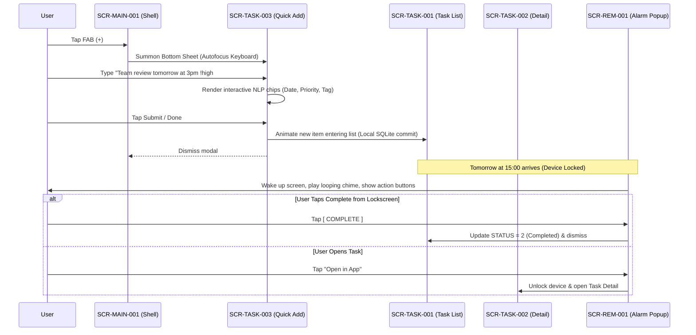
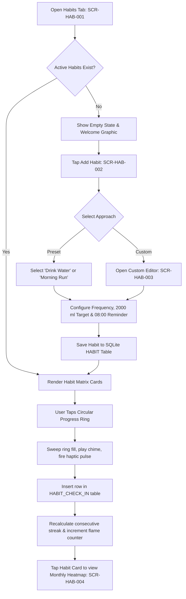
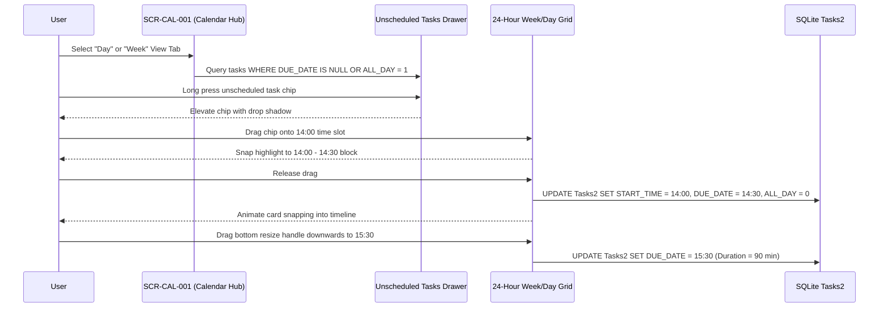
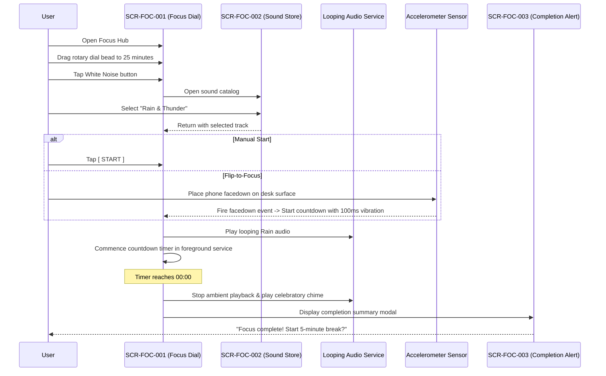

# GOOGLE STITCH COMPLETE SCREEN-BY-SCREEN FUNCTIONAL CONTENT SPECIFICATION

> **Target System**: Independent, 100% Open-Source Productivity Application  
> **Intended Consumer**: Google Stitch (Screen Content, Component Hierarchy & Functional Architecture Generator)  
> **Specification Standard**: Pure Functional Content, Component Hierarchy & Information Requirements  
> **Design Policy**: **STRICTLY ZERO VISUAL DESIGN INSTRUCTIONS**. No colors, typography, themes, gradients, shadows, border radii, or visual styling are specified. This document establishes **EXACTLY WHAT MUST BE INCLUDED ON EVERY SCREEN**, what data is required, what controls exist, what interactions occur, and what navigation paths connect them.

---

## 1. Product Overview & Open-Source Functional Architecture

This document defines the complete functional blueprint for an independent, open-source productivity application inspired by the capabilities discovered during reverse engineering of TickTick.

### 1.1 Complete Open-Source Entitlement (Zero Premium Restrictions)
The target application is **100% free and open-source**. All features originally restricted behind TickTick's commercial paywall are **unlocked and natively available to all users**:
1. **Full Calendar Suite**: Native Month, Week, Day, 3-Day, and Agenda views with direct drag-and-drop time blocking.
2. **Unlimited Habit Tracking**: No 5-habit cap; users can track unlimited habits with complete monthly and yearly historical heatmaps.
3. **Multi-Tier Exact Alarms**: Up to 5 discrete reminder alarms per task, plus individual subtask/checklist reminders.
4. **Persistent Annoying Alerts**: Repeating, un-dismissible high-urgency alarms for critical deadlines.
5. **Custom Eisenhower Matrix**: Unlimited custom matrix profiles and free-form Boolean rule builders for all four quadrants.
6. **Full Ambient Audio Library**: All 15+ focus soundscapes (Rain, Waves, Forest, Café, Campfire, etc.) available offline.
7. **Custom Smart Lists**: Advanced multi-variable filtering (combining tags, projects, dates, and priorities with AND/OR logic).
8. **Unlimited Lists & Checklists**: No artificial caps (supports up to 999 lists, 999 tasks per list, and 199 subtasks per task).
9. **Zero In-App Purchase Prompts**: No upgrade buttons, crown icons, billing SDKs, trial timers, or paywall dialogs.

### 1.2 Local-First Core & Optional Synchronization
* **Local-First Core**: All operations (create, edit, delete, complete, schedule) execute synchronously against an embedded SQLite database with zero blocking network calls.
* **Optional Synchronization**: If synchronization is configured, it connects to an open-source, self-hosted backend (or CalDAV / WebDAV sync server). Offline states and synchronization queues are managed gracefully without disabling any local feature.

---

## 2. Master Screen Inventory

The application is composed of **49 distinct functional screens, modals, dialogs, and bottom sheets** organized into 12 core modules:

| Module | Screen ID | Screen Name | Component Type | Main Purpose |
| :--- | :--- | :--- | :--- | :--- |
| **App Shell** | `SCR-MAIN-001` | Main Navigation Shell | Container Activity | Primary framework hosting Drawer, Top Bar, Viewport, and Bottom TabBar. |
| **App Shell** | `SCR-MAIN-002` | Global Navigation Drawer | Side Drawer Modal | User profile, Smart Lists, Lists/Folders tree, Tags, and Settings access. |
| **Tasks** | `SCR-TASK-001` | Main Task List | Primary Fragment | Sectioned list of tasks with swipe gestures, sorting, and FAB. |
| **Tasks** | `SCR-TASK-002` | Task Detail View | Full Detail Activity | Complete inspection and editing of task properties, subtasks, and notes. |
| **Tasks** | `SCR-TASK-003` | Quick Add Task Sheet | Bottom Sheet Modal | Rapid task capture with real-time NLP keyword chip tokenization. |
| **Tasks** | `SCR-TASK-004` | Batch Multi-Select Mode | Contextual Action Bar | Bulk editing of due dates, priorities, lists, and deletions. |
| **Tasks** | `SCR-TASK-005` | Task Comments & Activity Feed | Modal / Subpage | Chronological audit log of edits and collaborator comments. |
| **Tasks** | `SCR-TASK-006` | Task Revision History Log | Fullscreen Modal | Detailed historical revision timeline of task modifications. |
| **Tasks** | `SCR-TASK-007` | Date & Time Picker Dialog | Dialog Modal | Calendar date selection, quick presets, time picker, and recurrence. |
| **Tasks** | `SCR-TASK-008` | Recurrence Rule Builder | Dialog Modal | RFC-5545 recurrence rule editor (Daily, Weekly, Monthly, Lunar). |
| **Tasks** | `SCR-TASK-009` | Quick Date Presets Config | Subpage Activity | Customization of date shortcuts (Today, Tomorrow, Next Week). |
| **Organization**| `SCR-ORG-001` | List Container & View Switcher | Primary View Container | Displays lists in Standard List, Kanban Board, or Timeline Gantt view. |
| **Organization**| `SCR-ORG-002` | List Creation & Configuration | Sheet / Activity | Configure list name, color dot, icon, folder, view mode, and type. |
| **Organization**| `SCR-ORG-003` | Folder / Group Manager | Subpage Activity | Create folders, collapse/expand groups, reorder child lists. |
| **Organization**| `SCR-ORG-004` | Tag Hierarchy Manager | Subpage Activity | Tag management, parent-child nesting, and batch tag merging. |
| **Organization**| `SCR-ORG-005` | Custom Smart List Rule Builder| Subpage Activity | Multi-condition Boolean filter builder (Projects, Tags, Dates, Priority).|
| **Calendar** | `SCR-CAL-001` | Calendar Scheduling Hub | Primary View Container | Multi-view container hosting Month, Week, Day, 3-Day, and Agenda grids. |
| **Calendar** | `SCR-CAL-002` | Calendar Display & View Options| Subpage Activity | Start day of week, visible hour boundaries, show completed tasks. |
| **Calendar** | `SCR-CAL-003` | Calendar Subscription Manager | Subpage Activity | Manage CalDAV, Google, Outlook, and web .ics subscription feeds. |
| **Calendar** | `SCR-CAL-004` | Academic Course Timetable | Subpage Activity | Weekly course timetable with odd/even week cycle scheduling. |
| **Habits** | `SCR-HAB-001` | Habit Dashboard & Routine Hub | Primary View Container | Daily routine tracker with circular progress rings and streak counters. |
| **Habits** | `SCR-HAB-002` | Habit Creation & Template Store | Subpage Activity | Preset habit catalog (Health, Study, Mind) and custom creator. |
| **Habits** | `SCR-HAB-003` | Habit Configuration Editor | Subpage Activity | Frequency rules, target metrics (value/unit), icons, and reminders. |
| **Habits** | `SCR-HAB-004` | Habit Detail & Monthly Calendar | Full Detail Activity | Monthly check-in heatmap, streak records, completion rate stats. |
| **Habits** | `SCR-HAB-005` | Habit Quantitative Log Sheet | Bottom Sheet Modal | Manual check-in value entry, diary note logging, photo attachment. |
| **Habits** | `SCR-HAB-006` | Habit Section Organizer | Subpage Activity | Categorize habits into Morning, Afternoon, and Evening routines. |
| **Focus** | `SCR-FOC-001` | Focus Hub & Pomodoro Dial | Primary View Container | Rotary circular countdown dial, stopwatch, flip-to-focus, and controls.|
| **Focus** | `SCR-FOC-002` | Ambient Soundscape Store | Subpage Activity | Downloadable looping background audio (Rain, Forest, Café, Waves). |
| **Focus** | `SCR-FOC-003` | Focus Session Completion Alert| Dialog Modal | Session summary, focus duration recap, break countdown trigger. |
| **Focus** | `SCR-FOC-004` | Focus Timeline & Statistics | Full Detail Activity | Daily/weekly focus duration charts and chronological session log. |
| **Focus** | `SCR-FOC-005` | Focus Record Manual Editor | Sheet / Dialog | Manual creation or correction of past focus sessions. |
| **Matrix** | `SCR-MAT-001` | Eisenhower Matrix 2x2 Grid | Primary View Container | 4-quadrant decision matrix with direct drag-and-drop re-prioritization.|
| **Matrix** | `SCR-MAT-002` | Quadrant Detail Task List | Subpage Activity | Fullscreen list view of tasks residing within a single quadrant. |
| **Matrix** | `SCR-MAT-003` | Quadrant Condition Rule Editor | Subpage Activity | Custom filter rule builder for assigning tasks to quadrants. |
| **Matrix** | `SCR-MAT-004` | Matrix Profile Switcher | Sheet / Dialog | Switch between multiple matrix profiles (e.g. Work vs. Personal). |
| **Notes** | `SCR-NOTE-001`| Notes Grid & Markdown Editor | Primary View Container | Rich-text and markdown note-taking environment with checklists. |
| **Search** | `SCR-SRCH-001`| Global Search & Filter Hub | Primary Activity | Full-text search with instant token suggestions and filter chips. |
| **Reminders** | `SCR-REM-001` | Fullscreen Alarm Wakeup Alert | Fullscreen Activity | Lockscreen-surviving alarm window with Complete and Snooze buttons. |
| **Reminders** | `SCR-REM-002` | Granular Snooze Selector Sheet | Bottom Sheet Modal | Custom and preset snooze duration options (5m, 15m, 1h, tomorrow). |
| **Reminders** | `SCR-REM-003` | Geofence Location Reminder Setup| Subpage Activity | Map view with radius slider and arrival/departure triggers. |
| **Notifications**| `SCR-NOTIF-001`| Notification Center | Subpage Activity | In-app notification feed of alerts, comments, and milestones. |
| **Statistics** | `SCR-STAT-001` | Productivity & Achievements | Full Detail Activity | Productivity scores, completion velocity, and achievement badges. |
| **Collaboration**| `SCR-COLLAB-001`| Shared List Member Manager | Subpage Activity | Member invites (link/email/QR), role permissions, member removal. |
| **Settings** | `SCR-SET-001` | Root Settings Menu | Primary Activity | Master preferences menu organizing all subsystem configurations. |
| **Settings** | `SCR-SET-002` | Theme Palette & OLED Dark Setup| Subpage Activity | Primary accent selector, dark mode, and OLED pure black toggles. |
| **Settings** | `SCR-SET-003` | Swipe Gesture Customizer | Subpage Activity | Configures Left/Right Short/Long swipe action assignments. |
| **Settings** | `SCR-SET-004` | App Lock Security (PIN/Pattern)| Subpage Activity | Setup 3x3 pattern or 4-digit PIN with BiometricPrompt unlock. |
| **Settings** | `SCR-SET-005` | Smart Recognition NLP Config | Subpage Activity | Toggles for auto-parsing dates, times, priorities, tags, and lists. |
| **Settings** | `SCR-SET-006` | Sounds & Annoying Alert Config | Subpage Activity | Custom ringtones, vibration patterns, and repeating alarm intervals. |
| **Settings** | `SCR-SET-007` | Backup, CSV Export & Sync Config| Subpage Activity | Local .bak backups, auto-backup schedule, CSV export, sync server.|

---

## 3. Comprehensive Individual Screen Specifications

---

### MODULE 1: APPLICATION SHELL & GLOBAL NAVIGATION

---

#### SCREEN ID: SCR-MAIN-001
#### SCREEN NAME: Main Application Shell Container

##### 1. Screen Purpose
Acts as the root presentation harness of the mobile client. Hosts the top contextual app bar, the active feature viewport (`FrameLayout`), the persistent floating action button (+), and the configurable primary bottom navigation bar (`TabBar`).

##### 2. Entry Points
* Application cold start launch (via `DispatchActivity` post-auth verification).
* System resume from background.
* Deep link navigation root fallback (`ticktick://`).

##### 3. Complete Content Inventory
* **Top Contextual App Bar**:
  * Global Drawer toggle trigger (Hamburger menu icon).
  * Active View Title label (Dynamic text: Name of current List, Smart List, Calendar View, Habit Dashboard, or Matrix).
  * Synchronization Status indicator icon (Rotary sync spinner during delta sync, cloud-check icon when synced, offline slash icon when disconnected).
  * Top Action Icons:
    * Search trigger (Magnifying glass).
    * View Mode Switcher / Sort button (Vertical sliders / 3 horizontal bars).
    * Overflow Action Menu (3 vertical dots).
* **Primary Viewport Area**:
  * Full-bleed container fragment hosting the currently active tab or list.
* **Floating Action Button (FAB)**:
  * Persistent circular action button anchored at the bottom-right corner above the bottom navigation bar.
* **Bottom Navigation Bar (`TabBar`)**:
  * 3 to 5 configurable navigation tab slots:
    * Tab 1: Tasks (Checklist icon).
    * Tab 2: Calendar (Calendar grid icon).
    * Tab 3: Habits (Circular check / leaf icon).
    * Tab 4: Focus / Pomodoro (Tomato / Timer icon).
    * Tab 5: Search / Matrix (Grid / Search icon).

##### 4. Components and Controls
* `btn_nav_drawer`: Icon button; opens `SCR-MAIN-002` (Navigation Drawer).
* `txt_view_title`: Label displaying current list/view name.
* `icon_sync_indicator`: Static/animated status icon; tapping displays sync details toast/snackbar.
* `btn_top_search`: Icon button; navigates to `SCR-SRCH-001` (Global Search).
* `btn_top_sort`: Icon button; summons `SortOptionBottomFragment`.
* `btn_top_overflow`: Icon button; opens contextual dropdown menu.
* `fab_quick_add`: Primary action button; summons `SCR-TASK-003` (Quick Add Bottom Sheet).
* `tab_bar`: Segmented bottom bar; switches active viewport fragment.

##### 5. Exact Information Requirements
* `current_view_title`: String (e.g. "Today", "Work", "Calendar", "Habits").
* `sync_state`: Enum (`SYNCING`, `SYNCED`, `OFFLINE`, `ERROR`).
* `configured_tabs`: List of tab identifiers loaded from `UserPreference.tabBarConfig`.
* `unread_notification_badge`: Integer count (optional badge on drawer icon).

##### 6. User Actions
* **Tap Hamburger Icon**: Opens navigation drawer sliding from left edge.
* **Tap FAB (+)**: Summons Quick Add modal with auto-focused keyboard.
* **Tap Bottom Tab**: Transitions active viewport fragment (0ms local latency).
* **Tap Search Icon**: Navigates to full-screen search activity.
* **Tap Sort Icon**: Opens sort criteria bottom sheet.

##### 7. Screen States
* **Default State**: Active tab rendered; top bar displays list name; FAB enabled.
* **Offline State**: Sync icon transitions to offline cloud-slash; all features remain 100% interactable.
* **Syncing State**: Sync icon animates rotational spin; dismisses upon completion.

##### 8. Input and Validation
* No direct text inputs on the shell container.

##### 9. Navigation Relationships
* Leads to: `SCR-MAIN-002` (Drawer), `SCR-TASK-003` (Quick Add), `SCR-SRCH-001` (Search), and active tab fragments.

##### 10. Data Dependencies
* Local database `PROJECT` and `Tasks2` tables.
* `UserPreference` for bottom bar ordering.

##### 11. Acceptance Checklist
- [ ] Hamburger icon opens Navigation Drawer.
- [ ] FAB (+) reliably summons Quick Add modal.
- [ ] Tab switching executes with zero perceptible lag.
- [ ] Offline status does not disable any local action.

---

#### SCREEN ID: SCR-MAIN-002
#### SCREEN NAME: Global Navigation Drawer

##### 1. Screen Purpose
Provides global hierarchical navigation across user lists, list folders, smart lists, tags, filters, and system views (Trash, Completed, Summary, Settings).

##### 2. Entry Points
* Tapping the hamburger menu button on `SCR-MAIN-001`.
* Swiping right from the extreme left edge of any top-level screen.

##### 3. Complete Content Inventory
* **User Profile Header**:
  * User Avatar image (circular).
  * User Display Name / Nickname.
  * Productivity Level / Score badge (e.g. "Level 5: Master").
  * Open-Source Edition Label (Badge: "Open Source Edition").
* **Smart Lists Section**:
  * "All" smart list row (Inbox icon + total active task counter).
  * "Today" smart list row (Calendar today icon + today task counter).
  * "Next 7 Days" smart list row (Calendar week icon + upcoming counter).
  * "Inbox" default list row (Tray icon + unorganized task counter).
  * "Assigned to Me" smart list row (Person icon + assigned task counter).
* **Eisenhower Matrix Section**:
  * "Eisenhower Matrix" row (2x2 grid icon; direct entry to matrix module).
* **Lists & Folders Tree Section**:
  * Section Header: "Lists" with "+" (Add List / Folder) button.
  * Collapsible Folder rows (Folder icon, folder name, caret expand/collapse arrow, child list count).
  * Child List rows (Color dot indicator, list title, active task count badge).
* **Tags Section**:
  * Section Header: "Tags" with "+" (Add Tag) button.
  * Tag rows (# icon, tag name, color dot, tagged task count badge).
* **Filters Section**:
  * Custom user-defined smart list filters with rule summaries.
* **System Views Section**:
  * "Completed" archive row (Checkmark icon).
  * "Trash" bin row (Trash can icon; retains deleted items for 30 days).
  * "Productivity & Stats" row (Bar chart icon).
* **Footer Action Bar**:
  * Settings gear icon button (Opens `SCR-SET-001`).
  * Add List button (Text + plus icon).

##### 4. Components and Controls
* `img_user_avatar`: Circular image; tapping opens Account Info.
* `txt_user_name`: Display name text.
* `txt_achievement_badge`: Tapping opens `SCR-STAT-001`.
* `list_smart_projects`: Clickable rows for system smart lists.
* `btn_matrix_entry`: Row item; launches `SCR-MAT-001`.
* `tree_folders_lists`: Recursive expandable list of folders and projects.
* `btn_folder_caret`: Toggles expand/collapse state of child lists.
* `btn_add_project`: Plus icon button; launches `SCR-ORG-002`.
* `btn_settings`: Icon button at bottom-left; launches `SCR-SET-001`.

##### 5. Exact Information Requirements
* `user_profile`: Nickname, avatar URI, score integer.
* `smart_list_counts`: Real-time integer counts evaluated via SQLite `COUNT(*)` queries.
* `project_tree`: List of `PROJECT_GROUP` rows joined with child `PROJECT` rows where `DELETED = 0`.
* `tag_list`: List of `TAG` rows with associated task counts.

##### 6. User Actions
* **Tap List / Smart List Row**: Closes drawer, navigates viewport to `SCR-TASK-001` filtered by selected list.
* **Tap Folder Caret**: Toggles expansion of nested child lists without closing drawer.
* **Tap Eisenhower Matrix**: Navigates to `SCR-MAT-001`.
* **Tap Settings Gear**: Closes drawer, opens `SCR-SET-001` (Root Settings).
* **Tap Add List (+)**: Summons `SCR-ORG-002` (List Creation Sheet).

##### 7. Screen States
* **Default State**: Lists and folders rendered with accurate task counts.
* **Empty User Lists State**: Displays default seeded lists ("Personal", "Work", "Shopping") with prompt to create custom lists.

##### 8. Input and Validation
* No text inputs on the drawer surface.

##### 9. Navigation Relationships
* Navigates to: `SCR-TASK-001` (List), `SCR-MAT-001` (Matrix), `SCR-SET-001` (Settings), `SCR-ORG-002` (Add List), `SCR-STAT-001` (Stats).

##### 10. Data Dependencies
* `PROJECT`, `PROJECT_GROUP`, `TAG`, `Tasks2` tables.

##### 11. Acceptance Checklist
- [ ] Displays accurate live task count badges for every smart list and project.
- [ ] Collapsible folders smoothly expand/collapse child lists.
- [ ] Matrix, Settings, Trash, and Completed views are directly accessible.

---

### MODULE 2: TASK MANAGEMENT SCREENS

---

#### SCREEN ID: SCR-TASK-001
#### SCREEN NAME: Main Task List View

##### 1. Screen Purpose
Displays the sectioned, prioritized collection of actionable tasks belonging to the active list, folder, or smart filter. Supports direct row swipe gestures, drag-and-drop reordering, quick completion, and batch multi-select mode.

##### 2. Entry Points
* Main viewport landing screen inside `SCR-MAIN-001`.
* Selecting any list, smart list, folder, or tag in `SCR-MAIN-002`.

##### 3. Complete Content Inventory
* **Sectioned Task Feed (`RecyclerView`)**:
  * **Section Headers**:
    * Collapsible group banners (e.g. "Overdue", "Today", "Tomorrow", "Next 7 Days", "Someday", "Completed (X)").
    * Section count badge and caret expand/collapse toggle.
  * **Task Row Items (`item_task_row`)**:
    * Left circular hit-target Checkbox.
    * Task Title text (supports emoji, auto-truncates at 2 lines).
    * Subtitle / Checklist Progress indicator (e.g. "3/5 items completed").
    * Due Date / Time pill with clock icon (highlighted if overdue).
    * Recurrence icon (looping arrows) if repeating.
    * Priority Flag indicator (None, Low, Medium, High).
    * List Name pill (rendered when in unified smart lists like "Today" or "All").
    * Tag pills (`#tag_name`).
    * Paperclip icon if attachments exist.
    * Reorder grip handle (visible when list sort mode is manual).
* **Empty State Area**:
  * Contextual graphic, cheerful status message, and prompt to add tasks.

##### 4. Components and Controls
* `cb_task_complete`: Circular checkbox button; toggles completion state.
* `txt_task_title`: Primary label; tapping opens `SCR-TASK-002` (Detail).
* `pill_due_date`: Date chip; tapping summons date picker directly.
* `pill_priority_flag`: Flag indicator; tapping opens quick priority popup.
* `row_swipe_layout`: Touch handler implementing 15% and 45% horizontal swipe thresholds.

##### 5. Exact Information Requirements
* `Tasks2.SID`: UUID string.
* `Tasks2.TITLE`: String (max 1024 chars).
* `Tasks2.DUE_DATE`: Long epoch timestamp.
* `Tasks2.PRIORITY`: Integer (`0`=None, `1`=Low, `3`=Medium, `5`=High).
* `Tasks2.STATUS`: Integer (`0`=Active, `2`=Completed, `3`=Won't Do).
* `Tasks2.ALL_DAY`: Boolean (`1`=All Day, `0`=Time Specific).
* `Tasks2.REPEAT_FLAG`: RFC-5545 RRULE string.
* `CHECKLIST_ITEM`: Count of child items where `COMPLETED = 1` vs `TOTAL`.

##### 6. User Actions
* **Tap Checkbox**: Sets `Tasks2.STATUS = 2`; triggers completion animation, strikes through title, collapses row after 400ms, and shows 3.5s Undo Snackbar.
* **Tap Task Title/Body**: Navigates to `SCR-TASK-002` (Task Detail View).
* **Left Short Swipe (15%-45%)**: Summons Date Picker dialog anchored over row.
* **Left Long Swipe (>45%)**: Triggers Task Delete; shows undo snackbar.
* **Right Short Swipe (15%-45%)**: Marks task Completed.
* **Right Long Swipe (>45%)**: Opens Priority selector popup or marks Won't Do.
* **Long Press on Row (350ms)**: Enters `SCR-TASK-004` (Batch Multi-Select Mode).
* **Drag-and-Drop Handle**: Reorders tasks manually when custom sorting is active.

##### 7. Screen States
* **Default Active State**: Sectioned task rows rendered.
* **Empty State**: Graphic displayed; text: *"All clear! No tasks due today."*.
* **Multi-Select State**: Checkboxes appear on left of all rows; top bar switches to batch actions.
* **Filtered State**: Active search query or tag filter chip shown at top.

##### 8. Input and Validation
* No direct text inputs on the list surface.

##### 9. Navigation Relationships
* Navigates to: `SCR-TASK-002` (Detail), `SCR-TASK-003` (Quick Add), `SCR-TASK-004` (Batch).

##### 10. Data Dependencies
* `Tasks2` rows filtered by `PROJECT_ID` or Smart List logic where `DELETED = 0`.

##### 11. Acceptance Checklist
- [ ] Swipe gestures trigger at calibrated 15% and 45% screen width thresholds.
- [ ] Completing a task strikes through text and collapses row smoothly.
- [ ] Undo snackbar reverts completion accurately within 3.5 seconds.
- [ ] Subtask progress counter updates dynamically when subtasks change.

---

#### SCREEN ID: SCR-TASK-002
#### SCREEN NAME: Task Detail View

##### 1. Screen Purpose
Provides the complete inspection, editing, and attribute configuration view for a single task entity, including markdown notes, hierarchical checklists, attachments, comments, reminders, and activity audits.

##### 2. Entry Points
* Tapping any task card in `SCR-TASK-001`.
* Tapping a calendar time block in `SCR-CAL-001`.
* Tapping an item in `SCR-MAT-001` (Eisenhower Matrix).
* Notification tap action or deep link (`ticktick://task/open?id={sid}`).

##### 3. Complete Content Inventory
* **Top Action Bar**:
  * Back navigation button (commits changes on exit).
  * Project / List selector chip (shows list name, folder name, color dot).
  * Pin to Top toggle button (Pushpin icon).
  * Overflow Menu (3 dots): Duplicate Task, Copy Link, Share as Image, Share as Text, Convert to Note, Revision History, Delete.
* **Header Section**:
  * Large Completion Checkbox button.
  * Task Title input field (`EditText`, multiline, auto-growing).
* **Attribute Chips Row (Horizontal Scroll)**:
  * **Due Date Chip**: Displays scheduled date/time or "Add Date" (Calendar icon).
  * **Reminder Chip**: Shows active alarms (e.g. "At time of event", "+2 more") or "Add Reminder" (Bell icon).
  * **Priority Chip**: Shows current priority flag (None, Low, Med, High).
  * **Tags Container**: Horizontal list of assigned tag chips with "+" tag adder button.
* **Content Body Switcher**:
  * Segmented Toggle: **[ Checklist / Subtasks ]** vs. **[ Markdown Notes ]**.
* **Checklist Subtasks Container (when in Checklist Mode)**:
  * List of subtask items with individual checkboxes, editable text fields, drag handles, and delete (X) buttons.
  * "Add checklist item" input field with quick-add button.
  * Subtask completion progress bar and counter ("3 of 7 completed").
* **Markdown Notes Container (when in Notes Mode)**:
  * Multiline rich markdown editor with formatting toolbar: Bold, Italic, Strikethrough, Heading (H1, H2), Bullet List, Numbered List, Quote, Code Block, Link.
* **Attachments Section**:
  * Thumbnail grid of attached files (Images, voice recordings, PDFs, docs).
  * "Add Attachment" button with options: Take Photo, Choose from Gallery, Record Audio, Upload Document.
* **Activity & Comments Section**:
  * Chronological comment stream with user avatars, timestamps, and edit audit notes.
  * Comment input box with @mention button and send button.
* **Focus Integration Button**:
  * "Start Focus" button (Tomato icon); launches `SCR-FOC-001` bound to this task.

##### 4. Components and Controls
* `btn_back`: Commits edits and returns to caller screen.
* `chip_project`: Tapping opens Project Selector bottom sheet.
* `btn_pin`: Toggles `Tasks2.PIN` state (`0` or `1`).
* `input_task_title`: Auto-expanding title input.
* `chip_due_date`: Opens `SCR-TASK-007` (Date Picker).
* `chip_reminders`: Opens Reminder configuration sheet (supports up to 5 alarms).
* `chip_priority`: Cycles or pops up priority selector.
* `btn_add_checklist_item`: Appends new subtask row.
* `markdown_toolbar`: Rich text formatting buttons.
* `btn_start_focus`: Launches `SCR-FOC-001`.

##### 5. Exact Information Requirements
* `Tasks2` table row: `SID`, `TITLE`, `CONTENT`, `DUE_DATE`, `START_TIME`, `ALL_DAY`, `PRIORITY`, `STATUS`, `PROJECT_ID`, `PIN`, `REPEAT_FLAG`, `REMINDERS`.
* Child rows from `CHECKLIST_ITEM`, `ATTACHMENT`, and `COMMENT` tables.

##### 6. User Actions
* **Edit Title / Description**: Real-time autosave to SQLite; zero manual save required.
* **Check Subtask**: Marks `CHECKLIST_ITEM.STATUS = 1`; recalculates progress counter.
* **Add Attachment**: Opens system media/file picker; saves file in app storage.
* **Add Reminder**: Adds alarm trigger; schedules exact wake-up via `AlarmManager`.
* **Tap Start Focus**: Immediately transitions to `SCR-FOC-001` with timer pre-bound to task.

##### 7. Screen States
* **Active Task State**: Normal editable controls.
* **Completed Task State**: Title struck through; completion timestamp displayed; option to "Uncomplete".
* **Won't Do State**: Title styled in dimmed italics; banner explains task status.

##### 8. Input and Validation
* Title: String, mandatory, max 1024 chars.
* Description: Markdown string, max 32,768 chars.
* Subtasks: Up to 199 items supported (no commercial caps).

##### 9. Navigation Relationships
* Back leads to `SCR-TASK-001` or calling calendar/matrix screen.
* Overflow menu leads to `SCR-TASK-006` (Revision History).

##### 10. Data Dependencies
* `Tasks2`, `PROJECT`, `CHECKLIST_ITEM`, `ATTACHMENT`, `COMMENT` tables.

##### 11. Acceptance Checklist
- [ ] Title and markdown notes auto-save with zero data loss.
- [ ] Subtasks can be freely added, checked off, reordered, and deleted.
- [ ] Reminders support multiple alarms (up to 5) with zero subscription blocks.
- [ ] Switching between Checklist and Markdown mode retains underlying text content.

---

#### SCREEN ID: SCR-TASK-003
#### SCREEN NAME: Quick Add Task Bottom Sheet

##### 1. Screen Purpose
Provides a lightning-fast, modal task capture interface optimized for one-handed operation. Incorporates real-time natural language keyword parsing (NLP) to convert typed dates, times, priorities, lists, and tags into interactive chips on the fly.

##### 2. Entry Points
* Tapping the Floating Action Button (+) on `SCR-MAIN-001` or `SCR-TASK-001`.
* System text selection context action (`ACTION_PROCESS_TEXT`).
* Android Home Screen App Shortcut (`shortcut_add_task`).
* Notification shade Quick Add action.

##### 3. Complete Content Inventory
* **Modal Sheet Container (`BottomSheetDialogFragment`)**:
  * Auto-adjusts position above the soft keyboard using window insets.
* **Primary Input Field (`QuickAddEditText`)**:
  * Multi-line input field with placeholder: *"e.g. Meeting tomorrow at 3pm !high #work"*.
  * Auto-focuses keyboard with zero delay on invocation.
* **Live NLP Token Chip Strip**:
  * Horizontal strip rendering recognized keyword chips:
    * Date Chip (e.g. "Tomorrow, 3:00 PM").
    * Priority Chip (e.g. "High Priority !1").
    * List Chip (e.g. "~Work").
    * Tag Chip (e.g. "#Finance").
* **Bottom Toolbar Controls**:
  * Date Picker button (Calendar icon).
  * Priority selector button (Flag icon).
  * Project selector chip (Shows current default list with color dot; tapping changes target list).
  * Tag selector button (# icon).
  * Voice-to-Text Mic button (Mic icon; initiates speech recognition).
  * Submit / Commit button (Paper airplane or Checkmark icon).

##### 4. Components and Controls
* `input_quick_task`: Auto-focused text input field.
* `strip_nlp_chips`: Dynamic container for live tokenized chip spans.
* `btn_quick_date`: Opens mini calendar date picker.
* `btn_quick_priority`: Pops up 4-flag priority selector.
* `chip_quick_project`: Selector for destination project.
* `btn_voice_input`: Triggers speech-to-text recording.
* `btn_quick_submit`: Commits task to database.

##### 5. Exact Information Requirements
* Parsed tokens: `dueDate` (timestamp), `priority` (int), `projectId` (string), `tags` (string array).
* Active user preference for default list and default reminder offset.

##### 6. User Actions
* **Type Temporal Keywords**: Typing "tomorrow at 5pm" dynamically extracts the date and displays a parsed date chip.
* **Press Backspace adjacent to Chip**: Disassembles chip back into editable plain text without deleting surrounding text.
* **Tap Submit or Keyboard "Done"**: Inserts row into `Tasks2`, writes dirty sync record, plays confirmation chime, clears input field, and dismisses sheet (or remains open if continuous add mode is active).
* **Tap Project Chip**: Opens list picker sheet to redirect task to a specific list.

##### 7. Screen States
* **Empty Input State**: Submit button disabled; placeholder visible.
* **Active Typing State**: Submit button enabled; NLP chips dynamically render beneath cursor.
* **Voice Listening State**: Renders audio waveform indicator during speech-to-text capture.

##### 8. Input and Validation
* Title text: String, mandatory, max 1024 chars. Whitespace trimmed.
* Empty submit attempts trigger an input shake animation.

##### 9. Navigation Relationships
* Committing or dismissing returns directly to the calling screen.

##### 10. Data Dependencies
* Local `Tasks2` and `PROJECT` tables.

##### 11. Acceptance Checklist
- [ ] Keyboard auto-focuses within 150ms of modal invocation.
- [ ] NLP tokens parse accurately in real time (e.g., "today", "tomorrow at 3pm", "!1", "#tag").
- [ ] Backspacing un-spans chips cleanly into editable text.
- [ ] Committing inserts task immediately into local SQLite with zero network wait.

---

#### SCREEN ID: SCR-TASK-004
#### SCREEN NAME: Batch Multi-Select Mode

##### 1. Screen Purpose
Allows users to perform bulk management operations simultaneously across multiple selected tasks, including rescheduling due dates, bulk moving to lists, bulk priority changes, marking won't do, duplicating, and batch deletion.

##### 2. Entry Points
* Long-pressing any task item row (350ms) in `SCR-TASK-001`.
* Selecting "Select Tasks" from list overflow menu.

##### 3. Complete Content Inventory
* **Contextual Top App Bar**:
  * Close / Cancel button (X icon).
  * Selected Count Title (e.g. "3 Selected").
  * "Select All" checkmark toggle button.
* **Multi-Select Task List**:
  * Checkbox controls rendered on the left margin of every task row.
  * Selected rows highlighted.
* **Bottom Batch Action Bar**:
  * **Move Button** (Folder icon): Bulk relocate to another list.
  * **Set Date Button** (Calendar icon): Bulk reschedule due date.
  * **Set Priority Button** (Flag icon): Bulk assign priority.
  * **Won't Do Button** (Circle-slash icon): Mark selected as won't do.
  * **Duplicate Button** (Copy icon): Clone all selected tasks.
  * **Delete Button** (Trash icon): Batch delete selected tasks.

##### 4. Components and Controls
* `btn_cancel_batch`: Exits multi-select mode; unchecks all rows.
* `txt_selected_count`: Dynamic label showing number of checked items.
* `btn_select_all`: Toggles between selecting all visible tasks and deselecting all.
* `btn_batch_move`: Summons list selector sheet.
* `btn_batch_date`: Summons DatePickerDialog.
* `btn_batch_priority`: Summons priority picker dialog.
* `btn_batch_delete`: Prompts confirmation: *"Delete X tasks?"*.

##### 5. Exact Information Requirements
* Set of selected `Tasks2.SID` UUID strings.

##### 6. User Actions
* **Tap Any Row**: Toggles checkbox state for that row; updates count in top app bar.
* **Tap Select All**: Checks all tasks currently displayed in the filtered list.
* **Tap Batch Date**: Opens date picker; selecting a date executes:
  `UPDATE Tasks2 SET DUE_DATE = ? WHERE SID IN (...)`
* **Tap Batch Delete**: Displays confirmation dialog; on confirmation, marks `DELETED = 1` across all selected rows.

##### 7. Screen States
* **1+ Items Selected**: Bottom action bar icons fully enabled.
* **0 Items Selected**: Bottom action icons disabled / dimmed.

##### 8. Input and Validation
* Confirmation dialog required for batch deletion.

##### 9. Navigation Relationships
* Exiting returns to standard `SCR-TASK-001` view.

##### 10. Data Dependencies
* `Tasks2` table.

##### 11. Acceptance Checklist
- [ ] Multi-select activates on 350ms long press with haptic confirmation.
- [ ] Bulk updates execute within an atomic SQLite transaction.
- [ ] Exiting cleanly resets all row checkboxes.

---

### MODULE 3: ORGANIZATION & LIST MANAGEMENT

---

#### SCREEN ID: SCR-ORG-001
#### SCREEN NAME: List Container & View Mode Switcher

##### 1. Screen Purpose
Hosts user lists and folders, allowing seamless switching between three distinct layout representations: **Standard List View**, **Kanban Board View**, and **Timeline Gantt View**.

##### 2. Entry Points
* Selecting any user list or folder in `SCR-MAIN-002` (Drawer).
* Creating a new list in `SCR-ORG-002`.

##### 3. Complete Content Inventory
* **Top Header & Switcher Bar**:
  * Navigation Drawer toggle (Hamburger icon).
  * List Name with Project Color Dot indicator.
  * **View Mode Segmented Toggle**:
    * **[ List ]** (Standard vertical list).
    * **[ Kanban ]** (Horizontal multi-column board).
    * **[ Timeline ]** (Gantt schedule chart).
  * Right Action Buttons: Search, Sort & Filter, Project Settings (Gear/3 dots).
* **Viewport Area (dynamically changes by mode)**:
  * **List Mode**: Renders `SCR-TASK-001` layout.
  * **Kanban Mode**:
    * Horizontally scrolling columns representing workflow stages (`COLUMN` table).
    * Column headers displaying Column Name, Task Count, and "+" Add Task in Column.
    * Draggable task cards with drag handles.
    * "Add Column" button at the rightmost end of the board.
  * **Timeline Mode**:
    * Horizontal date timeline header (Days/Weeks).
    * Horizontal task duration bars spanning from `START_TIME` to `DUE_DATE`.
    * Expandable sidebar listing unscheduled tasks.

##### 4. Components and Controls
* `tab_view_mode`: Switcher between List, Kanban, and Timeline modes.
* `btn_add_column`: Appends new Kanban column.
* `card_kanban_task`: Draggable task card with touch elevation.
* `timeline_canvas`: Interactive Gantt chart surface with horizontal pan/zoom.

##### 5. Exact Information Requirements
* `PROJECT` row: `SID`, `NAME`, `COLOR`, `VIEW_MODE`, `SORT_TYPE`.
* `COLUMN` rows associated with the project, ordered by `SORT_ORDER`.
* `Tasks2` rows associated with each column via `Tasks2.COLUMN_ID`.

##### 6. User Actions
* **Switch View Mode**: Updates `PROJECT.VIEW_MODE` and smoothly transitions viewport layout.
* **Drag Kanban Card between Columns**: Drops card into new column; executes:
  `UPDATE Tasks2 SET COLUMN_ID = ? WHERE SID = ?`
* **Add Kanban Column**: Opens prompt dialog: *"Column Name"*; inserts row into `COLUMN`.

##### 7. Screen States
* **Default List State**: Renders standard vertical list.
* **Kanban State**: Horizontal multi-column board active.
* **Empty Column State**: Displays prompt: *"No tasks in this stage"*.

##### 8. Input and Validation
* Column names: String, max 64 chars.

##### 9. Navigation Relationships
* Project Settings icon navigates to `SCR-ORG-002` (List Configuration Editor).

##### 10. Data Dependencies
* `PROJECT`, `COLUMN`, and `Tasks2` tables.

##### 11. Acceptance Checklist
- [ ] Users can freely toggle between List, Kanban, and Timeline modes.
- [ ] Dragging task cards across Kanban columns immediately updates `COLUMN_ID` in SQLite.
- [ ] All three view modes are fully unlocked for all users with zero paywalls.

---

#### SCREEN ID: SCR-ORG-002
#### SCREEN NAME: List Creation and Configuration Editor

##### 1. Screen Purpose
Allows users to create new lists or edit existing list metadata, including list name, color dot, custom icon, parent folder allocation, default view mode, and list kind (Task List vs. Note List).

##### 2. Entry Points
* Tapping "+" next to "Lists" in `SCR-MAIN-002` (Drawer).
* Selecting "Edit List" from list overflow menu in `SCR-ORG-001`.

##### 3. Complete Content Inventory
* **Top App Bar**:
  * Cancel / Back button.
  * Title: "New List" or "Edit List".
  * Save / Done button.
* **List Name Section**:
  * List Name input field (`EditText`, single line, autofocus).
* **Color & Icon Customizer**:
  * Palette of 24 distinct color dots (selecting one sets `PROJECT.COLOR`).
  * Icon picker grid (50+ categorized icons for Work, Home, Finance, Fitness, Travel).
* **Folder Assignment Dropdown**:
  * Select parent folder (`PROJECT_GROUP`) or "None (Root)".
* **List Type Selector**:
  * Radio options: **Task List** (checklists and due dates) vs. **Note List** (markdown notes).
* **Default View Mode Selector**:
  * Radio options: **List**, **Kanban**, or **Timeline**.
* **Danger Zone (Edit Mode Only)**:
  * "Archive List" button (hides list from drawer).
  * "Delete List" button (prompts: *"Delete list and all contained tasks?"*).

##### 4. Components and Controls
* `input_project_name`: Mandatory text input.
* `grid_color_picker`: 24-color selection grid.
* `grid_icon_picker`: Icon selection modal.
* `spinner_parent_folder`: Dropdown selector of existing folders.
* `radio_list_type`: Toggle between Task List and Note List.
* `btn_delete_project`: Danger button with confirmation dialog.

##### 5. Exact Information Requirements
* `PROJECT`: `NAME`, `COLOR`, `ICON`, `GROUP_ID`, `VIEW_MODE`, `KIND`.

##### 6. User Actions
* **Tap Save**: Validates name; inserts/updates row in `PROJECT`; updates drawer; returns to list.
* **Tap Delete**: Prompts confirmation; on confirm, sets `DELETED = 1` on project and cascades to tasks.

##### 7. Screen States
* **Creation Mode**: Empty fields, default blue color, "Task List" selected.
* **Editing Mode**: Pre-populated fields; "Delete List" button visible at bottom.

##### 8. Input and Validation
* Name: String, mandatory, 1 to 128 chars.
* Cannot save with empty or duplicate name within the same folder.

##### 9. Navigation Relationships
* Saving returns to `SCR-ORG-001` or `SCR-MAIN-001`.

##### 10. Data Dependencies
* `PROJECT` and `PROJECT_GROUP` tables.

##### 11. Acceptance Checklist
- [ ] Name validation prevents empty list names.
- [ ] Color and icon selections update drawer and list headers immediately.
- [ ] Delete action safely cascades with confirmation dialog.

---

### MODULE 4: CALENDAR SYSTEM & SCHEDULING

---

#### SCREEN ID: SCR-CAL-001
#### SCREEN NAME: Calendar Multi-View Scheduling Hub

##### 1. Screen Purpose
Serves as the unified scheduling command center, displaying tasks and external calendar events across Month, Week, Day, 3-Day, and Agenda layouts with direct drag-and-drop time-blocking.

##### 2. Entry Points
* "Calendar" tab on the bottom navigation bar (`TabBar`).
* Calendar shortcut widgets on Android home screen.
* Deep link: `ticktick://calendar`.

##### 3. Complete Content Inventory
* **Top Calendar Navigation Bar**:
  * Navigation Drawer toggle (Hamburger icon).
  * Current Month / Year Header (e.g. "November 2026") with mini calendar dropdown.
  * Today Button (Calendar icon showing current day date number).
  * Calendar View Mode Selector icon (pops up view selection: Month, Week, 3-Day, Day, Agenda).
  * Calendar Manager icon (opens `SCR-CAL-003`).
* **View Mode Sub-Header Tabs**:
  * Tab strip: **[ MONTH ] [ WEEK ] [ 3-DAY ] [ DAY ] [ AGENDA ]**.
* **Primary Viewport Area (dynamically changes by active view)**:
  * **Month View**:
    * 7x5 or 7x6 monthly grid of day cells.
    * Day numbers with indicators for Today and selected date.
    * Color-coded task pills in each cell (up to 3 visible + "+X more" counter).
    * Collapsible bottom agenda sheet displaying tasks for the selected date.
  * **Week & 3-Day Views**:
    * Top horizontal all-day task banner.
    * 7 or 3 vertical daily columns with hourly grid lines (00:00 to 24:00, or user configured range e.g. 08:00 to 22:00).
    * Current time red indicator horizontal line across columns.
    * Scheduled event blocks rendered with start time, title, and project color.
  * **Day View**:
    * High-granularity single-day 24-hour vertical timeline with 15-minute snapping.
  * **Agenda View**:
    * Chronological infinite scroll feed grouped by date headers ("Today", "Tomorrow", "Thursday, Nov 15").
* **Expandable Unscheduled Tasks Drawer**:
  * Bottom pull-up tray listing all tasks scheduled for the date without specific times, ready for drag-and-drop placement onto the hourly grid.

##### 4. Components and Controls
* `tab_calendar_views`: Multi-view switcher tabs.
* `btn_jump_today`: Focuses viewport immediately on current time/date.
* `drawer_unscheduled_tasks`: Expandable tray of unscheduled task chips.
* `view_timeline_grid`: Touch surface supporting pan, pinch-to-zoom (hour height), and drag-to-schedule.
* `block_event_item`: Draggable event card with bottom duration resize handle.

##### 5. Exact Information Requirements
* `Tasks2` rows within active date range: `SID`, `TITLE`, `START_TIME`, `DUE_DATE`, `ALL_DAY`, `PRIORITY`, `PROJECT_ID`, `STATUS`.
* Synced external events from `CALENDAR_BIND_EVENT` / Android `CalendarContract`.

##### 6. User Actions
* **Tap Date Cell in Month View**: Selects date; updates bottom agenda list to show tasks for that day.
* **Drag Unscheduled Chip onto Day/Week Grid**: Snaps to 15-minute increment; sets `Tasks2.START_TIME` and `Tasks2.DUE_DATE`.
* **Drag Duration Handle**: Adjusts end time; updates `Tasks2.DUE_DATE` in 15-minute intervals.
* **Tap Event Block**: Opens `SCR-TASK-002` (Task Detail View).
* **Tap Empty Slot on Grid**: Opens Quick Add pre-filled with that hour block.

##### 7. Screen States
* **Default View State**: Renders scheduled tasks and events across active view.
* **Empty Time Slot State**: Clean grid lines.
* **Drag-in-Progress State**: Draggable chip elevated with drop shadow and highlight snap box.

##### 8. Input and Validation
* Grid snapping enforced at 15-minute boundaries.

##### 9. Navigation Relationships
* Tapping event leads to `SCR-TASK-002`.
* Tapping Calendar Manager leads to `SCR-CAL-003`.
* View Options leads to `SCR-CAL-002`.

##### 10. Data Dependencies
* `Tasks2`, `PROJECT`, and `CALENDAR_BIND_EVENT` tables.

##### 11. Acceptance Checklist
- [ ] All 5 views (Month, Week, Day, 3-Day, Agenda) are 100% unlocked for all users.
- [ ] Drag-to-schedule reliably snaps to 15-minute increments.
- [ ] Duration handle resizing updates `DUE_DATE` accurately.

---

#### SCREEN ID: SCR-CAL-003
#### SCREEN NAME: Calendar Subscription & External Sync Manager

##### 1. Screen Purpose
Allows users to manage external calendar integrations (Google Calendar, Microsoft Outlook, Exchange, iCloud, CalDAV) and subscribe to external web `.ics` calendar URL feeds.

##### 2. Entry Points
* Tapping Calendar Manager icon in `SCR-CAL-001`.
* Calendar settings menu in `SCR-SET-001`.

##### 3. Complete Content Inventory
* **Top App Bar**:
  * Back button.
  * Title: "Calendar Subscriptions & Sync".
  * Add Subscription (+) button.
* **Local Device Calendars Section**:
  * List of Android system calendar accounts (Google accounts, device calendars) queried via `CalendarContract`.
  * Checkbox toggle for each calendar account (Show / Hide in TickTick).
  * Color picker dot for each calendar.
* **CalDAV / Remote Accounts Section**:
  * "Add CalDAV Account" button (Server URL, Username, Password).
  * List of connected CalDAV calendars with sync status and manual "Sync Now" button.
* **WebCal URL Subscriptions Section (`.ics`)**:
  * List of active URL calendar feeds (e.g. Public Holidays, Sports Schedules).
  * URL subscription card displaying Feed Title, Source URL, Refresh Frequency (e.g. Every 12 hours), and Delete button.
* **Two-Way Sync Setting**:
  * Toggle: "Export Scheduled Tasks to Device Calendar" (writes TickTick tasks into Android calendar provider).

##### 4. Components and Controls
* `switch_cal_account`: Toggles visibility of external calendars.
* `btn_add_webcal`: Opens URL subscription dialog.
* `btn_add_caldav`: Opens CalDAV account configuration sheet.
* `btn_sync_now`: Forces immediate background calendar refresh.

##### 5. Exact Information Requirements
* External calendar IDs, display names, account names, and colors.
* WebCal `.ics` URLs and refresh intervals.

##### 6. User Actions
* **Toggle Account**: Updates visibility in SQLite; refreshes `SCR-CAL-001` grid.
* **Add WebCal URL**: Validates `.ics` format; fetches feed; parses VEVENT records; stores in local database.

##### 7. Screen States
* **Default State**: Lists enabled accounts and active subscriptions.
* **Syncing State**: Shows refresh spinner next to accounts.

##### 8. Input and Validation
* URL validation: Must begin with `http://`, `https://`, or `webcal://` and return valid iCalendar text.

##### 9. Navigation Relationships
* Back returns to `SCR-CAL-001`.

##### 10. Data Dependencies
* Android `CalendarContract`, `CALENDAR_BIND_EVENT` table.

##### 11. Acceptance Checklist
- [ ] System calendars correctly toggle on and off.
- [ ] WebCal `.ics` feeds parse and display in calendar multi-views with zero subscription barriers.

---

### MODULE 5: HABIT TRACKING SYSTEM

---

#### SCREEN ID: SCR-HAB-001
#### SCREEN NAME: Habit Dashboard & Routine Matrix

##### 1. Screen Purpose
Primary routine tracking interface where users monitor active daily habits, observe unbroken streak flame counters, execute one-tap check-ins, and review daily completion rates.

##### 2. Entry Points
* "Habits" tab on the bottom navigation bar (`TabBar`).
* Home screen habit widgets (`AppWidgetHabitConfigActivity`).
* Deep link: `ticktick://habit/dashboard`.

##### 3. Complete Content Inventory
* **Top Header Bar**:
  * Title: "Habits".
  * Section Filter dropdown (All, Morning Routine, Afternoon, Evening Routine).
  * Right Action Icons: Section Manager, Calendar Heatmap View, Add Habit (+).
* **Weekly Date Strip**:
  * Horizontal scrolling 7-day strip displaying weekdays and dates.
  * Dot indicators beneath past dates indicating full/partial completion across all habits.
* **Sectioned Habit List (`RecyclerView`)**:
  * Grouped by user-defined categories (e.g. "Morning Routine", "General Routines").
  * **Habit Card Items (`item_habit_row`)**:
    * Habit Category Vector Icon with habit color background.
    * Habit Title (e.g. "Drink Water", "Read 30 mins", "Meditation").
    * Streak Flame Counter with flame icon (e.g. "14 Days Streak").
    * Target Metric label (e.g., "1,500 / 2,000 ml" or "Check-off").
    * **Circular Progress Ring / Check Button**:
      * Circular hit target rendering current completion percentage.
      * Tapping fills the circle with animated checkmark and particle burst.

##### 4. Components and Controls
* `btn_filter_section`: Dropdown to filter visible habit cards by routine section.
* `btn_add_habit`: Plus button; opens `SCR-HAB-002` (Preset Store).
* `card_habit`: Tapping card opens `SCR-HAB-004` (Habit Detail View).
* `btn_habit_checkin`: Circular ring button; executes one-tap completion.
* `btn_habit_sections`: Opens `SCR-HAB-006` (Section Manager).

##### 5. Exact Information Requirements
* Active rows from `HABIT` table: `SID`, `NAME`, `ICON`, `COLOR`, `FREQUENCY_TYPE`, `TARGET_VALUE`, `UNIT`, `STATUS`.
* `HABIT_CHECK_IN` records matching selected date.
* Computed consecutive streak integer.

##### 6. User Actions
* **Single Tap on Circular Ring**:
  * For simple check-off habits: Marks day complete, sweeps circular progress to 100%, plays chime, fires haptic pulse, and increments streak counter.
  * For quantitative habits: Adds configured increment (e.g. +250 ml); marks complete when total $\ge$ target.
* **Long Press on Habit Card**: Opens `SCR-HAB-005` (Quantitative Log Sheet) to log custom values and notes.
* **Single Tap on Habit Card Body**: Opens `SCR-HAB-004` (Habit Detail & Calendar).

##### 7. Screen States
* **Default State**: Lists active habits with completion progress for selected date.
* **All Habits Done State**: Displays celebratory card: *"All habits completed today! Outstanding work!"*.
* **Empty State**: Displays welcoming graphic, copy: *"Build positive daily routines. Add your first habit."*, and "Add Habit" button.

##### 8. Input and Validation
* No direct text inputs on the dashboard surface.

##### 9. Navigation Relationships
* Tapping (+) leads to `SCR-HAB-002`.
* Tapping habit card leads to `SCR-HAB-004`.
* Long press leads to `SCR-HAB-005`.

##### 10. Data Dependencies
* `HABIT`, `HABIT_CHECK_IN`, `HABIT_RECORD`, and `HABIT_SECTION` tables.

##### 11. Acceptance Checklist
- [ ] Users can track **unlimited habits** (no 5-habit commercial cap).
- [ ] One-tap check-in triggers circular ring fill animation, audio chime, and haptics.
- [ ] Streak flame counter updates accurately in real time.

---

#### SCREEN ID: SCR-HAB-002
#### SCREEN NAME: Habit Template & Preset Catalog

##### 1. Screen Purpose
Offers an organized catalog of preset habits grouped by wellness categories, plus a custom habit builder button, allowing users to rapidly adopt established healthy routines.

##### 2. Entry Points
* Tapping "+" (Add Habit) on `SCR-HAB-001`.

##### 3. Complete Content Inventory
* **Top Navigation Bar**:
  * Back button.
  * Title: "Add Habit".
* **"Create Custom Habit" Action Card**:
  * Prominent card at the top with plus icon and copy: "Create a Custom Habit".
* **Categorized Habit Presets Grid**:
  * **Health & Fitness Category**:
    * Presets: "Drink Water" (2000 ml), "Morning Run" (5 km), "Workout" (30 min), "Sleep 8 Hours" (8 hr), "Stretch" (10 min).
  * **Mind & Wellness Category**:
    * Presets: "Meditation" (15 min), "Gratitude Journal" (1 entry), "Deep Breathing" (5 min).
  * **Productivity & Learning Category**:
    * Presets: "Read Book" (30 min), "Practice Coding" (60 min), "Review Goals" (10 min).
* Each preset card displays: Preset Icon, Title, Default Target Value & Unit, and "Add" button.

##### 4. Components and Controls
* `card_custom_habit`: Tapping navigates to `SCR-HAB-003` (Blank Custom Editor).
* `card_preset_item`: Tapping navigates to `SCR-HAB-003` pre-filled with preset properties.

##### 5. User Actions
* **Tap Custom Habit**: Launches `SCR-HAB-003` with empty fields.
* **Tap Preset Item**: Launches `SCR-HAB-003` populated with preset name, icon, color, and target metric.

##### 6. Screen States
* **Default State**: Lists all preset categories and items.

##### 7. Navigation Relationships
* Navigates to `SCR-HAB-003` (Habit Configuration Editor).

##### 8. Acceptance Checklist
- [ ] Tapping preset correctly pre-populates `SCR-HAB-003`.
- [ ] Tapping custom card opens blank editor.

---

#### SCREEN ID: SCR-HAB-003
#### SCREEN NAME: Habit Configuration Editor

##### 1. Screen Purpose
Allows users to configure all properties of a habit: name, icon, color, frequency, daily target metrics, reminders, section assignment, and motivational encouragement quote.

##### 2. Entry Points
* Selecting a preset or custom habit in `SCR-HAB-002`.
* Selecting "Edit Habit" from habit detail menu in `SCR-HAB-004`.

##### 3. Complete Content Inventory
* **Top App Bar**:
  * Cancel / Back button.
  * Title: "New Habit" or "Edit Habit".
  * Save button.
* **Basic Information Section**:
  * Habit Name input field (`EditText`, single line, max 64 chars).
  * Icon Selector button (opens 60+ vector icon picker dialog).
  * Color Palette selector (grid of 24 colors).
* **Frequency & Schedule Section**:
  * Frequency Selector tabs: **[ Daily ] [ Specific Days of Week ] [ Monthly / Interval ]**.
  * Weekday Selector Pills (Mon, Tue, Wed, Thu, Fri, Sat, Sun) active when specific days selected.
* **Goal & Target Metric Section**:
  * Goal Type Selector: **Simple Check-off** vs. **Quantitative Target**.
  * Target Value input field (Numeric, e.g. `2000`).
  * Unit input field (e.g. "ml", "pages", "min", "steps").
  * Step Increment input field (e.g. "+250 ml per tap").
* **Reminder Section**:
  * Reminders list with "+" Add Reminder button (supports multiple daily reminder times).
* **Section / Category Assignment**:
  * Dropdown selector: "Morning Routine", "Afternoon", "Evening Routine", or "General".
* **Encouragement Quote Section**:
  * Optional quote input field (e.g. "Small steps every day lead to big changes").

##### 4. Components and Controls
* `input_habit_name`: Mandatory text input.
* `btn_icon_picker`: Opens icon selection sheet.
* `picker_frequency`: Segmented frequency selector.
* `input_target_value`: Numeric decimal input.
* `input_unit`: Short string input.
* `btn_add_habit_reminder`: TimePicker modal launcher.

##### 5. Exact Information Requirements
* `HABIT` table fields: `NAME`, `ICON`, `COLOR`, `FREQUENCY_TYPE`, `FREQUENCY_DAYS`, `TARGET_VALUE`, `UNIT`, `SECTION_ID`, `QUOTE`.

##### 6. User Actions
* **Tap Save**: Validates inputs; inserts/updates row in `HABIT`; schedules reminders; returns to `SCR-HAB-001`.

##### 7. Input and Validation
* Name: Mandatory, 1 to 64 chars.
* Target Value: Number $> 0$ if quantitative mode is active.

##### 8. Acceptance Checklist
- [ ] Validates that habit name and target value are properly populated.
- [ ] Frequency rules support daily and specific weekday chains.
- [ ] Saves habit with zero subscription prompts.

---

#### SCREEN ID: SCR-HAB-004
#### SCREEN NAME: Habit Detail & Monthly Calendar Heatmap

##### 1. Screen Purpose
Provides deep analytics and historical audit logs for a single habit, including monthly check-in heatmaps, longest vs. current streak statistics, completion rate percentages, and check-in diary logs.

##### 2. Entry Points
* Tapping a habit card in `SCR-HAB-001`.

##### 3. Complete Content Inventory
* **Top Navigation Bar**:
  * Back button.
  * Habit Name with assigned Icon and Color indicator.
  * Edit button (Pencil icon; opens `SCR-HAB-003`).
  * Overflow Menu (3 dots): Share Habit Card, Archive Habit, Delete Habit.
* **Performance Overview Card**:
  * Current Streak Counter with animated flame icon.
  * Longest Streak Counter (historical best).
  * Total Check-in Days count (e.g. "84 Days Total").
  * Monthly Completion Rate percentage (e.g. "92% this month").
* **Monthly Check-in Calendar Heatmap**:
  * Month navigation arrows (Previous Month / Next Month).
  * 7x5 or 7x6 monthly grid of date cells.
  * Date cells colored by completion status (Filled circle = Completed, Half ring = Partial, Blank = Missed).
  * Tapping any past date allows retroactive check-in or viewing the logged check-in note.
* **Check-in History & Diary Feed**:
  * Chronological reverse-ordered feed of past check-ins.
  * Displays: Check-in Date, Time, Logged Value (e.g. "2,000 ml"), Journal Note text, and attached photo thumbnail.

##### 4. Components and Controls
* `txt_current_streak`: Large streak counter.
* `txt_longest_streak`: Historical personal best counter.
* `heatmap_calendar`: Interactive monthly calendar widget.
* `btn_retroactive_checkin`: Allows logging a missed day to repair broken streaks.

##### 5. User Actions
* **Tap Past Date on Heatmap**: Opens log sheet allowing retroactive check-in.
* **Tap Edit**: Navigates to `SCR-HAB-003`.
* **Tap Share**: Generates a shareable achievement card graphic.

##### 6. Acceptance Checklist
- [ ] Monthly calendar heatmap is available for all historical months (no paywall).
- [ ] Retroactive check-ins accurately recalculate streaks.
- [ ] Performance cards update dynamically.

---

### MODULE 6: FOCUS & POMODORO SYSTEM

---

#### SCREEN ID: SCR-FOC-001
#### SCREEN NAME: Focus Hub & Pomodoro Dial

##### 1. Screen Purpose
Implements the central productivity timer interface, supporting both countdown Pomodoros and open-ended stopwatches, task associations, ambient white noise playback, and distraction-free focus sessions.

##### 2. Entry Points
* "Focus" tab on bottom navigation bar (`TabBar`).
* Swipe action "Start Focus" on any task row in `SCR-TASK-001`.
* "Start Focus" button in `SCR-TASK-002` (Task Detail).
* Deep link: `ticktick://focus/start?duration=25`.

##### 3. Complete Content Inventory
* **Top Mode Switcher**:
  * Segmented toggle button: **[ POMODORO ]** (Countdown) vs. **[ STOPWATCH ]** (Countup).
* **Central Interactive Rotary Dial Area**:
  * Circular progress ring with draggable rotary slider bead (`PomoDialView`).
  * Center Digital Timer display (e.g. `25:00`) in prominent monospace typography.
  * Associated Task Chip: Displays bound task title (e.g. "Draft Q3 Financials") with "X" unbind button. If unassociated, displays "Select a task to focus on".
* **Controls & Settings Row**:
  * **White Noise Button**: Displays active ambient audio track (e.g. "Rain", "Café", "None") with volume icon.
  * **Strict Mode Toggle**: Padlock icon showing Strict Mode status (On/Off).
  * **Fullscreen / Night Mode Button**: Moon icon to switch to OLED pure black digital clock mode.
* **Bottom Action Controls**:
  * Large Primary Start Button ("START" / "PAUSE" / "RESUME").
  * Secondary Stop / Give Up button (Square icon).

##### 4. Components and Controls
* `tab_focus_mode`: Toggle between Pomodoro and Stopwatch.
* `pomo_rotary_dial`: Touch-rotatable circular slider.
* `btn_select_focus_task`: Opens task picker sheet.
* `btn_white_noise`: Opens `SCR-FOC-002` (Sound Store).
* `btn_strict_mode`: Toggles strict lock mode.
* `btn_fullscreen_night`: Toggles OLED night clock mode.
* `btn_start_focus`: Starts/pauses countdown timer.
* `btn_stop_focus`: Terminates session with partial save prompt.

##### 5. Exact Information Requirements
* `PomodoroConfig`: Durations for work (default: 25 min), short break (5 min), long break (15 min), long break interval (4 cycles).
* Optional bound `Tasks2` row.

##### 6. User Actions
* **Drag Dial Bead**: Rotates countdown duration in 5-minute increments (5 to 180 mins) with haptic feedback ticks.
* **Tap Start**: Commences timer, starts foreground service, plays ambient audio.
* **Flip Phone Facedown**: Accelerometer sensor detects facedown orientation; starts timer with 100ms vibration.
* **Timer Reaches 00:00**: Plays completion chime; records session in SQLite `Pomodoro`; launches `SCR-FOC-003`.

##### 7. Screen States
* **Idle State**: Timer dial at default duration; Start button enabled.
* **Running State**: Dial animating; "Pause" and "Stop" visible; notification active in status bar.
* **Paused State**: Timer static; "Resume" and "Give Up" visible.
* **OLED Night State**: Minimal digital clock with random ±3px coordinate jitter every 60s to prevent burn-in.

##### 8. Acceptance Checklist
- [ ] Rotary dial physics drag smoothly with haptic ticks.
- [ ] Flip-to-focus triggers countdown automatically when phone is facedown.
- [ ] Ambient audio loops seamlessly in background.
- [ ] Session completes and launches `SCR-FOC-003` reliably.

---

#### SCREEN ID: SCR-FOC-002
#### SCREEN NAME: Ambient Soundscape Store

##### 1. Screen Purpose
Provides a library of high-quality, looping ambient background audio tracks (white noise, nature sounds, binaural beats) to enhance concentration during focus sessions.

##### 2. Entry Points
* Tapping the White Noise button on `SCR-FOC-001`.
* Focus settings in `SCR-SET-001`.

##### 3. Complete Content Inventory
* **Top App Bar**:
  * Back button.
  * Title: "White Noise & Ambient Sounds".
* **Volume Slider Card**:
  * Ambient audio volume percentage slider (0% to 100%).
* **Soundscape Grid**:
  * Complete catalog of 15+ sound tracks:
    * "Rain & Thunder"
    * "Ocean Waves"
    * "Forest Birds"
    * "Café Ambience"
    * "Campfire Crackle"
    * "Clock Ticking"
    * "Library Silence"
    * "White Noise"
    * "Pink Noise"
    * "Brown Noise"
    * "Binaural Focus Beats"
  * Each card displays: Sound Icon, Track Name, Download/Play status indicator, and selected radio checkmark.
* **Background Playback Toggle**:
  * Switch: "Continue playing ambient sound during breaks".

##### 4. Components and Controls
* `slider_ambient_volume`: Adjusts playback volume.
* `grid_sound_cards`: Selection cards for ambient tracks.
* `switch_play_during_breaks`: Preference toggle.

##### 5. User Actions
* **Tap Sound Card**: Previews sound, selects it as active focus background audio.

##### 6. Acceptance Checklist
- [ ] All 15+ ambient tracks are 100% unlocked for all users (no Pro sound gating).
- [ ] Audio loops seamlessly without audible gaps or stutter.

---

### MODULE 7: EISENHOWER MATRIX

---

#### SCREEN ID: SCR-MAT-001
#### SCREEN NAME: Eisenhower Matrix 2x2 Grid

##### 1. Screen Purpose
Provides a 4-quadrant decision-making grid categorizing tasks across urgency and importance dimensions, supporting direct drag-and-drop re-prioritization, quick task additions inside quadrants, and custom rule filtering.

##### 2. Entry Points
* Left Navigation Drawer item: "Eisenhower Matrix" (`SCR-MAIN-002`).
* Optional bottom `TabBar` slot.
* Home screen Matrix widget.

##### 3. Complete Content Inventory
* **Top Header Bar**:
  * Navigation Drawer toggle (Hamburger icon).
  * Matrix Profile selector dropdown (e.g. "Default Matrix", "Work Matrix", "Personal Matrix").
  * Right Action Buttons: Profile Switcher icon, Quadrant Rule Configurator icon (Gear icon).
* **2x2 Quadrant Grid Layout (`matrix_grid_view`)**:
  * **Quadrant 1 (Top-Left, Urgent & Important - "Do It Now")**:
    * Quadrant title and urgency/importance label.
    * Active task list preview with checkboxes and priority flags.
    * "+" Quick Add button anchored inside quadrant.
  * **Quadrant 2 (Top-Right, Not Urgent & Important - "Plan to Do")**:
    * Quadrant title and label.
    * Active task list preview.
    * "+" Quick Add button.
  * **Quadrant 3 (Bottom-Left, Urgent & Not Important - "Delegate / Assign")**:
    * Quadrant title and label.
    * Active task list preview.
    * "+" Quick Add button.
  * **Quadrant 4 (Bottom-Right, Not Urgent & Not Important - "Eliminate / Won't Do")**:
    * Quadrant title and label.
    * Active task list preview.
    * "+" Quick Add button.

##### 4. Components and Controls
* `dropdown_matrix_profile`: Switcher between custom matrix profiles.
* `btn_matrix_rules`: Opens `SCR-MAT-003` (Rule Editor).
* `grid_quadrant_card`: Draggable quadrant surface with touch elevation.
* `btn_add_in_quadrant`: Summons Quick Add with pre-filled priority and due date.

##### 5. User Actions
* **Drag Task Across Quadrants**: Dragging from Q2 (Plan) into Q1 (Do It Now) immediately updates `Tasks2.PRIORITY = 5` (High) and `Tasks2.DUE_DATE = Today`. Dragging into Q4 clears priority to `0` (None).
* **Tap Quadrant Title**: Opens `SCR-MAT-002` (Expanded Single Quadrant Detail List).
* **Tap Checkbox inside Quadrant**: Marks task completed directly from the grid.

##### 6. Acceptance Checklist
- [ ] Drag-and-drop between quadrants immediately mutates priority and due dates.
- [ ] Custom matrix profiles and rule builders are 100% unlocked (no Pro restrictions).

---

#### SCREEN ID: SCR-MAT-003
#### SCREEN NAME: Quadrant Condition Rule Editor

##### 1. Screen Purpose
Allows users to define custom auto-sorting logic for each of the four quadrants using Boolean expressions combining priorities, due dates, projects, and tags.

##### 2. Entry Points
* Tapping the Gear / Rules icon on `SCR-MAT-001`.

##### 3. Complete Content Inventory
* **Top App Bar**:
  * Back / Cancel button.
  * Title: "Matrix Quadrant Rules".
  * Save button.
* **Quadrant Selector Tabs**:
  * Tabs: **[ Q1: Urgent & Important ] [ Q2: Plan ] [ Q3: Delegate ] [ Q4: Eliminate ]**.
* **Filter Rule Builder Canvas**:
  * **Priority Condition**: Checkbox selector for included priorities (High !1, Med !2, Low !3, None !0).
  * **Date Condition**: Dropdown selector: Today, Tomorrow, Next 7 Days, Overdue, No Date, or Custom Date Range.
  * **Project Condition**: Multi-select picker of included or excluded lists.
  * **Tag Condition**: Multi-select picker of included or excluded tags.

##### 4. Components and Controls
* `tab_selected_quadrant`: Switcher between Q1, Q2, Q3, Q4 rules.
* `picker_rule_priorities`: Multi-select priority flags.
* `spinner_rule_dates`: Temporal filter dropdown.
* `btn_save_rules`: Commits JSON rule definition to `MATRIX_QUADRANT.FILTER_RULE`.

##### 5. Acceptance Checklist
- [ ] Custom filter rule configuration is fully accessible to all users.
- [ ] Changes immediately re-evaluate task distribution across quadrants.

---

### MODULE 8: NOTES & RICH TEXT

---

#### SCREEN ID: SCR-NOTE-001
#### SCREEN NAME: Notes Grid & Markdown Editor

##### 1. Screen Purpose
Provides a lightweight, full-featured markdown note-taking environment for capturing meeting minutes, reference materials, project briefs, and checklists without due date pressure.

##### 2. Entry Points
* Selecting a "Note List" (where `PROJECT.KIND = 1`) in `SCR-MAIN-002`.
* Tapping "Notes" tab if configured on bottom `TabBar`.

##### 3. Complete Content Inventory
* **Top App Bar**:
  * Navigation Drawer toggle.
  * Note List Name.
  * Layout Switcher (Staggered Grid vs. Single Column List).
  * Search within Notes.
* **Notes Feed (`RecyclerView` / Staggered Grid)**:
  * Note Cards displaying:
    * Note Title in bold.
    * Note Preview text snippet (first 3 lines of markdown).
    * Embedded Checklist preview if checklists exist.
    * Thumbnail preview if images are attached.
    * Last Modified timestamp.
    * Tag pills (`#reference`, `#ideas`).
* **Floating Action Button (+)**: Opens new blank note editor.
* **Full Editor Sub-Surface (when editing)**:
  * Note Title `EditText`.
  * Rich Markdown Editor surface.
  * Formatting Bar: H1, H2, Bold, Italic, Strikethrough, Bullet, Checklist, Code Block, Image.

##### 4. Acceptance Checklist
- [ ] Supports rich markdown editing and checklists.
- [ ] Auto-saves notes locally with zero latency.

---

### MODULE 9: SEARCH & GLOBAL FILTERS

---

#### SCREEN ID: SCR-SRCH-001
#### SCREEN NAME: Global Search & Filter Hub

##### 1. Screen Purpose
Provides instant, full-text searching across all active tasks, completed tasks, checklist items, habit names, notes, and tags with real-time keyword suggestions and filter pills.

##### 2. Entry Points
* Tapping the Magnifying Glass search icon on `SCR-MAIN-001`.
* Keyboard shortcut or deep link (`ticktick://search`).

##### 3. Complete Content Inventory
* **Top Search Header**:
  * Back arrow button.
  * Search Input Field (`EditText`, autofocus) with clear (X) button.
* **Filter Criteria Chip Strip (Horizontal Scroll)**:
  * Status Filter Chip: "Active" / "Completed" / "All".
  * Date Filter Chip: "All Dates" / "Overdue" / "Today" / "Next 7 Days".
  * Priority Filter Chip: "Any Priority" / "High" / "Medium" / "Low".
  * List / Project Filter Chip: "All Lists" / Select specific list.
  * Tag Filter Chip: "All Tags" / Select specific tag.
* **Search Results Viewport**:
  * **Recent Searches Section** (shown before query is typed):
    * List of past search keywords with clock icon and "Clear History" button.
  * **Categorized Results Section** (shown during query):
    * "Tasks & Notes" section header + matching items with query terms highlighted.
    * "Lists" section header + matching list names.
    * "Tags" section header + matching tags.
    * "Habits" section header + matching habits.
* **Empty Results State**:
  * Illustration and text: *"No matching tasks found for '[query]'."*.

##### 4. Acceptance Checklist
- [ ] Instant search results update dynamically as user types.
- [ ] Filter chips accurately constrain search results.

---

### MODULE 10: REMINDERS, ALARMS & NOTIFICATIONS

---

#### SCREEN ID: SCR-REM-001
#### SCREEN NAME: Fullscreen Alarm Wakeup Alert

##### 1. Screen Purpose
Implements the high-urgency, lockscreen-surviving alarm display fired when a scheduled task alarm or Annoying Alert triggers, demanding immediate user resolution.

##### 2. Entry Points
* `AlarmManager` wake-up intent via `ReminderReceiver` when a task alarm triggers.
* `AlertActionDispatchActivity` invoking fullscreen intent on lockscreen.

##### 3. Complete Content Inventory
* **Window Configuration**:
  * Configured with `FLAG_SHOW_WHEN_LOCKED` and `FLAG_TURN_SCREEN_ON`.
* **Header Area**:
  * Current Time in large digital clock font (e.g. `16:30`).
  * Current Date (e.g. "Friday, November 13").
  * Project / List name pill (e.g. "Work").
* **Central Task Card**:
  * High-contrast Task Title in prominent bold text.
  * Checklist Preview: Shows up to 3 checklist items if task has subtasks.
  * Priority flag banner.
* **Action Buttons Bar**:
  * **[ COMPLETE ]** (Large Green button with Checkmark).
  * **[ SNOOZE ]** (Large Blue button with Snooze Clock icon).
  * **[ WON'T DO ]** (Secondary outline button with Circle-Slash).
  * **"Open in App"** link button at bottom.

##### 4. User Actions
* **Tap Complete**: Marks task `STATUS = 2`; terminates alarm audio; dismisses window.
* **Tap Snooze**: Reschedules alarm for default snooze duration (15m) or opens `SCR-REM-002`; terminates audio; dismisses window.
* **Tap Won't Do**: Sets `STATUS = 3`; terminates audio; dismisses window.
* **Tap Open in App**: Unlocks screen and opens `SCR-TASK-002` (Detail).

##### 5. Acceptance Checklist
- [ ] Wakes up device screen even when locked.
- [ ] Plays looping alarm audio until acted upon.
- [ ] Actions execute directly without requiring app unlock.

---

#### SCREEN ID: SCR-REM-002
#### SCREEN NAME: Granular Snooze Selector Sheet

##### 1. Screen Purpose
Provides immediate, granular snooze duration presets allowing users to delay an alert without losing the reminder.

##### 2. Entry Points
* Tapping "Snooze" on `SCR-REM-001` or notification banner.

##### 3. Complete Content Inventory
* **Snooze Options List**:
  * "5 Minutes"
  * "10 Minutes"
  * "15 Minutes" (Default)
  * "30 Minutes"
  * "1 Hour"
  * "Tonight (20:00)"
  * "Tomorrow Morning (09:00)"
  * "Next Week"
  * "Custom Date & Time..." (Opens DatePicker)

##### 4. Acceptance Checklist
- [ ] Selecting option immediately reschedules alarm via `AlarmManager`.

---

#### SCREEN ID: SCR-REM-003
#### SCREEN NAME: Geofence Location Reminder Setup

##### 1. Screen Purpose
Allows users to configure geographic location-based triggers (e.g. "Remind me when I arrive at Office" or "Remind me when I leave Supermarket").

##### 2. Entry Points
* Tapping "Location Reminder" inside `SCR-TASK-002`.

##### 3. Complete Content Inventory
* **Top App Bar**:
  * Back button.
  * Title: "Location Reminder".
  * Save button.
* **Map View**:
  * Interactive map surface with draggable center pin.
  * Circular geofence boundary overlay showing active radius.
* **Search Location Input Field**:
  * Address search box with auto-complete places dropdown.
* **Trigger Condition Segmented Button**:
  * Radio options: **[ When Arriving ]** vs. **[ When Leaving ]**.
* **Geofence Radius Slider**:
  * Slider from 50 meters to 1,000 meters (default: 100m).
* **Favorite Locations List**:
  * "Home", "Work", "School", "Gym" quick-select chips.

##### 4. Acceptance Checklist
- [ ] Configures geofences with arrival/departure triggers.

---

#### SCREEN ID: SCR-NOTIF-001
#### SCREEN NAME: In-App Notification Center

##### 1. Screen Purpose
Central inbox for system announcements, collaboration updates, comment mentions, milestone achievements, and overdue task digests.

##### 2. Entry Points
* Notification Bell icon in Navigation Drawer or Top App Bar.

##### 3. Complete Content Inventory
* **Notification Feed**:
  * Chronological cards displaying: Notification Icon, Category Title, Timestamp, Message body, and "View Task" action button.
* **"Mark All as Read" action button**.

##### 4. Acceptance Checklist
- [ ] Displays notifications cleanly with direct navigation to referenced items.

---

### MODULE 11: STATISTICS & COLLABORATION

---

#### SCREEN ID: SCR-STAT-001
#### SCREEN NAME: Productivity Overview & Achievements

##### 1. Screen Purpose
Visualizes personal productivity metrics, task completion velocity, Pomodoro focus duration trends, habit adherence scores, and achievement badge milestones.

##### 2. Entry Points
* Tapping Productivity Level badge in `SCR-MAIN-002` (Drawer).
* "Productivity & Stats" drawer row.

##### 3. Complete Content Inventory
* **Productivity Score Card**:
  * Current Score (e.g. "8,450 XP").
  * Productivity Tier (e.g. "Master Level").
  * Score Breakdown: Tasks Completed (+), Habits Kept (+), Focus Time (+), Overdue Penalties (-).
* **Task Completion Velocity Chart**:
  * Daily and weekly completed task bar chart.
  * On-time completion rate percentage.
* **Focus Duration Summary Chart**:
  * Total focus hours logged this week/month.
  * Distribution by project and tag.
* **Achievement Badges Grid**:
  * Badges: "7-Day Streak", "30-Day Master", "Century Club (100 Tasks)", "Early Bird", "Night Owl".

##### 4. Acceptance Checklist
- [ ] All statistics charts are available with unlimited historical range (no Pro restriction).

---

#### SCREEN ID: SCR-COLLAB-001
#### SCREEN NAME: Shared List Member Manager

##### 1. Screen Purpose
Manages collaborative access to specific shared lists, handling member invitations via link/email/QR code, role permissions, and member removal.

##### 2. Entry Points
* Selecting "Share List" from list settings in `SCR-ORG-001`.

##### 3. Complete Content Inventory
* **Top App Bar**:
  * Back button.
  * Title: "Share List".
* **Invite Collaborators Section**:
  * "Invite via Link" button (copies shareable URL).
  * "Invite via Email" input field with Send button.
  * "Show QR Code" button.
* **Current Members List**:
  * Member Rows displaying Avatar, Name, Email, Role pill (Owner, Admin, Member, Viewer), and Remove button (for Owner).

##### 4. Acceptance Checklist
- [ ] Member invitations generate valid link tokens.
- [ ] Roles accurately govern edit permissions.

---

### MODULE 12: ROOT SETTINGS & SYSTEM CONFIGURATION

---

#### SCREEN ID: SCR-SET-001
#### SCREEN NAME: Root Settings Menu

##### 1. Screen Purpose
Central preferences directory organizing all application configuration subpages, accounts, appearance, reminders, security, and data backups.

##### 2. Entry Points
* Tapping the Gear icon in `SCR-MAIN-002` (Drawer).

##### 3. Complete Content Inventory
* **Account Section**: User avatar, display name, email, and "Open Source Edition" label.
* **Preferences Categories**:
  * **Appearance & Theme** (Current theme name; opens `SCR-SET-002`).
  * **Swipe Actions** (Configure gestures; opens `SCR-SET-003`).
  * **Security & App Lock** (PIN/Pattern/Biometric; opens `SCR-SET-004`).
  * **Smart Recognition (NLP)** (Date parsing toggles; opens `SCR-SET-005`).
  * **Sounds & Notifications** (Annoying alert, ringtones; opens `SCR-SET-006`).
  * **Date & Time** (Start day of week, 24-hr clock).
  * **Task Defaults** (Default list, default reminder).
  * **Data Management & Sync** (Backup, CSV export, sync server; opens `SCR-SET-007`).
  * **About & Legal** (Version string, open-source licenses, GitHub repository link).

##### 4. Acceptance Checklist
- [ ] Zero subscription upgrade banners or billing settings exist on this menu.

---

#### SCREEN ID: SCR-SET-002
#### SCREEN NAME: Theme Palette & OLED Dark Setup

##### 1. Screen Purpose
Controls system-wide visual theme preferences, offering full primary color customization, automatic dark mode switching, and true pure black OLED display modes.

##### 2. Entry Points
* Tapping "Appearance & Theme" in `SCR-SET-001`.

##### 3. Complete Content Inventory
* **Color Palette Grid**:
  * Selection of 18 distinct primary accent colors (Blue, Green, Orange, Purple, Teal, Amber, Pink, etc.).
  * Custom Hex Color Picker (free-form color input field `#RRGGBB`).
* **Dark Mode Controls**:
  * Radio options: **Follow System**, **Always Light**, **Always Dark**.
  * Switch: "Pure Black OLED Dark Mode" (uses `#000000` background).

##### 4. Acceptance Checklist
- [ ] Pure black OLED mode and custom hex color picker are fully available to all users.

---

#### SCREEN ID: SCR-SET-003
#### SCREEN NAME: Swipe Gesture Customizer

##### 1. Screen Purpose
Configures the specific actions assigned to Left Short, Left Long, Right Short, and Right Long swipe gestures on task rows.

##### 2. Entry Points
* Tapping "Swipe Actions" in `SCR-SET-001`.

##### 3. Complete Content Inventory
* **Gesture Slots List**:
  * Left Short Swipe (Default: Due Date).
  * Left Long Swipe (Default: Delete).
  * Right Short Swipe (Default: Complete).
  * Right Long Swipe (Default: Priority).
* **Available Action Catalog for each slot**:
  * Complete, Due Date, Priority, Pin to Top, Won't Do, Move to List, Start Focus, Delete, None.

##### 4. Acceptance Checklist
- [ ] All 4 gesture slots are fully configurable.

---

#### SCREEN ID: SCR-SET-004
#### SCREEN NAME: App Lock Security Setup

##### 1. Screen Purpose
Configures application password protection, pattern locks, 4-digit PINs, biometric fingerprint unlock, and auto-lock timeout grace periods.

##### 2. Entry Points
* Tapping "Security & App Lock" in `SCR-SET-001`.

##### 3. Complete Content Inventory
* **Lock Toggle**: Switch: "Enable App Lock".
* **Lock Method Selector**: Radio options: **3x3 Pattern** vs. **4-digit PIN**.
* **Biometric Authentication**: Switch: "Unlock with Fingerprint / Face Unlock" (`BiometricPrompt`).
* **Auto-Lock Delay Selector**: Dropdown: Immediately, 1 Minute, 5 Minutes, 15 Minutes.
* **Stealth Mode**: Switch: "Hide Pattern Trace Lines".

##### 4. Acceptance Checklist
- [ ] Biometric and pattern locks accurately protect local access.

---

#### SCREEN ID: SCR-SET-005
#### SCREEN NAME: Smart Recognition NLP Configuration

##### 1. Screen Purpose
Configures the natural language parser rules for real-time keyword tokenization during task entry.

##### 2. Entry Points
* Tapping "Smart Recognition" in `SCR-SET-001`.

##### 3. Complete Content Inventory
* **Master NLP Switch**: "Enable Smart Date Parsing".
* **Remove Text Option**: Switch: "Remove recognized keywords from task title upon saving".
* **Entity Toggles**:
  * Switch: "Parse Time tokens (e.g. 3pm, 15:00)".
  * Switch: "Parse Priority tokens (!1, !high)".
  * Switch: "Parse Project tokens (~Work)".
  * Switch: "Parse Tag tokens (#urgent)".
* **Language Model Selector**: Dropdown: Auto-Detect, English, Chinese, French, German, Spanish, Japanese.

##### 4. Acceptance Checklist
- [ ] All NLP tokenizers can be individually toggled.

---

#### SCREEN ID: SCR-SET-006
#### SCREEN NAME: Sounds & Annoying Alert Configuration

##### 1. Screen Purpose
Configures notification sounds, vibration profiles, and persistent repeating alarms for urgent reminders.

##### 2. Entry Points
* Tapping "Sounds & Notifications" in `SCR-SET-001`.

##### 3. Complete Content Inventory
* **Ringtone Selector**: Ringtone picker for task alarms.
* **Vibration Pattern**: Dropdown: Default, Short, Long, Urgent Pulse, Off.
* **Annoying Alert Section**:
  * Switch: "Enable Annoying Alert (Repeating Alarms)".
  * Interval Selector: Dropdown: Every 1 Minute, Every 2 Minutes, Every 5 Minutes.
* **Do Not Disturb Override**:
  * Switch: "Bypass Do Not Disturb for High-Priority Alarms".
* **Daily Agendas**:
  * Switch: "Morning Daily Agenda Digest (08:30)".
  * Switch: "Evening Daily Recap (20:00)".

##### 4. Acceptance Checklist
- [ ] Annoying Alert persistent repeating alarms are 100% unlocked for all users.

---

#### SCREEN ID: SCR-SET-007
#### SCREEN NAME: Backup, CSV Export & Sync Configuration

##### 1. Screen Purpose
Provides complete data sovereignty controls, including offline database snapshots, rolling automated backups, open CSV spreadsheet exports, and optional self-hosted sync server connection settings.

##### 2. Entry Points
* Tapping "Data Management & Sync" in `SCR-SET-001`.

##### 3. Complete Content Inventory
* **Local Backup Section**:
  * "Create Backup Now" button (generates local `.bak` SQLite archive in device storage).
  * Switch: "Auto Weekly Backups" (retains rolling snapshots).
  * "Restore from Backup" button (file picker to restore `.bak` database).
* **Export Section**:
  * "Export to CSV" button (exports all active and completed tasks to open spreadsheet).
* **Self-Hosted Sync Configuration Section**:
  * Server Connection Dropdown: **Offline Only (Local Storage)** vs. **Self-Hosted Sync Server** vs. **CalDAV Sync**.
  * Server URL input field (e.g. `https://sync.myhome.org`).
  * Username and Auth Token input fields.
  * "Test Connection" button and sync status indicator.

##### 4. Acceptance Checklist
- [ ] Local backups create valid, restorable SQLite snapshots.
- [ ] CSV export includes title, due date, priority, list, tags, and status.

---

## 4. Complete Cross-Screen Navigation and Workflow Mappings

This section maps the complete, uninterrupted navigation flows connecting the screens specified above.

### 4.1 Master Workflow 1: Rapid Task Capture, NLP Scheduling & Completion

---

### 4.2 Master Workflow 2: Habit Adoption, Daily Check-In & Streak Maintenance

---

### 4.3 Master Workflow 3: Calendar Drag-to-Schedule Time Blocking

---

### 4.4 Master Workflow 4: Distraction-Free Focus Session & White Noise

---

## 5. Data Consistency & Cross-Module Shared Entities

Every screen in this application operates against a unified, relational SQLite schema (extracted directly from TickTick's GreenDAO architecture). To maintain data integrity across modules:

### 5.1 Shared Task Entity (`Tasks2`)
A task created or edited in any screen (`SCR-TASK-001`, `SCR-TASK-002`, `SCR-TASK-003`, `SCR-CAL-001`, `SCR-MAT-001`) maintains consistent properties:
* `SID`: Global UUID string primary key.
* `TITLE`: Plain text string (max 1024 chars).
* `CONTENT`: Rich markdown text.
* `DUE_DATE`: Long epoch milliseconds (end of scheduled event).
* `START_TIME`: Long epoch milliseconds (start of scheduled event).
* `ALL_DAY`: Boolean (`1` = All Day, `0` = Time Specific).
* `PRIORITY`: Integer (`0` = None, `1` = Low, `3` = Medium, `5` = High).
* `STATUS`: Integer (`0` = Active, `2` = Completed, `3` = Won't Do).
* `PROJECT_ID`: Foreign key referencing parent `PROJECT.SID`.
* `COLUMN_ID`: Foreign key referencing Kanban column in `COLUMN.SID`.
* `PIN`: Integer (`1` = Pinned to top, `0` = Standard sort).
* `REPEAT_FLAG`: RFC-5545 RRULE recurrence definition.

### 5.2 Cross-Module Bindings
* **Tasks to Calendar**: Calendar Day/Week grids display any `Tasks2` row where `DUE_DATE` is populated. Dragging updates `START_TIME` and `DUE_DATE`.
* **Tasks to Matrix**: Quadrant 1 (Urgent & Important) automatically displays tasks where `PRIORITY = 5` and `DUE_DATE <= Today`. Dragging between quadrants mutates `PRIORITY` and `DUE_DATE`.
* **Habits to Focus**: A user can start a focus session directly bound to a habit (e.g. "Read 30 mins"). Completing the session logs a check-in in `HABIT_CHECK_IN`.

---

## 6. Final Quality Audit & Feature Coverage Matrix

This audit confirms that every functional capability discovered during reverse engineering is specified without omission, visual styling, or commercial paywalls:

| Functional Feature Area | Required Screen Specifications | Specification Status | Open-Source Completeness |
| :--- | :--- | :--- | :--- |
| **Main Framework & Shell** | `SCR-MAIN-001`, `SCR-MAIN-002` | **COMPLETE** | Drawer, bottom tab bar, and global actions specified. |
| **Task Management** | `SCR-TASK-001` through `SCR-TASK-009` | **COMPLETE** | Lists, detail, quick add, batch mode, NLP chips, subtasks specified. |
| **List & Folder Organization**| `SCR-ORG-001` through `SCR-ORG-005` | **COMPLETE** | Lists, folders, Kanban boards, Gantt timeline, tags specified. |
| **Calendar Multi-Views** | `SCR-CAL-001` through `SCR-CAL-004` | **COMPLETE** | Month, Week, Day, 3-Day, Agenda, WebCal sync fully unlocked. |
| **Habit Tracking System** | `SCR-HAB-001` through `SCR-HAB-006` | **COMPLETE** | Dashboard, presets, editor, monthly heatmap, streaks fully unlocked. |
| **Focus & Pomodoro System** | `SCR-FOC-001` through `SCR-FOC-005` | **COMPLETE** | Rotary dial, stopwatch, white noise, flip-to-focus fully unlocked. |
| **Eisenhower Matrix** | `SCR-MAT-001` through `SCR-MAT-004` | **COMPLETE** | 2x2 grid, drag mutations, custom Boolean rules fully unlocked. |
| **Notes & Markdown** | `SCR-NOTE-001` | **COMPLETE** | Rich-text markdown notes and checklists specified. |
| **Global Search & Filter** | `SCR-SRCH-001` | **COMPLETE** | Full-text search with instant filter pills specified. |
| **Reminders & Alarms** | `SCR-REM-001` through `SCR-REM-003` | **COMPLETE** | Fullscreen alarm, snooze picker, geofencing, multi-reminders specified. |
| **Productivity Statistics** | `SCR-STAT-001` | **COMPLETE** | Productivity score, completion velocity, badges fully unlocked. |
| **Collaboration** | `SCR-COLLAB-001` | **COMPLETE** | Member management, role permissions, invitations specified. |
| **Settings & Data Sovereignty**| `SCR-SET-001` through `SCR-SET-007` | **COMPLETE** | App lock, swipe gestures, NLP toggles, local backups, CSV export. |

---

## 7. Instructions for Google Stitch

When consuming this document to generate screens, component trees, and functional architectures:
1. **Respect Information Hierarchy**: Adhere strictly to the sections, controls, and fields defined in each screen's Content Inventory.
2. **Do Not Invent Visual Aesthetics**: Use your own independent visual design system, color palette, typography, and styling.
3. **Ensure Complete Component Delivery**: Every button, input, toggle, chip, card, counter, and list item specified in Section 4 of each screen must be present in the generated screen.
4. **Preserve Open-Source Independence**: Never add paywalls, upgrade banners, lock icons, or payment prompts to any screen.
