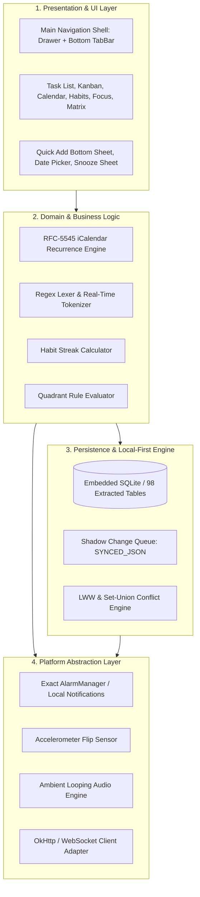
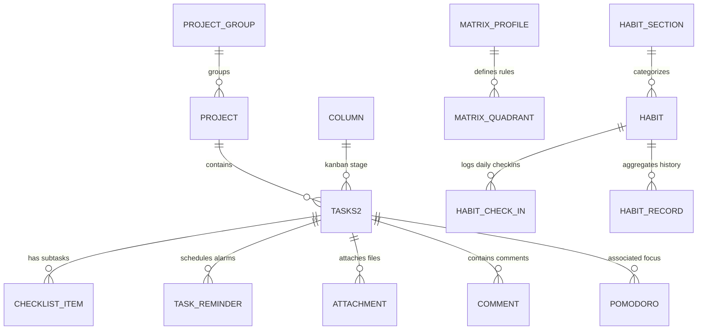

# Complete Product Blueprint for Open-Source Alternative

## 1. Executive Product Definition

The goal of this blueprint is to enable the clean-room, independent engineering of a production-grade, open-source productivity platform inspired by **TickTick**.

The application unifies five core domains into a single cohesive experience:
1. **Task Management & Organization**: Lists, folders, nested subtasks, checklists, Kanban boards, tags, custom filters, and multi-select batch operations.
2. **Scheduling & Calendar**: Multi-view calendar (Month, Week, Day, 3-Day, Agenda) with direct drag-and-drop time blocking and two-way external calendar sync.
3. **Habit Building**: Routine tracking with quantitative daily targets, streak flame counters, retroactive check-ins, and monthly heatmaps.
4. **Focus & Pomodoro**: Rotary dial timers, stopwatches, accelerometer flip-to-focus, looping ambient white noise, OLED burn-in protection, and floating PiP timer balls.
5. **Prioritization Tools**: 2x2 Eisenhower Matrix with drag-and-drop auto-mutations and custom quadrant rule filter builders.

---

## 2. Core Architectural Pillars

---

## 3. Master Entity Relationship Schema

The system is centered around 98 discrete SQLite tables extracted directly from TickTick's bytecode in [`evidence/code_references/schema.sql`](file:///d:/tick%20tick%20open%20source/TICKTICK_FUNCTIONAL_RESEARCH/evidence/code_references/schema.sql):

---

## 4. Primary Clean-Room Subsystems to Build

### 4.1 The Recurrence Engine
* Follow standard **RFC-5545 iCalendar `RRULE`** specifications.
* Handle repeat from due date (`repeatFrom = 0`) vs. repeat from completion date (`repeatFrom = 1`).
* Implement month-end clamping (Jan 31 repeating to Feb 28/29, Apr 30).
* Support exception dates via comma-delimited ISO strings in `EX_DATE`.

### 4.2 Natural Language Processing (NLP)
* Scans keystrokes in Quick Add using a local regex tokenizer.
* Matches temporal expressions ("tomorrow at 3pm"), priorities (`!1`, `!2`), lists (`~Work`), and tags (`#urgent`).
* Wraps recognized tokens in interactive UI Chip Spans.
* Backspace immediately restores raw characters without destroying user text.

### 4.3 Exact Alarm & Doze Mode Survival
* Register alarms via platform exact alarm APIs (`AlarmManager.setExactAndAllowWhileIdle()` or `setAlarmClock()`).
* Intercept system boot (`BOOT_COMPLETED`), timezone change (`TIMEZONE_CHANGED`), and clock reset (`TIME_SET`) to query `TASK_REMINDER` and re-schedule pending alarms.
* Support persistent Annoying Alert loops and fullscreen lockscreen wake-up dialogs.

### 4.4 Offline-First Shadow Synchronization
* Every local create, update, or delete writes immediately to the primary table (e.g. `TASKS2`) and logs a dirty payload into the shadow change table (e.g. `TASKS2_SYNCED_JSON`).
* The UI updates with 0ms latency.
* When connectivity is available, batches dirty changes into delta sync requests (`POST /api/v2/batch/check`).
* Resolves conflicts via Last-Write-Wins (LWW) on scalar fields and set-union merging on checklists.

---

## 5. Free vs. Premium Boundaries

In your open-source alternative, you may choose to provide all features freely, or replicate TickTick's tier structure:
* **Task Lists**: Free = 9 lists, Pro = 299 lists.
* **Tasks per List**: Free = 99 tasks, Pro = 999 tasks.
* **Subtasks**: Free = 19 items, Pro = 199 items.
* **Reminders**: Free = 1 reminder, Pro = 5 reminders + subtask alarms.
* **Habits**: Free = 5 habits, Pro = Unlimited.
* **Calendar Views**: Free = Agenda only, Pro = Full Month, Week, Day, 3-Day.
* **Matrix**: Free = 1 fixed profile, Pro = Custom profiles & custom filter rules.
* **Annoying Alert**: Pro persistent repeating siren alarms.
