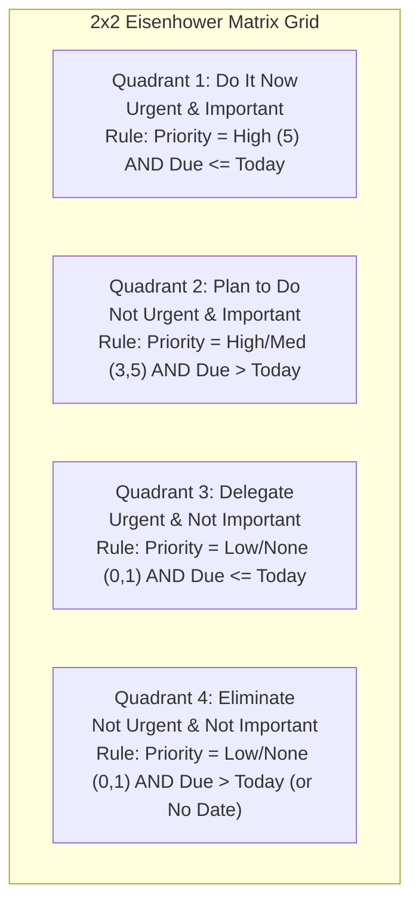

# Feature Specification: F138 - Eisenhower Matrix

## 1. Feature Identification
* **Feature ID**: `F138`
* **Feature Name**: Eisenhower Matrix (4-Quadrant Prioritization Grid)
* **Domain**: Productivity Tools
* **Evidence Standard**: `[CODE-CONFIRMED]` via REA JADX / `MatrixProfileDao` / `MatrixQuadrantDao` / `MatrixManageActivity`

---

## 2. Functional Description
Visualizes tasks across a 2x2 decision matrix based on urgency and importance:
* **Quadrant 1 (Top-Left)**: Urgent & Important ("Do It Now")
* **Quadrant 2 (Top-Right)**: Not Urgent & Important ("Plan to Do")
* **Quadrant 3 (Bottom-Left)**: Urgent & Not Important ("Assign / Delegate")
* **Quadrant 4 (Bottom-Right)**: Not Urgent & Not Important ("Eliminate / Try Not to Do")

Supports direct drag-and-drop between quadrants, quick-add inside individual quadrants, expanded quadrant views, and custom auto-sorting filter rules (Pro tier).

---

## 3. Entry Points & User Invocations
1. Navigation Drawer item: "Eisenhower Matrix" (`MatrixManageActivity`).
2. Optional bottom TabBar slot (if configured in user TabBar settings).
3. Android Home Screen Widget (`AppWidgetMatrixConfigActivity`).

---

## 4. Default Quadrant Logic & Mapping Rules



### Drag-and-Drop Auto-Mutation Rules:
* When a task is dragged from **Q2** (Plan to Do) into **Q1** (Do It Now):
  * Priority is set to `5` (High).
  * Due Date is automatically set to `Today`.
* When dragged from **Q1** into **Q4** (Eliminate):
  * Priority is set to `0` (None).
  * Due Date is cleared or pushed back.

---

## 5. Free vs. Pro Limitations
* **Free Tier**: 1 default Matrix profile with fixed, un-editable mapping rules.
* **Pro Tier**:
  * **Custom Matrix Profiles**: Create multiple matrices (e.g. "Work Matrix" vs. "Personal Matrix").
  * **Custom Condition Rule Editor** (`MatrixConditionEditActivity`): Define custom filter expressions for each quadrant combining projects, tags, priorities, and date boundaries.

---

## 6. Data Model & Database Persistence
```sql
-- Matrix Profile Definition
INSERT INTO MATRIX_PROFILE (
    SID, NAME, IS_DEFAULT, SORT_ORDER
) VALUES (
    'profile_work_matrix',
    'Work Matrix',
    1,
    0
);

-- Quadrant Configuration with JSON Filter Rule
INSERT INTO MATRIX_QUADRANT (
    SID, PROFILE_ID, QUADRANT_INDEX, NAME, FILTER_RULE, COLOR
) VALUES (
    'quadrant_q1_uuid',
    'profile_work_matrix',
    0,
    'Urgent & Important',
    '{"priority":[5],"dateRange":"TODAY","projectIds":["proj_work"]}',
    '#F44336'
);
```

---

## 7. Verification & Test Criteria
1. Open Eisenhower Matrix. Verify tasks due today with High Priority automatically populate Quadrant 1.
2. Drag a task from Quadrant 4 into Quadrant 1. Verify its priority flag immediately turns red (High) and due date becomes Today.
3. Tap "+" inside Quadrant 2. Verify new task is created with High Priority and scheduled for Tomorrow.
4. On Free tier, verify tapping "Edit Rules" triggers `GetProActivity`.
