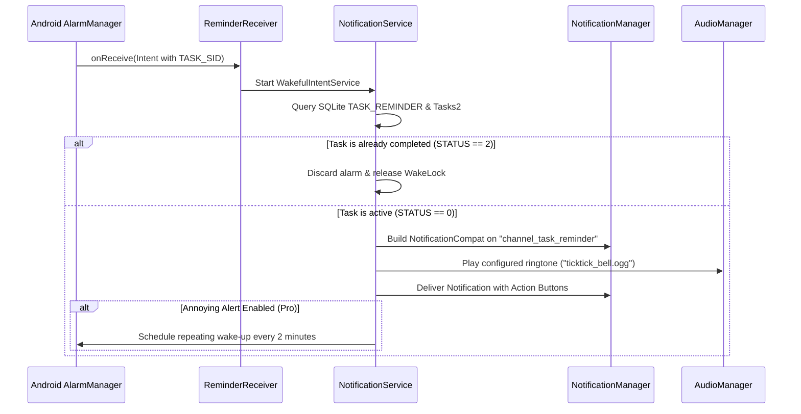

# Feature Specification: F036 - Task Reminders and Alarms

## 1. Feature Identification
* **Feature ID**: `F036`
* **Feature Name**: Single and Multi-Tier Task Reminders
* **Domain**: Reminders & Notifications
* **Evidence Standard**: `[CODE-CONFIRMED]` via REA JADX / `ReminderReceiver` / `AlarmManager` / `TASK_REMINDER`

---

## 2. Functional Description
Provides timely notifications and persistent alarms for scheduled tasks. Supports relative offsets (e.g., "At time of event", "15 minutes before", "1 day before"), custom datetime triggers, recurring alarm patterns, and persistent Annoying Alert loops.

---

## 3. Entry Points & User Invocations
1. Reminder button in `dialog_date_picker.xml`.
2. Reminder field inside `TaskDetailActivity`.
3. Natural Language quick-entry token (e.g., "remind me at 10am").
4. Snooze picker modal (`SnoozePopupActivity`).

---

## 4. Input Fields & Validation Rules
| Field | Type | Required | Default Value | Options & Constraints |
| :--- | :--- | :--- | :--- | :--- |
| `triggerTime` | Long (Epoch ms) | Yes | Same as `dueDate` | Must be a valid epoch millisecond timestamp. |
| `offsetMinutes`| Integer | No | `0` | Presets: `0` (At time of event), `5`, `15`, `30`, `60`, `1440` (1 day before). |
| `reminderType` | Integer | Yes | `0` (Notification) | `0` = Status Bar Notification, `1` = Fullscreen Alarm, `2` = Annoying Alert. |
| `snoozeDuration`| Integer | No | `15` | Default snooze interval in minutes (5, 10, 15, 30, 60, tomorrow morning). |

---

## 5. Free vs. Pro Limitations
* **Free Tier**: Maximum **1 Reminder** per task. Subtask reminders not permitted.
* **Pro Tier**: Up to **5 Reminders** per task. Individual subtask reminders allowed. Annoying Alert persistent repeating alarms unlocked.

---

## 6. Notification Shade & Lockscreen Interface
```
+-------------------------------------------------------+
| [TickTick] Doctor Appointment                         |
| Today at 4:30 PM - Central Medical Center             |
|                                                       |
| [ COMPLETE ]       [ SNOOZE (15m) ]     [ WON'T DO ]  |
+-------------------------------------------------------+
```

---

## 7. Alarm Execution Flow


---

## 8. Verification & Test Criteria
1. Schedule a reminder for $T+1\text{ minute}$. Put device in screen-off Doze mode. Verify notification fires at exact second.
2. Tap "Complete" directly on the notification banner. Verify notification dismisses and `Tasks2.STATUS` becomes `2`.
3. Tap "Snooze". Verify notification dismisses and re-appears 15 minutes later.
4. Schedule 2 reminders on Free tier; verify second reminder prompts `GetProActivity`.
