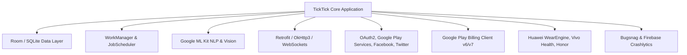

# TickTick APK Technical Overview & Architecture Baseline

**Project**: TickTick Functional Research  
**Document**: `research/01_APK_OVERVIEW.md`  
**Target Package**: `com.ticktick.task`  
**Application Version**: `8.3.0.1` (Version Code: `8301`)  
**Target Architecture**: `arm64-v8a`, multi-split density/locale  
**Date**: November 13, 2026  
**Evidence Standard**: [CODE-CONFIRMED] and [RESOURCE-CONFIRMED]  

---

## 1. Package & Distribution Profile

| Attribute | Inspected Value | Evidence / Source |
| :--- | :--- | :--- |
| **Original Archive** | `TickTick_To+Do+List+&+Calendar_8.3.0.1_APKPure.xapk` | Workspace Root (Size: 42,331,961 bytes) |
| **Archive Format** | XAPK Container (Zip v2 bundle) | `staging_apk/manifest.json` |
| **Base APK** | `com.ticktick.task.apk` | Uncompressed: 30,787,649 bytes |
| **Package Identifier** | `com.ticktick.task` | Manifest attribute `package` |
| **Version Name** | `8.3.0.1` | Manifest attribute `android:versionName` |
| **Version Code** | `8301` | Manifest attribute `android:versionCode` |
| **Minimum SDK** | `26` (Android 8.0 Oreo) | `minSdkVersion="26"` |
| **Target SDK** | `37` (Android 15+) | `targetSdkVersion="37"` |
| **Effective Target SDK**| `37` | pyaxmlparser & REA verified |
| **Base APK SHA-256** | `f4c4f43b63d0849a4c53e6ed8a2414245805df86f8335d6b76cdf02756b19a6f` | Authenticated Evidence `ev_a885a345c8e145a1b18b1b42fbb97e27f1ee6f2b4c6c7db5c8a37c411e615862` |

---

## 2. Multi-Split APK Installation Analysis

The application was distributed as an Android App Bundle / Split APK installation packaged into an XAPK container.

### 2.1 Split Configuration Breakdown
1. **Base Application APK**:
   - `com.ticktick.task.apk`: Houses the complete application logic across 3 DEX files, base AndroidManifest, asset catalogs, core UI layouts, and base strings.
2. **Native Architecture ABI Split**:
   - `config.arm64_v8a.apk` (1,442,436 bytes): Contains optimized 64-bit ARM compiled binaries (`lib/arm64-v8a/`).
3. **Screen Density Split**:
   - `config.xxhdpi.apk` (2,497,224 bytes): High-density raster assets, icons, and themes.
4. **Localization Language Splits (17 Locales)**:
   - Arabic (`config.ar.apk`), German (`config.de.apk`), English (`config.en.apk`), Spanish (`config.es.apk`), French (`config.fr.apk`), Hindi (`config.hi.apk`), Indonesian (`config.in.apk`), Italian (`config.it.apk`), Japanese (`config.ja.apk`), Korean (`config.ko.apk`), Burmese (`config.my.apk`), Portuguese (`config.pt.apk`), Russian (`config.ru.apk`), Thai (`config.th.apk`), Turkish (`config.tr.apk`), Vietnamese (`config.vi.apk`), Chinese (`config.zh.apk`).

### 2.2 Sufficiency Evaluation
- **Analysis Status**: [CODE-CONFIRMED] **FULLY SUFFICIENT**.
- The base APK `com.ticktick.task.apk` contains the complete application bytecode (`classes.dex`, `classes2.dex`, `classes3.dex` totaling 26,593,416 uncompressed bytes), the full schema definitions, activity declarations, intent filters, database models, and business logic.
- No split APKs are missing. All language and density splits are extracted in `staging_apk/`.

---

## 3. High-Level Bytecode & Component Metrics

| Component Type | Total Count | Namespace Distribution / Key Notes |
| :--- | :--- | :--- |
| **DEX Files** | 3 | `classes.dex` (9.4 MB), `classes2.dex` (11.0 MB), `classes3.dex` (6.1 MB) |
| **Loaded Classes** | 18,071 | Verified via REA JADX Headless engine |
| **Activities** | 227 | Main dashboard, calendar views, pomo screens, settings, oauth |
| **Services** | 60 | Sync services, reminder alarms, wear engine, pomo timer foreground service |
| **Broadcast Receivers**| 54 | Boot receiver, alarm receivers, widget providers, timezone change |
| **Content Providers** | 11 | Multi-process data providers, Facebook provider, FileProvider |
| **Declared Permissions**| 61 | Core system, hardware sensors, billing, health/wear, OEM specific |
| **Decoded XML Strings**| 4,322 | Key functional strings: habit (372), pomo (88), focus (126), calendar (171), reminder (138) |

---

## 4. Declared Permissions Audit

TickTick declares 61 permissions spanning essential system capabilities, OEM integrations, and background services:

### 4.1 System Alarms & Timing
- `android.permission.SCHEDULE_EXACT_ALARM`: Scheduling precise task and habit reminders.
- `android.permission.USE_EXACT_ALARM`: Android 13+ exemption for calendar and reminder apps.
- `android.permission.WAKE_LOCK`: Holding wake lock during alarm ringing and database synchronization.
- `android.permission.RECEIVE_BOOT_COMPLETED`: Rescheduling all pending alarms and reminders after device reboot.

### 4.2 Foreground Services & Notifications
- `android.permission.POST_NOTIFICATIONS`: Android 13+ runtime notification display.
- `android.permission.USE_FULL_SCREEN_INTENT`: High-priority ringing alarm banners across locked screens.
- `android.permission.FOREGROUND_SERVICE`: General background persistence.
- `android.permission.FOREGROUND_SERVICE_MEDIA_PLAYBACK`: White noise and ambient focus sounds during Pomodoro sessions.
- `android.permission.FOREGROUND_SERVICE_MICROPHONE`: Voice task input and audio recordings attached to tasks.
- `android.permission.FOREGROUND_SERVICE_SPECIAL_USE`: Specialized long-running background tasks.
- `android.permission.SYSTEM_ALERT_WINDOW`: Floating task widgets, Pomodoro floating countdown ball.

### 4.3 Location & Geofencing
- `android.permission.ACCESS_FINE_LOCATION`: Precise GPS coordinates for geofence entry/exit reminders.
- `android.permission.ACCESS_COARSE_LOCATION`: Approximate network-based location.
- `android.permission.ACCESS_BACKGROUND_LOCATION`: Triggering reminders when arriving at/leaving places while app is in background.

### 4.4 Hardware & Peripherals
- `android.permission.CAMERA`: Scanning QR codes, capturing document attachments.
- `android.permission.RECORD_AUDIO`: Voice notes, speech-to-text task parsing.
- `android.permission.VIBRATE`: Alarm and haptic feedback on completion.
- `android.permission.USE_BIOMETRIC` & `android.permission.USE_FINGERPRINT`: App lock and list privacy protection.

### 4.5 Calendar & Contacts
- `android.permission.READ_CALENDAR`: Importing and displaying events from Google Calendar, Outlook, local calendars.
- `android.permission.WRITE_CALENDAR`: Two-way synchronization of TickTick tasks to system calendars.
- `com.coloros.permission.READ_CALENDAR` & `WRITE_CALENDAR`: Oppo/ColorOS calendar bridge.
- `android.permission.READ_CONTACTS`: Inviting collaborators and assigning tasks to contact emails.

### 4.6 Storage & Media
- `android.permission.READ_EXTERNAL_STORAGE` / `WRITE_EXTERNAL_STORAGE`: Legacy Android storage.
- `android.permission.READ_MEDIA_AUDIO`: Selecting custom alarm ringtones from device audio files.

### 4.7 OEM Wearable & Ecosystem Integrations
- `com.huawei.wearengine`: Huawei Watch task sync and notification actions.
- `com.vivo.health`: Vivo smartwatch and fitness tracking data synchronization.
- `com.hihonor.healthservice.permission.access`: Honor smartwatch integration.
- `com.vivo.aiengine.permission.READ_AWARE_PROVIDER`: Vivo Jovi smart assistant integration.

### 4.8 Billing & Accounts
- `com.android.vending.BILLING`: Google Play In-App Billing for TickTick Premium subscriptions.
- `android.permission.GET_ACCOUNTS`, `USE_CREDENTIALS`, `MANAGE_ACCOUNTS`: Account sync adapter.

---

## 5. Third-Party Library & Infrastructure Footprint

Analysis of DEX string pools, manifests, and class hierarchies identifies the following key dependencies:

1. **Database & Persistence**:
   - `androidx.room`: Multi-instance Room Database with `androidx.room.MultiInstanceInvalidationService`.
   - Raw SQLite helper fallback and `SharedPreferences` for user display settings.
2. **Background Processing**:
   - `androidx.work.impl`: AndroidX WorkManager for deferred periodic synchronization, cleanup, and analytics dispatch.
   - `JobScheduler` and `AlarmManager` for real-time reminder triggers.
3. **Smart Features & Machine Learning**:
   - `com.google.mlkit`: Google ML Kit for on-device natural language text entity extraction (dates, times, recurrence tags) and optical text recognition (OCR) from images.
4. **Networking & Sync**:
   - `okhttp3`, `retrofit2`: RESTful API clients communicating with TickTick cloud endpoints.
   - WebSocket client for real-time collaboration events and instant notification pushes.
5. **Analytics & Crash Monitoring**:
   - `com.bugsnag.android`: Bugsnag crash reporting and breadcrumb logging.
   - `com.google.firebase.analytics`: Firebase events and funnel tracking.
   - `com.google.android.gms.ads`: Google Mobile Ads SDK (AdMob) for free-tier promotional placement.
6. **Authentication & Identity**:
   - `net.openid.appauth`: OpenID Connect and OAuth2 client.
   - `com.google.android.gms.auth`: Google Sign-In.
   - `com.facebook.login`: Facebook SDK.
   - `com.twitter.sdk`: Twitter / X OAuth integration.

---

## 6. Structural Sufficiency & Research Roadmap

The uploaded APK is an authentic production release of TickTick Android containing all business entities, database DAOs, UI fragments, and background alarm dispatchers. The decompiled codebase and decoded resources provide a complete static evidence foundation to extract every functional specification required for an independent alternative application.
