# Screen and Navigation Inventory

## 1. Navigation Architecture Overview

TickTick's Android application (`com.ticktick.task`) employs a hybrid navigation architecture composed of:
1. **Primary Navigation Bar (`TabBar`)**: Configurable bottom navigation bar hosting 3 to 5 core feature modules.
2. **Global Navigation Drawer (`DrawerLayout`)**: Persistent left-side drawer providing access to user profile, smart lists, user lists, list folders, tags, filters, and system views (Trash, Completed, Summary).
3. **Contextual Action Modals (`BottomSheetDialogFragment`)**: Used for high-frequency micro-interactions such as Quick Add, Date/Time picking, Recurrence rules, Priority selection, and Sorting options.
4. **Dedicated Activities**: Heavyweight independent flows such as Calendar Management, Habit Creation, Pomodoro Focus Screen, Eisenhower Matrix, Settings, and Account Management.

```mermaid
graph TD
    AppStart[Splash / DispatchActivity] --> MainContainer[TaskActivity / Main Container]
    
    subgraph PrimaryTabBar [Configurable Bottom TabBar]
        TabTasks[Tasks View]
        TabCalendar[Calendar View]
        TabHabits[Habits View]
        TabFocus[Focus / Pomo View]
        TabSearch[Search / Settings]
    end
    
    subgraph NavigationDrawer [Left Navigation Drawer]
        DrawerProfile[User Profile & Level]
        DrawerSmartLists[Smart Lists: Today, Next 7 Days, Inbox, Assigned]
        DrawerLists[User Lists & Folders]
        DrawerTags[Tags & Filter Views]
        DrawerMatrix[Eisenhower Matrix Entry]
        DrawerTrash[Trash & Archive]
    end
    
    MainContainer --> PrimaryTabBar
    MainContainer --> NavigationDrawer
    
    TabTasks --> TaskDetail[Task Detail View]
    TabTasks --> QuickAdd[Quick Add Bottom Sheet]
    TabTasks --> BatchEdit[Batch Multi-Select Mode]
    
    TabCalendar --> CalMonth[Month / Week / Day / Agenda]
    TabCalendar --> CalManage[Calendar Manager Activity]
    
    TabHabits --> HabitAdd[Habit Creation / Template Activity]
    TabHabits --> HabitDetail[Habit Detail & Calendar Activity]
    
    TabFocus --> PomoDial[Pomodoro Dial & Fullscreen Focus]
    TabFocus --> WhiteNoise[White Noise Picker Activity]
    TabFocus --> FocusStats[Focus Timeline & Statistics]
    
    DrawerMatrix --> MatrixGrid[4-Quadrant Matrix Activity]
    MatrixGrid --> MatrixEdit[Matrix Condition / Profile Editor]
```

---

## 2. Exhaustive Screen Inventory by Functional Domain

### 2.1 Main Application Container & Framework

| Screen ID | Component Class | XML Layout Resource | Type | Purpose & Visible Controls |
| :--- | :--- | :--- | :--- | :--- |
| `SCR-MAIN-001` | `com.ticktick.task.activity.TaskActivity` | `activity_task.xml` | Activity (SingleTask) | **Primary Shell**: Hosts the Navigation Drawer, Top Toolbar, Fragment Container (`FrameLayout`), and Bottom Tab Bar (`TabBar`). Controls drawer toggle, global quick add floating button, and sync status icon. |
| `SCR-MAIN-002` | `com.ticktick.task.activity.DispatchActivity` | (Theme windowBackground) | Activity (Transparent) | **Routing Dispatcher**: Initial launcher entry point. Inspects auth tokens, first-launch flags, intent deep links, and shortcuts, redirecting to `LoginMainActivity` or `TaskActivity`. |
| `SCR-MAIN-003` | `com.ticktick.task.activity.nav.NavDrawerFragment` | `fragment_nav_drawer.xml` | Fragment | **Navigation Drawer**: Displays user avatar, username, Pro badge, achievement score/level, Smart Lists list, Folders/Projects tree, Tags list, Add List button, and Settings gear icon. |
| `SCR-MAIN-004` | `com.ticktick.task.activity.ProcessTextActivity` | (Transparent) | Activity | **System Text Selection Context**: Handles Android system `ACTION_PROCESS_TEXT` intent; opens a floating quick-add dialog populated with the highlighted text. |

---

### 2.2 Task Management & Detail Screens

| Screen ID | Component Class | XML Layout Resource | Type | Purpose & Visible Controls |
| :--- | :--- | :--- | :--- | :--- |
| `SCR-TASK-001` | `com.ticktick.task.fragment.TaskListFragment` | `fragment_task_list.xml` | Fragment | **Main Task List Screen**: Displays task items in RecyclerView with swipe gestures, section headers (Overdue, Today, Tomorrow), search bar entry, and floating action button (+). |
| `SCR-TASK-002` | `com.ticktick.task.activity.TaskDetailActivity` | `activity_task_detail.xml` | Activity / Sheet | **Task Detail Screen**: Displays full task metadata: Title (editable text), Checklist / Markdown body, Due Date/Time picker, Reminders badge, Priority flag (None/Low/Med/High), Project/Folder selector, Tag pills, Subtask hierarchy, Comments stream, and Attachment previews. |
| `SCR-TASK-003` | `com.ticktick.task.fragment.QuickAddBottomSheet` | `dialog_quick_add_task.xml` | BottomSheetDialogFragment | **Quick Add Sheet**: Single-line/multi-line input with real-time NLP date chip rendering, quick priority toggle, date trigger button, tag picker popup, list selector, and voice-input mic button. |
| `SCR-TASK-004` | `com.ticktick.task.activity.BatchEditTaskActivity` | `activity_batch_edit_task.xml` | Activity / Modal | **Batch Task Operation Screen**: Activated upon multi-selection. Displays bottom action toolbar: Move to Project, Set Due Date, Set Priority, Mark Won't Do, Duplicate, and Delete. |
| `SCR-TASK-005` | `com.ticktick.task.activity.TaskCommentActivity` | `activity_task_comment.xml` | Activity / Fragment | **Task Comments & Activity Feed**: Chronological list of user comments, system edit audits (e.g., date changed, completed by X), @mention auto-complete popup, and image upload button. |
| `SCR-TASK-006` | `com.ticktick.task.activity.TaskDetailMenuEditActivity` | `activity_task_detail_menu_edit.xml` | Activity | **Detail Menu Customization**: Allows user to toggle and reorder visible fields in Task Detail (e.g., Hide Reminders, Reorder Tags above Priority). |
| `SCR-TASK-007` | `com.ticktick.task.activity.TaskActivitiesWebViewActivity` | `activity_webview.xml` | Activity | **Task Activity History**: Detailed web-based audit log of all historical revisions to a task (dates, checklist modifications, collaborator actions). |
| `SCR-TASK-008` | `com.ticktick.task.activity.QuickDateConfigActivity` | `activity_quick_date_config.xml` | Activity | **Quick Date Preset Customization**: Configure quick-date shortcuts shown in date picker (e.g., "Today", "Tomorrow", "Next Week", custom delta offsets). |

---

### 2.3 Calendar System Screens

| Screen ID | Component Class | XML Layout Resource | Type | Purpose & Visible Controls |
| :--- | :--- | :--- | :--- | :--- |
| `SCR-CAL-001` | `com.ticktick.task.activity.CalendarViewActivity` | `activity_calendar_view.xml` | Activity / Fragment | **Calendar Root Screen**: Unified calendar container supporting multi-view tabs: Month, Week, Day, 3-Day, Agenda. Supports dragging unscheduled tasks from bottom tray onto time blocks. |
| `SCR-CAL-002` | `com.ticktick.task.activity.CalendarViewOptionsActivity` | `activity_calendar_view_options.xml` | Activity | **Calendar Display Options**: Configure start day of week (Mon/Sun/Sat), show/hide completed tasks, show/hide lunar calendar, show week numbers, select default view. |
| `SCR-CAL-003` | `com.ticktick.task.activity.calendarmanage.CalendarManagerActivity` | `activity_calendar_manager.xml` | Activity | **Calendar Subscription Manager**: Manage enabled Google, Outlook, iCloud, Exchange, and CalDAV calendars; add webical (`.ics`) subscription URLs; toggle visibility colors per calendar. |
| `SCR-CAL-004` | `com.ticktick.task.activity.CalendarDisplayRangeActivity` | `activity_calendar_display_range.xml` | Activity | **Calendar View Time Range**: Select visible hour span for day/week grids (e.g., 08:00 to 22:00 vs. full 24 hours). |
| `SCR-CAL-005` | `com.ticktick.task.activity.course.CourseDetailActivity` | `activity_course_detail.xml` | Activity | **Class Timetable / Course Detail**: Displays academic course schedule, lesson times, classroom location, teacher name, and recurrence weeks (Odd/Even). |
| `SCR-CAL-006` | `com.ticktick.task.activity.course.CourseImportActivity` | `activity_course_import.xml` | Activity | **Course Import Screen**: Import academic schedules via educational portal login, QR code, or Excel/CSV template. |

---

### 2.4 Habit Tracking Screens

| Screen ID | Component Class | XML Layout Resource | Type | Purpose & Visible Controls |
| :--- | :--- | :--- | :--- | :--- |
| `SCR-HAB-001` | `com.ticktick.task.activity.habit.AllHabitListActivity` | `activity_habit_all_list.xml` | Activity / Fragment | **Habit Dashboard**: Matrix/list grid of active habits. Displays habit icon, title, current streak flame counter, target metric, and one-tap circular completion button. |
| `SCR-HAB-002` | `com.ticktick.task.activity.habit.HabitAddActivity` | `activity_habit_add.xml` | Activity | **Habit Creation & Preset Screen**: Catalog of preset habits (Drink Water, Read, Exercise, Meditate) grouped by categories, plus "Create Custom Habit" button. |
| `SCR-HAB-003` | `com.ticktick.task.activity.habit.HabitEditActivity` | `activity_habit_edit.xml` | Activity | **Habit Configuration Editor**: Configure Habit Name, Icon picker (60+ icons), Color picker, Frequency (Daily, Specific Days of Week, Monthly, Interval), Daily Target Value & Unit (e.g. 2000 ml), Reminder times, and Encouragement quote. |
| `SCR-HAB-004` | `com.ticktick.task.activity.habit.HabitDetailActivity` | `activity_habit_detail.xml` | Activity | **Habit Statistics & Log**: Monthly check-in heat map calendar, total check-in days counter, current streak vs. longest streak, completion rate percentage, and historical check-in notes log. |
| `SCR-HAB-005` | `com.ticktick.task.activity.habit.HabitRecordActivity` | `activity_habit_record.xml` | Activity / Sheet | **Habit Check-in Log Sheet**: Log quantitative value (e.g., 500 ml), add check-in diary note, attach photos, and record check-in timestamp. |
| `SCR-HAB-006` | `com.ticktick.task.activity.habit.HabitSectionManageActivity` | `activity_habit_section_manage.xml` | Activity | **Habit Section Organizer**: Create, reorder, and manage habit grouping categories (e.g., Morning Routine, Afternoon, Evening Routine). |

---

### 2.5 Focus & Pomodoro Screens

| Screen ID | Component Class | XML Layout Resource | Type | Purpose & Visible Controls |
| :--- | :--- | :--- | :--- | :--- |
| `SCR-FOC-001` | `com.ticktick.task.activity.PomodoroActivity` | `activity_pomodoro.xml` | Activity | **Focus Hub Screen**: Circular countdown timer dial, toggle between Pomodoro (countdown) and Stopwatch (countup), Task binding selector, Start/Pause/Stop controls, and Ambient Sound selector. |
| `SCR-FOC-002` | `com.ticktick.task.activity.ChoosePomoSoundActivity` | `activity_choose_pomo_sound.xml` | Activity | **Ambient / White Noise Sound Store**: Sound library with downloadable looping audio (Rain, Forest, Café, White Noise, Ocean Waves, Campfire, Clock Ticking, Binaural Beats). Controls volume slider and background playback toggle. |
| `SCR-FOC-003` | `com.ticktick.task.activity.PomoPopupActivity` | `activity_pomo_reminder_popup.xml` | Activity (Dialog) | **Pomodoro Completion Popup**: Fullscreen / dialog alert fired when a Pomodoro or break period completes. Displays summary of elapsed minutes, congratulatory message, and "Start Short Break" / "Start Long Break" / "Continue Focus" buttons. |
| `SCR-FOC-004` | `com.ticktick.task.activity.statistics.FocusTimelineActivity` | `activity_focus_timeline.xml` | Activity | **Focus Statistics & History**: Daily, weekly, and monthly focus duration bar charts, distribution across projects/tags, and detailed chronological timeline log of individual sessions. |
| `SCR-FOC-005` | `com.ticktick.task.activity.statistics.FocusTimelineEditActivity` | `activity_focus_timeline_edit.xml` | Activity | **Focus Session Manual Editor**: Allows manual creation or editing of historical focus records (start time, end time, associated task, interruption notes). |

---

### 2.6 Eisenhower Matrix Screens

| Screen ID | Component Class | XML Layout Resource | Type | Purpose & Visible Controls |
| :--- | :--- | :--- | :--- | :--- |
| `SCR-MAT-001` | `com.ticktick.task.activity.matrix.MatrixManageActivity` | `activity_matrix_manage.xml` | Activity | **Eisenhower Matrix 2x2 Grid**: 4 quadrant panels: Q1 (Urgent & Important), Q2 (Not Urgent & Important), Q3 (Urgent & Not Important), Q4 (Not Urgent & Not Important). Supports drag-and-drop between quadrants and quick-add inside each quadrant. |
| `SCR-MAT-002` | `com.ticktick.task.activity.matrix.MatrixQuadrantDetailActivity` | `activity_matrix_detail_list.xml` | Activity | **Expanded Quadrant View**: Fullscreen list of tasks residing within a single quadrant with priority flags and batch actions. |
| `SCR-MAT-003` | `com.ticktick.task.activity.matrix.MatrixConditionEditActivity` | `activity_matrix_condition_edit.xml` | Activity | **Matrix Rule Configurator (Pro)**: Customizes the auto-sorting rules for each quadrant (e.g. Map High Priority + Due Today to Q1; Map Medium Priority to Q2). |
| `SCR-MAT-004` | `com.ticktick.task.activity.matrix.MatrixProfileActivity` | `activity_matrix_profile.xml` | Activity | **Matrix Profile Switcher**: Switch between custom matrix profiles (e.g., Work Matrix vs. Personal Matrix). |

---

### 2.7 Organization (Lists, Folders, Tags & Smart Lists)

| Screen ID | Component Class | XML Layout Resource | Type | Purpose & Visible Controls |
| :--- | :--- | :--- | :--- | :--- |
| `SCR-ORG-001` | `com.ticktick.task.activity.ProjectDetailActivity` | `activity_project_detail.xml` | Activity | **List Container & View Switcher**: Displays tasks in List, Kanban Board, or Timeline view mode. Header menu gives access to list sharing, sorting, and view preferences. |
| `SCR-ORG-002` | `com.ticktick.task.activity.ProjectEditActivity` | `activity_project_edit.xml` | Activity / Sheet | **List Configuration Editor**: List Name, Color picker, Icon picker, Folder selector, List Type (Task List vs. Note List), and View Mode default ("list", "kanban", "timeline"). |
| `SCR-ORG-003` | `com.ticktick.task.activity.ProjectGroupManageActivity` | `activity_project_group_manage.xml` | Activity | **Folder / Group Manager**: Create new folder, drag and drop lists into/out of folders, rename folders, and collapse/expand in sidebar. |
| `SCR-ORG-004` | `com.ticktick.task.activity.TagManageActivity` | `activity_tag_manage.xml` | Activity | **Tag Hierarchy Manager**: List of all tags, tag creation dialog, color picker, tag parent/child nesting, and batch delete/merge tags. |
| `SCR-ORG-005` | `com.ticktick.task.activity.smartlist.SmartListRuleEditActivity` | `activity_smart_list_rule_edit.xml` | Activity | **Smart List Custom Rule Configurator**: Rule builder with boolean filters: Projects, Tags, Due Date (Overdue, Today, Tomorrow, Next 7 Days, No Date), Priority (High/Med/Low/None), and Assigned To. |

---

### 2.8 Reminders, Alarms & Notifications

| Screen ID | Component Class | XML Layout Resource | Type | Purpose & Visible Controls |
| :--- | :--- | :--- | :--- | :--- |
| `SCR-REM-001` | `com.ticktick.task.activity.ReminderPopupActivity` | `activity_reminder_popup.xml` | Activity (Dialog / Fullscreen) | **Fullscreen Alarm / Persistent Reminder**: Fullscreen wake-up window displaying task title, checklist items, due time, and prominent buttons: "Complete", "Won't Do", "Snooze", and "Open Task". |
| `SCR-REM-002` | `com.ticktick.task.activity.SnoozePopupActivity` | `dialog_snooze_picker.xml` | BottomSheetDialogFragment | **Snooze Selection Sheet**: Quick options: 5 Minutes, 15 Minutes, 30 Minutes, 1 Hour, Tomorrow Morning (09:00), Custom Date/Time. |
| `SCR-REM-003` | `com.ticktick.task.activity.NotificationCenterActivity` | `activity_notification_center.xml` | Activity | **In-App Notification Center**: Central inbox of system announcements, collaboration invites, comment @mentions, and achievement unlocks. |
| `SCR-REM-004` | `com.ticktick.task.activity.location.LocationPickerActivity` | `activity_location_picker.xml` | Activity | **Geofence Location Reminder Setup**: Map view (Google Maps / AMap) with radius circle slider (50m–1000m), trigger condition toggle ("When Arriving" vs. "When Leaving"), and favorite locations list. |

---

### 2.9 Settings & Customization

| Screen ID | Component Class | XML Layout Resource | Type | Purpose & Visible Controls |
| :--- | :--- | :--- | :--- | :--- |
| `SCR-SET-001` | `com.ticktick.task.activity.preference.SettingActivity` | `preferences.xml` | Activity | **Root Settings Menu**: Grouped menu: Account & Profile, General, Appearance & Themes, Sounds & Notifications, Date & Time, Smart Recognition, Task Defaults, Habit Defaults, Focus Settings, Backup & Import, and About. |
| `SCR-SET-002` | `com.ticktick.task.activity.preference.CustomThemeActivity` | `activity_custom_theme.xml` | Activity | **Theme Store & Color Customizer**: Theme library (Classic Blue, Midnight OLED Dark, Forest Green, Sunset Orange, Sakura Pink, Pure Black), City themes (London, Paris, Tokyo), and custom hex primary color generator (Pro). |
| `SCR-SET-003` | `com.ticktick.task.activity.preference.CustomSwipePreference` | `preference_custom_swipe.xml` | Activity | **Swipe Gesture Customizer**: Customization of Left Short Swipe, Left Long Swipe, Right Short Swipe, and Right Long Swipe actions (Complete, Won't Do, Pin, Date, Priority, Move, Start Pomo, Delete). |
| `SCR-SET-004` | `com.ticktick.task.activity.lock.ChooseLockPattern` | `activity_choose_lock_pattern.xml` | Activity | **App Lock Security Setup**: Setup 3x3 pattern lock or PIN, with toggle for Biometric / Fingerprint unlock authentication and auto-lock timeout delay (Immediately, 1 min, 5 min). |
| `SCR-SET-005` | `com.ticktick.task.activity.preference.SmartDateParsePreference` | `preference_smart_date_parse.xml` | Activity | **NLP Smart Recognition Settings**: Toggles for Date Parsing, Time Parsing, Tag Parsing (`#`), List Parsing (`~`), Priority Parsing (`!`), Remove Parsed Text toggle, and language model selector. |

---

### 2.10 Premium & Subscription Paywalls

| Screen ID | Component Class | XML Layout Resource | Type | Purpose & Visible Controls |
| :--- | :--- | :--- | :--- | :--- |
| `SCR-PRO-001` | `com.ticktick.task.activity.account.GetProActivity` | `activity_get_pro.xml` | Activity | **Pro Upgrade Paywall**: Visual carousel highlighting Pro capabilities (Full Calendar Views, Custom Smart Lists, Unlimited Habits, Annoying Alert, Matrix Rules), Monthly / Annual pricing cards, and "Subscribe Now" Google Play billing button. |
| `SCR-PRO-002` | `com.ticktick.task.upgrade.ProFeaturesActivity` | `activity_pro_features.xml` | Activity | **Pro vs Free Feature Comparison Matrix**: Detailed side-by-side table listing limits for Free vs Pro tiers (Lists: 9 vs 299; Tasks per list: 99 vs 999; Subtasks: 19 vs 199; Reminders per task: 1 vs 5; Habit count: 5 vs Unlimited). |
| `SCR-PRO-003` | `com.ticktick.task.activity.pro.ProExpiredActivity6130` | `activity_pro_expired.xml` | Activity | **Subscription Expiration Screen**: Warns user of expired Pro tier, explains data preservation policies (data is kept read-only or capped, not deleted), and presents renewal discount offer. |

---

## 3. Deep Link & Intent Routing Architecture

TickTick registers multiple URI schemes and intent filters in `AndroidManifest.xml`:

| URI Scheme / Intent Action | Pattern | Target Component | Handled Parameters |
| :--- | :--- | :--- | :--- |
| `ticktick://` | `ticktick://task/add` | `DispatchActivity` | `title`, `dueDate`, `priority`, `projectId` |
| `ticktick://` | `ticktick://task/open?id={sid}` | `DispatchActivity` | `id` (maps to `Tasks2.SID`) |
| `ticktick://` | `ticktick://calendar` | `CalendarViewActivity` | `view` ("month", "week", "day", "agenda") |
| `ticktick://` | `ticktick://habit/add` | `HabitAddActivity` | `templateId` |
| `ticktick://` | `ticktick://focus/start` | `PomodoroActivity` | `taskId`, `duration` |
| `https://ticktick.com` | `https://ticktick.com/webapp/#p/{pid}/tasks/{tid}` | `DispatchActivity` | Web-app task URL deep link resolution |
| `android.intent.action.SEND` | `text/plain` | `ShareReceiveActivity` | Shared text / URL converts into task title/description |
| `android.intent.action.PROCESS_TEXT` | `text/plain` | `ProcessTextActivity` | System highlighted text quick-capture popup |

---

## 4. Modal and Dialog Hierarchy Summary

1. **`dialog_quick_add_task.xml`** (`QuickAddBottomSheet`): Quick task entry modal with auto-expanding input and dynamic keyword pill suggestions.
2. **`dialog_date_picker.xml`** (`DatePickerDialog`): Calendar date grid with Quick Date presets ("Today", "Tomorrow", "Next Week", "Someday"), Time toggle, and Recurrence button.
3. **`dialog_repeat_picker.xml`** (`RecurrenceDialog`): Custom RRULE recurrence builder (Daily, Weekly, Monthly, Yearly, Spaced Repetition / Forgetting Curve, Chinese Lunar).
4. **`dialog_snooze_picker.xml`** (`SnoozePopupActivity`): Granular snooze duration selector.
5. **`dialog_sort_options.xml`** (`SortOptionBottomFragment`): Dynamic sort criteria sheet (Sort by Due Date, Title, Priority, Creation Date; Group by Project, Date, Priority, Tag).

---

## 5. Architectural Implementation Assessment for Independent Build

For an independent open-source recreation:
- **Clean Separation**: Decouple the UI shell from the data engine. Navigation state should be driven by a centralized declarative router (e.g. URI-based navigation matching the deep link schema).
- **Extensible Tab Bar**: Allow user reordering of bottom navigation items (Tasks, Calendar, Habits, Focus, Matrix, Search) stored in user preferences.
- **Unified Modal Flow**: Maintain a consistent modal system where Quick Add, Date/Time selection, and Snooze dialogs can be summoned from any screen or system-level shortcut.
