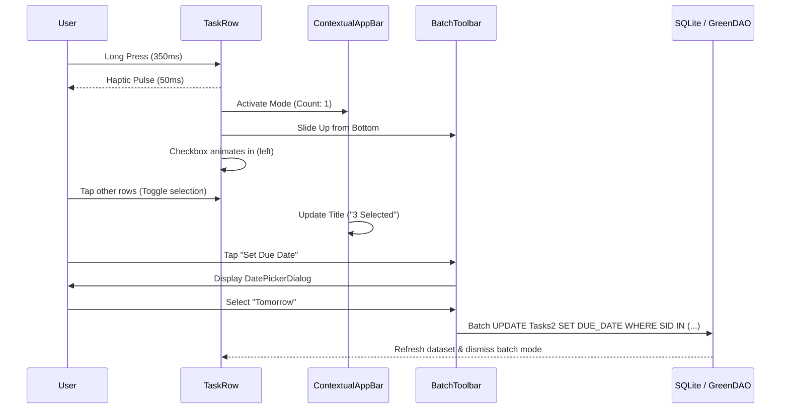

# Interaction and Micro-Behavior Specifications

## 1. Overview of Micro-Interaction Principles

TickTick’s user experience relies heavily on tactile feedback, fluid swipe gestures, direct manipulation (drag-and-drop), and context-sensitive input parsing. This document specifies the exact micro-interactions, trigger thresholds, visual transitions, physics behavior, and haptic feedback profiles discovered in `com.ticktick.task`.

---

## 2. Task Row Swipe Gesture System

### 2.1 Architecture and Trigger Thresholds
The task item swipe mechanism is implemented via a custom touch listener extending Android's `ItemTouchHelper.SimpleCallback` and `OnTouchListener`.

```
|<------------------- Left Swipe -------------------|--- Idle ---|------------------- Right Swipe ------------------->|
| [Long Swipe Threshold: > 45%] | [Short Swipe: 15-45%] |  0% Offset | [Short Swipe: 15-45%] | [Long Swipe Threshold: > 45%] |
| Action: Delete / Won't Do    | Action: Due Date      |  Item Card | Action: Complete      | Action: Priority / Pin        |
```

* **Deadzone (0% – 14%)**: Horizontal swipe delta is ignored to prevent accidental triggers during vertical scrolling.
* **Short Swipe Zone (15% – 45% screen width)**:
  * Icon scales from `0.6x` to `1.0x` opacity and scale.
  * Background color transitions with subtle alpha blending.
  * Releasing in this zone fires the **Short Swipe Action**.
* **Long Swipe Threshold (> 45% screen width)**:
  * At 45% displacement, the device fires a discrete haptic click (`HapticFeedbackConstants.KEYBOARD_TAP`).
  * The primary icon shrinks or transitions to the secondary action icon.
  * Releasing past 45% fires the **Long Swipe Action**.
* **Abort Animation**: If released below the 15% threshold, the item animates back to `translateX = 0` using a standard decelerate interpolator (`duration = 200ms`).

### 2.2 Configurable Swipe Actions
From `preference_custom_swipe.xml` and `CustomSwipePreference`, the user can configure 4 independent gesture slots:
1. **Left Short Swipe** (Default: `Due Date`)
2. **Left Long Swipe** (Default: `None` / `Delete`)
3. **Right Short Swipe** (Default: `Complete`)
4. **Right Long Swipe** (Default: `Priority` / `Won't Do`)

#### Available Swipe Action Catalog:
| Action Identifier | Display String | Visual Icon & Color | Execution Behavior |
| :--- | :--- | :--- | :--- |
| `COMPLETE` | `Complete` | Checkmark (`#4CAF50` Green) | Marks task status `COMPLETED (2)`. Plays checkmark draw animation, strikes through text, pauses 400ms, and collapses row with slide-out animation. |
| `DUE_DATE` | `Due Date` | Calendar Clock (`#2196F3` Blue) | Instantly summons `dialog_date_picker.xml` anchored over the row without opening the full task detail screen. |
| `PRIORITY` | `Priority` | Flag Icon (`#FF9800` Orange) | Opens a 4-item priority popup (High / Medium / Low / None). Selecting a flag updates `Tasks2.PRIORITY` with ripple effect. |
| `WONT_DO` | `Won't Do` | Circle-Slash (`#9C27B0` Purple) | Marks task `STATUS = 3` (Won't Do). Moves item into the completed/won't do section with dimmed italic typography. |
| `PIN_TASK` | `Pin to Top` | Pushpin (`#00BCD4` Teal) | Sets `Tasks2.PIN = 1`. Vibrates and smoothly moves the item to the top of its respective group above unpinned tasks. |
| `MOVE_TO_PROJECT` | `Move` | Folder Icon (`#795548` Brown) | Opens list selector bottom sheet allowing instant relocation of task without opening details. |
| `START_POMO` | `Start Focus` | Tomato / Clock (`#E91E63` Pink) | Launches `PomodoroActivity` immediately bound to the selected task SID. |
| `DELETE` | `Delete` | Trash Can (`#F44336` Red) | Slides item off-screen to the left; displays a bottom `Snackbar` with "Task deleted" and an "UNDO" action button (duration: 3500ms). |
| `NONE` | `None` | (No icon, swipe blocked) | Gesture is inert in that direction. |

---

## 3. Direct Manipulation & Drag-and-Drop System

### 3.1 Task List Reordering
* **Activation**: Only available when the active List Sort Mode is set to **Custom Sorting** (`sortType = 0`).
* **Handle vs. Long-Press**: Users can drag using the vertical reorder grip handle (`ic_drag_handle`) or by holding a row for 300ms until elevation increases from `0dp` to `6dp` with a drop shadow.
* **Auto-Scroll Boundary**: When dragging an item within 48dp of the top or bottom viewport edge, the `RecyclerView` auto-scrolls with velocity proportional to edge proximity (`50px/s` to `300px/s`).
* **Section Traversing**: If dragged between section dividers (e.g. from "Tomorrow" into "Today"), the task automatically adopts the destination section’s date attributes upon release.

### 3.2 Kanban Board Column Shuffling
* **Horizontal Paging**: Horizontal `ViewPager2` or nested horizontal `RecyclerView`.
* **Card Lift**: Dragging lifts the task card, applying a slight rotational tilt (1.5 degrees clockwise).
* **Column Drop**: Dropping into a target column triggers an update to `Tasks2.COLUMN_ID` and triggers a database transaction updating the sibling `SORT_ORDER` values.

### 3.3 Eisenhower Matrix Drag Relocation
* Dragging an item from any quadrant (e.g. Quadrant 1: Urgent & Important) and dropping into another quadrant (e.g. Quadrant 2: Not Urgent & Important) dynamically updates:
  * `Tasks2.PRIORITY` (High vs. Medium/Low).
  * `Tasks2.DUE_DATE` (Clears or adjusts based on target quadrant conditions).

### 3.4 Calendar Drag-to-Schedule
* In Calendar Day / 3-Day / Week views:
  * An expandable bottom drawer ("Unscheduled Tasks") holds tasks without due times.
  * Dragging a chip from the tray onto the 24-hour vertical timeline snaps to 15-minute or 30-minute grid increments (`snapToMinutes = 15`).
  * Dropping writes `START_TIME` and `DUE_DATE` to `Tasks2`.
  * **Duration Resize**: Dragging the bottom anchor handle of a calendar event block stretches its time block, updating duration in increments of 15 minutes.

---

## 4. Multi-Select & Batch Operation Micro-Behaviors



---

## 5. Habit Tracking Micro-Interactions

### 5.1 One-Tap Check-In Ring
* **Visual Structure**: Circular progress widget (`HabitCircleProgressView`) rendering an outer stroke ring around a category icon.
* **Tap Event**:
  * Tap triggers an animated sweep angle from `currentProgress` to `targetProgress` over 350ms with an elastic overshoot interpolator.
  * When target is met (100%), the icon morphs into a flame icon accompanied by a radial particle burst.
  * Audio chime plays (`habit_complete.ogg`).
  * Current streak counter increments with a vertical flip counter animation.
* **Long Press on Habit Card**:
  * Summons quantitative input sheet (`activity_habit_record.xml`) allowing logging of fractional amounts (e.g., 250ml / 2000ml) or appending a check-in journal entry and photo attachment.

---

## 6. Focus & Pomodoro Hardware Interactions

### 6.1 Rotary Dial Physics
* The Pomodoro timer interface features a rotary circular slider (`PomoDialView`).
* Dragging along the circumference calculates angle $\theta = \arctan2(y - y_0, x - x_0)$ relative to dial center.
* Angular increments of $6^\circ$ correspond to 1 minute, with discrete tactile feedback generated at each minute tick.

### 6.2 Flip-to-Focus (Sensor Event Listener)
* TickTick registers an Android `SensorEventListener` on `Sensor.TYPE_ACCELEROMETER`.
* **Trigger Condition**:
  * Phone is resting horizontally on flat surface ($Z \approx -9.8 \text{ m/s}^2$, $X \approx 0$, $Y \approx 0$).
  * Screen orientation is facedown.
* **Behavior**:
  * Device vibrates for 100ms.
  * Audio prompt plays subtle click.
  * Focus countdown timer commences automatically.
  * Proximity sensor ensures phone is covered or resting on a desk surface.

### 6.3 OLED Burn-In Prevention Micro-Shift
* When Focus Mode is displayed in Fullscreen Night/OLED mode:
  * A periodic timer fires every 60 seconds.
  * The digital time coordinates are offset by `dX = (rand() % 6) - 3` and `dY = (rand() % 6) - 3` pixels.
  * Prevents pixel static burn-in on AMOLED screens while maintaining perfect legibility.

### 6.4 PiP (Picture-in-Picture) & Floating Timer Widget
* When app transitions to background during an active Pomodoro:
  * If permission `SYSTEM_ALERT_WINDOW` is granted, launches `FloatingPomoService`.
  * Renders a 48x48dp circular overlay displaying remaining minutes.
  * Can be freely dragged across the screen edge and docked/snapped to left or right screen border.
  * Tapping the floating ball brings `PomodoroActivity` back to the foreground.

---

## 7. Natural Language Processing (NLP) Input Micro-Interactions

### 7.1 Real-Time Chip Tokenization
Implemented inside `QuickAddEditText` via a custom `TextWatcher`:
1. As the user types characters, regex tokenizers scan for temporal and priority expressions:
   * Dates: "tomorrow", "next monday", "at 5pm", "dec 25".
   * Priority: `!1` (High), `!2` (Medium), `!3` (Low).
   * Project tag: `~Work`, `~Personal`.
   * Tag: `#Urgent`, `#Finance`.
2. When a valid token is recognized:
   * The plain text substring is replaced with a custom `ReplacementSpan` / `ChipSpan`.
   * The chip renders a rounded rectangle with icon + parsed date/time string.
3. **Backspace Handling**:
   * If the cursor is positioned immediately after a chip span and the user presses backspace, the chip is un-spanned and converted back into editable plain text, allowing effortless typo correction.
4. **Remove Text on Completion Setting**:
   * A user setting (`prefkey_smart_recognition_remove_text`) controls whether the recognized temporal keywords are stripped from the saved title or preserved in the task body.

---

## 8. Keyboard & IME Inset Management

* **Auto-Focus Behavior**: Launching `QuickAddBottomSheet` immediately requests keyboard focus (`showSoftInput`) with zero perceptible delay.
* **Window Insets (`WindowInsetsCompat`)**:
  * Modals listen to `ime()` and `systemBars()` insets.
  * When the soft keyboard expands, the Quick Add action bar (priority, date, tags, mic) elevates directly on top of the keyboard surface without clipping list content.
* **IME Actions**:
  * Quick Add field uses `imeOptions="actionDone"` or `actionSend`.
  * Tapping the keyboard "Enter/Done" key commits the task, resets the text input, displays a confirmation toast/sound, and keeps the keyboard open for rapid continuous entry.
