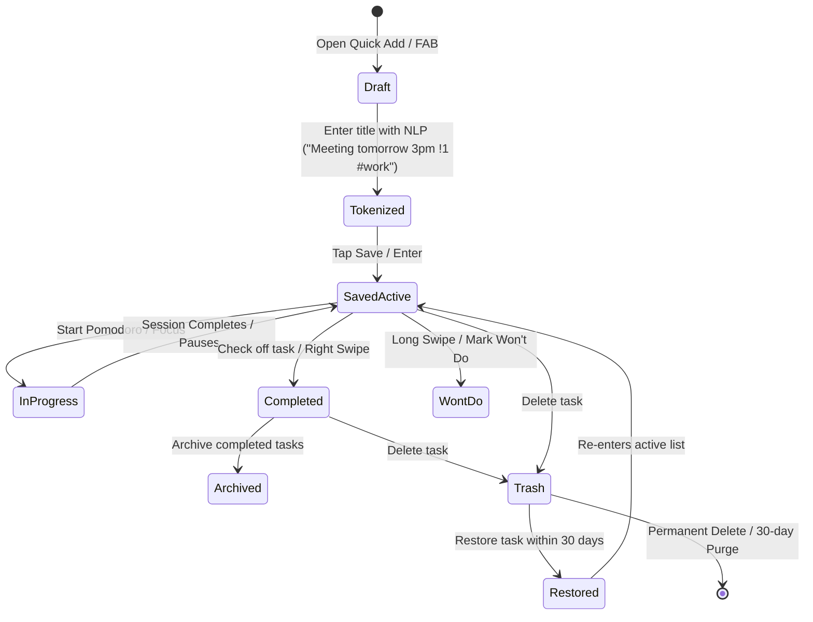
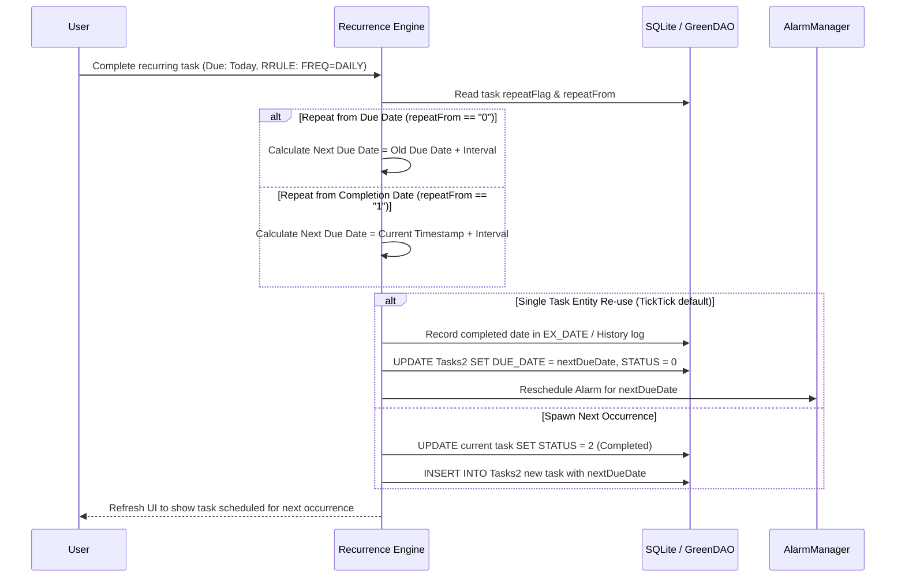
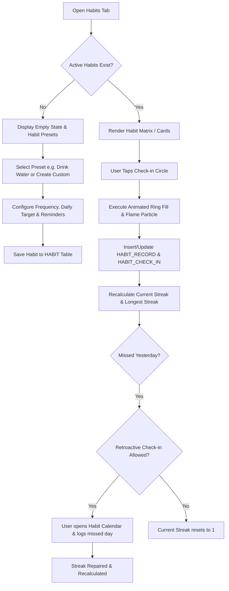
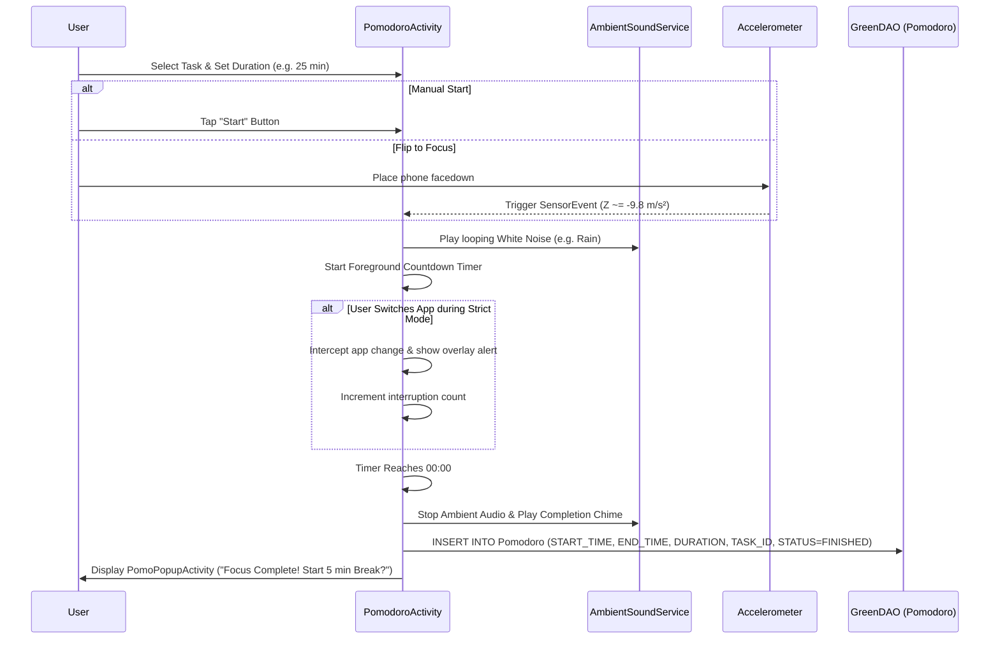
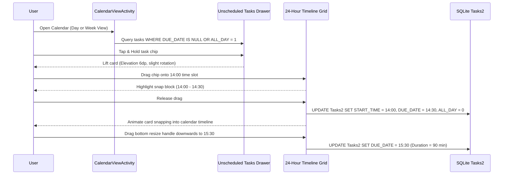
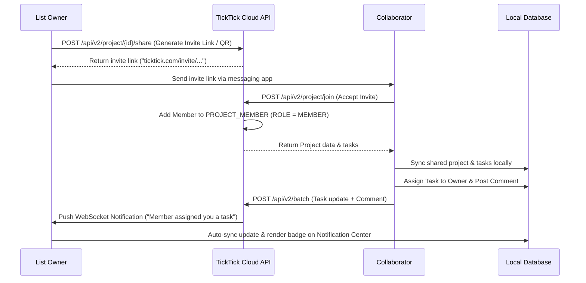

# Complete User Workflows

## 1. Overview

This document specifies the end-to-end user workflows of TickTick, tracing each trigger, user action, internal state transition, data mutations, background operations, and error branches. These workflows serve as the functional blueprint for an independent open-source recreation.

---

## 2. Workflow 1: End-to-End Task Lifecycle



### Detailed Execution Steps:
1. **Creation Trigger**: User taps the Floating Action Button (+) or uses the notification shade quick-add tile.
2. **Input Processing**: As text is typed, the local NLP tokenizer extracts dates, times, priority levels (`!1`, `!2`, `!3`), lists (`~ListName`), and tags (`#TagName`).
3. **Local Commit**:
   * Generates a new UUID `SID`.
   * Inserts row into `Tasks2` SQLite table with `STATUS = 0` (Active).
   * Writes initial record into `Tasks2_SYNCED_JSON` with `SYNC_STATUS = 1` (Pending Upload).
4. **Alarm Scheduling**: If a reminder timestamp is present, calls `AlarmManager.setExactAndAllowWhileIdle()` to schedule the notification via `ReminderReceiver`.
5. **Completion Transition**:
   * Tapping the checkbox triggers the completion animation.
   * `STATUS` updates to `2` (Completed); `COMPLETED_TIME` is set to current epoch milliseconds.
   * If part of a shared list, dispatches an activity notification to list collaborators.
6. **Undo Grace Period**: A bottom `Snackbar` appears for 3.5 seconds. Tapping "Undo" reverts `STATUS` to `0` and cancels deletion/completion flags.

---

## 3. Workflow 2: Recurring Task Recurrence Engine



### Edge Cases in Recurrence:
* **Skipping an Occurrence**: User selects "Skip this occurrence". The engine appends the skipped date to the task's `EX_DATE` string in ISO-8601 format and advances `DUE_DATE` without modifying task completion counters.
* **Editing a Recurring Task**: When modifying due date, priority, or title, a dialog prompts:
  1. *This occurrence only*: Clones current task, appends current date to parent's `EX_DATE`, and applies edits to the cloned standalone instance.
  2. *All future occurrences*: Updates the parent recurring task definition; updates `RRULE` starting from current date.
* **Chinese Lunar Calendar Recurrence**: For birthdays and lunar holidays, the engine maps Gregorian dates to the Chinese Lunar Calendar table, advancing recurrence based on lunar month and leap month cycles (`REPEAT_FLAG = "LUNAR"`).

---

## 4. Workflow 3: Habit Tracking & Streak Management



### Streak Computation Rules:
* **Daily Frequency**: Streak increments if a valid `HABIT_CHECK_IN` exists for consecutive days $T$ and $T-1$.
* **Specific Days of Week (e.g. Mon, Wed, Fri)**: The streak counter does not break on unselected days (Tue, Thu, Sat, Sun). The chain is evaluated strictly against scheduled active days.
* **Target Metric Habits**: For quantitative habits (e.g. 2000 ml water), partial check-ins record entries in `HABIT_CHECK_IN`. The habit is marked achieved for the day only when $\sum \text{value} \ge \text{targetValue}$.

---

## 5. Workflow 4: Focus & Pomodoro Cycle



---

## 6. Workflow 5: Calendar Drag-to-Schedule



---

## 7. Workflow 6: Shared List Collaboration



---

## 8. Workflow 7: Offline-to-Online Synchronization & Conflict Resolution

```mermaid
sequenceDiagram
    participant Client as TickTick Client (Offline)
    participant LocalDB as SQLite (GreenDAO)
    participant SyncMgr as SyncManager
    participant Server as TickTick REST API

    Note over Client: User edits task while disconnected
    Client->>LocalDB: UPDATE Tasks2 SET TITLE = "Updated Offline", ETAG = oldEtag
    Client->>LocalDB: INSERT INTO Tasks2_SYNCED_JSON (CHANGE_TYPE = UPDATE, SYNC_STATUS = 1)
    
    Note over Client: Device regains Internet connectivity
    SyncMgr->>SyncMgr: NetworkCallback.onAvailable() fired
    SyncMgr->>LocalDB: Query all rows WHERE SYNC_STATUS = 1
    SyncMgr->>Server: POST /api/v2/batch/check (Upload dirty entities + Checkpoint ID)
    
    alt No Conflict (Server ETag matches client oldEtag)
        Server->>Server: Apply update to master database
        Server-->>SyncMgr: 200 OK (New Checkpoint ID, New ETag)
        SyncMgr->>LocalDB: UPDATE Tasks2 SET ETAG = newEtag; DELETE FROM Tasks2_SYNCED_JSON
    else Conflict Detected (Server ETag modified by another client)
        Server-->>SyncMgr: 409 Conflict / Return Server Version
        alt Last-Write-Wins (LWW) Strategy
            SyncMgr->>SyncMgr: Compare client updateTime vs server updateTime
            SyncMgr->>LocalDB: Overwrite with latest timestamp version
        else Three-Way Merge (for Checklists / Notes)
            SyncMgr->>SyncMgr: Merge checklist items by item SID
            SyncMgr->>LocalDB: Save merged state & upload reconciled record
        end
    end
```
