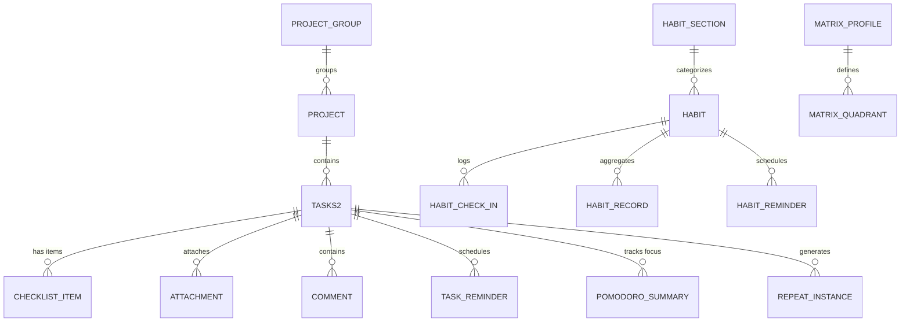

# TickTick Data Architecture & Database Blueprint

**Project**: TickTick Functional Research  
**Document**: `research/08_DATA_ARCHITECTURE.md`  
**Target Package**: `com.ticktick.task`  
**Evidence Standard**: [CODE-CONFIRMED] via REA JADX Headless decompilation and raw DEX SQLite table extracts.  
**Schema Artifact**: `evidence/code_references/schema.sql` (98 Discovered SQLite Tables)  

---

## 1. Architectural Overview

TickTick employs a **local-first, multi-tier persistence model** centered on an embedded SQLite database managed via an ORM layer (primarily **GreenDAO** supplemented by **Room** for multi-instance invalidation and **SQLDelight** for reactive queries).



### Key Persistence Tiers
1. **Local SQLite Store (`Tasks2`, `PROJECT`, `HABIT`, etc.)**:
   - Master persistent repository containing local primary keys (`_id INTEGER PRIMARY KEY AUTOINCREMENT`) and global synchronization keys (`SID TEXT`, `USER_ID TEXT`).
2. **Synchronization Journal (`*_SYNCED_JSON`, `SYNC_STATUS`)**:
   - Caches change vectors, server ETags, and pending mutation payloads for bidirectional cloud synchronization.
3. **Display & Order Indices (`TASK_SORT_ORDER_IN_*`)**:
   - Normalized manual ordering tables that isolate user drag-and-drop sort preferences from the primary task schema.
4. **SharedPreferences & DataStore**:
   - Stores fast UI toggle states, onboarding flags, active theme selections, and cached user credentials.

---

## 2. Core Entities & Database Schemas

### 2.1 The Master Task Entity (`Tasks2`)
The central entity representing a task, note, or reminder:

```sql
CREATE TABLE IF NOT EXISTS "Tasks2" (
    "_id" INTEGER PRIMARY KEY AUTOINCREMENT,
    "SID" TEXT,                             -- Globally unique server identifier
    "USER_ID" TEXT,                         -- Account owner identifier
    "PROJECT_ID" INTEGER,                   -- Local foreign key to PROJECT._id
    "PROJECT_SID" TEXT,                     -- Global identifier of parent list
    "TITLE" TEXT,                           -- Task title
    "CONTENT" TEXT,                         -- Primary task body / checklist payload
    "DESC" TEXT,                            -- Rich notes or additional description
    "KIND" TEXT,                            -- Type discriminator: "TEXT", "CHECKLIST", "NOTE"
    "TASK_TYPE" INTEGER,                    -- Task type: 0=Task, 1=Note, 2=Checklist
    "TASK_STATUS" INTEGER NOT NULL,         -- 0=Normal/Active, 2=Completed
    "PRIORITY" INTEGER,                     -- 0=None, 1=Low (Blue), 3=Medium (Orange), 5=High (Red)
    "PROGRESS" INTEGER,                     -- Progress percentage (0-100)
    "DUE_DATE" INTEGER,                     -- Scheduled due date/time (Unix timestamp ms)
    "START_DATE" INTEGER,                   -- Task start date/time (Unix timestamp ms)
    "SERVER_DUE_DATE" INTEGER,              -- Synchronized server due date timestamp
    "SERVER_START_DATE" INTEGER,            -- Synchronized server start date timestamp
    "isAllDay" INTEGER NOT NULL,            -- 1=All-day task, 0=Timed task
    "IS_FLOATING" INTEGER NOT NULL,         -- 1=Floating task (moves to Today when overdue)
    "TIME_ZONE" TEXT,                       -- IANA timezone string (e.g. "America/New_York")
    "REMINDER" TEXT,                        -- Primary reminder trigger rule string
    "reminder_time" INTEGER,                -- Calculated reminder epoch timestamp
    "REPEAT_REMINDER_TIME" INTEGER,         -- Offset for advance early reminder
    "RepeatFirstDate" INTEGER,              -- Timestamp of original seed recurrence
    "repeatFlag" TEXT,                      -- iCalendar RRULE format recurrence string
    "repeatFrom" TEXT,                      -- "0"=From Due Date, "1"=From Completion Date
    "repeatTaskId" TEXT,                    -- Recurrence chain master task ID
    "EX_DATE" TEXT,                         -- Excluded dates for recurrence exceptions
    "PARENT_SID" TEXT,                      -- Parent task ID for nested subtasks
    "CHILD_IDS" TEXT,                       -- JSON array of subtask IDs
    "COLLAPSED" INTEGER NOT NULL,           -- Subtask list UI collapse state (0/1)
    "COLUMN_ID" TEXT,                       -- Kanban board column SID
    "COLUMN_UID" INTEGER,                   -- Kanban board column local ID
    "SORT_ORDER" INTEGER,                   -- Relative sort index within list
    "PINNED_TIME" INTEGER,                  -- Timestamp when pinned to top of list
    "LOCAL_UNPINNED" INTEGER NOT NULL,      -- Flag overriding remote pin state
    "TAGS" TEXT,                            -- Comma-delimited or JSON array of tag names
    "HAS_ATTACHMENT" INTEGER NOT NULL,      -- Flag for fast attachment badge rendering
    "IMG_MODE" INTEGER,                     -- Thumbnail render mode: 0=Hidden, 1=Card, 2=Full
    "COMMENT_COUNT" INTEGER NOT NULL,       -- Count of collaborative comments
    "CREATOR" INTEGER NOT NULL,             -- User ID of task author
    "ASSIGNEE" INTEGER NOT NULL,            -- User ID of assigned team collaborator
    "COMPLETED_USER_ID" INTEGER NOT NULL,   -- User ID of user who checked the task done
    "COMPLETED_TIME" INTEGER,               -- Completion timestamp
    "ATTEND_ID" TEXT,                       -- Link to associated calendar event
    "ANNOYING_ALERT" INTEGER,               -- Persistent alarm nag interval mode
    "NOTION_BLOCK" TEXT,                    -- Notion integration block sync reference
    "CURRENT_TASK_HAS_RECOGNIZED" INTEGER NOT NULL, -- Smart NLP parsing processed flag
    "ETAG" TEXT,                            -- HTTP entity tag for conflict detection
    "_deleted" INTEGER,                     -- 0=Active, 1=In Trash, 2=Permanently purged
    "_status" INTEGER,                      -- Local sync dirty flag (0=Synced, 1=New, 2=Updated)
    "createdTime" INTEGER,                  -- Local creation timestamp
    "modifiedTime" INTEGER                  -- Local last modification timestamp
);
```

### 2.2 List / Project Entity (`PROJECT`)
Represents user task lists and shared project folders:

```sql
CREATE TABLE IF NOT EXISTS "PROJECT" (
    "_id" INTEGER PRIMARY KEY AUTOINCREMENT,
    "SID" TEXT,                             -- Global server ID
    "USER_ID" TEXT,                         -- Account owner ID
    "NAME" TEXT NOT NULL,                   -- List title
    "COLOR" TEXT,                           -- List accent color (Hex string or palette index)
    "BACKGROUND_INFO" TEXT,                 -- Custom list background (image URL / gradient)
    "PROJECT_GROUP_SID" TEXT,               -- Parent folder SID (if grouped)
    "SORT_ORDER" INTEGER,                   -- Position in left sidebar navigation
    "SORT_TYPE" INTEGER,                    -- Sort attribute: Title, Date, Priority, Custom
    "ORDER_BY" INTEGER,                     -- Sort direction: Ascending, Descending
    "GROUP_BY" INTEGER,                     -- Grouping mode: Date, Priority, Tag, Assignee
    "TIMELINE_SORT_TYPE" INTEGER,           -- Sort preference for Timeline view
    "TIMELINE_ORDER_BY" INTEGER,            -- Order direction for Timeline view
    "TIMELINE_GROUP_BY" INTEGER,            -- Grouping preference for Timeline view
    "VIEW_MODE" TEXT,                       -- Default view: "list", "kanban", "timeline"
    "DEFAULT_COLUMN" TEXT,                  -- Default Kanban column SID for new tasks
    "CLOSED" INTEGER NOT NULL,              -- 1=Archived list, 0=Active
    "MUTED" INTEGER NOT NULL,               -- 1=Mute list notifications, 0=Active
    "SHOW_IN_ALL" INTEGER NOT NULL,         -- 1=Include tasks in "All" / "Today", 0=Hide
    "IS_OWNER" INTEGER NOT NULL,            -- 1=Current user created list, 0=Shared member
    "PERMISSION" TEXT,                      -- Collaborator rights: "read", "write", "admin"
    "TEAM_ID" TEXT,                         -- Team ID if shared in organizational space
    "OPEN_TO_TEAM" INTEGER NOT NULL,        -- 1=Visible to all team members
    "TEAM_MEMBER_PERMISSION" TEXT,          -- Default permission granted to team
    "NOTIFICATION_OPTIONS" TEXT,            -- Notification policy JSON (e.g. notify on assignment)
    "REMINDER_TYPE" INTEGER,                -- Default reminder policy for new tasks in list
    "DEFAULT_PROJECT" INTEGER NOT NULL,     -- 1=Special "Inbox" list, 0=User created list
    "ETAG" TEXT,                            -- Sync conflict tracking tag
    "_deleted" INTEGER,                     -- Soft deletion flag
    "_status" INTEGER,                      -- Local dirty state
    "createdTime" INTEGER,                  -- Creation timestamp
    "modifiedTime" INTEGER                  -- Last update timestamp
);
```

### 2.3 Checklist Item / Subtask Entity (`checklist_item`)
Represents atomic checklist items contained within a task:

```sql
CREATE TABLE IF NOT EXISTS "checklist_item" (
    "_id" INTEGER PRIMARY KEY AUTOINCREMENT,
    "ID" TEXT,                              -- Subtask unique ID
    "TASK_ID" INTEGER,                      -- Foreign key referencing Tasks2._id
    "TASK_SID" TEXT,                        -- Global Task SID
    "TITLE" TEXT NOT NULL,                  -- Subtask text
    "STATUS" INTEGER NOT NULL,              -- 0=Unchecked, 1=Completed
    "SORT_ORDER" INTEGER,                   -- Relative subtask display order
    "START_DATE" INTEGER,                   -- Subtask specific start date
    "DUE_DATE" INTEGER,                     -- Subtask specific due date
    "IS_ALL_DAY" INTEGER NOT NULL,          -- Subtask all-day flag
    "TIME_ZONE" TEXT,                       -- Subtask timezone
    "REMINDER" TEXT,                        -- Subtask specific reminder rule
    "REMINDER_TIME" INTEGER,                -- Calculated subtask reminder epoch
    "COMPLETED_TIME" INTEGER,               -- Subtask completion timestamp
    "COMPLETED_USER_ID" INTEGER,            -- User who completed the subtask
    "_deleted" INTEGER,                     -- Deletion flag
    "createdTime" INTEGER,                  -- Creation timestamp
    "modifiedTime" INTEGER                  -- Modification timestamp
);
```

### 2.4 Habit Tracking Schema (`HABIT`, `HABIT_CHECK_IN`, `HABIT_RECORD`)
Tracks recurring daily and weekly habits, targets, and streaks:

```sql
CREATE TABLE IF NOT EXISTS "HABIT" (
    "_id" INTEGER PRIMARY KEY AUTOINCREMENT,
    "SID" TEXT,                             -- Global habit identifier
    "USER_ID" TEXT,                         -- Owner identifier
    "NAME" TEXT NOT NULL,                   -- Habit title (e.g., "Drink Water")
    "ICON" TEXT,                            -- Icon identifier or vector resource
    "COLOR" TEXT,                           -- Habit color accent
    "TYPE" INTEGER NOT NULL,                -- 0=Simple check-in, 1=Numeric goal with unit
    "TARGET" REAL NOT NULL,                 -- Numerical target value (e.g. 2000)
    "UNIT" TEXT,                            -- Target unit string (e.g. "ml", "pages", "min")
    "FREQUENCY" TEXT NOT NULL,              -- Recurrence schedule (Daily, Days of Week, Interval)
    "DAYS_OF_WEEK" INTEGER,                 -- Bitmask or JSON of active weekdays
    "SECTION_SID" TEXT,                     -- Time-of-day section: "Morning", "Afternoon", "Evening"
    "SORT_ORDER" INTEGER,                   -- Position within habit list
    "ENCOURAGEMENT" TEXT,                   -- Custom motivational quote displayed on check-in
    "REMINDERS" TEXT,                       -- JSON array of habit reminder times
    "START_DATE" INTEGER NOT NULL,          -- Habit start tracking date
    "END_DATE" INTEGER,                     -- Optional target end date
    "ARCHIVED" INTEGER NOT NULL,            -- 1=Archived/Paused habit, 0=Active
    "STATUS" INTEGER NOT NULL,              -- Sync state
    "_deleted" INTEGER                      -- Deletion flag
);

CREATE TABLE IF NOT EXISTS "HABIT_CHECK_IN" (
    "_id" INTEGER PRIMARY KEY AUTOINCREMENT,
    "HABIT_SID" TEXT NOT NULL,              -- Foreign key to HABIT.SID
    "CHECK_IN_DATE" INTEGER NOT NULL,       -- Epoch day (YYYY-MM-DD normalized to timestamp)
    "VALUE" REAL NOT NULL,                  -- Logged progress (e.g. 1.0 for boolean, 500.0 for numeric)
    "LOG_THOUGHTS" TEXT,                    -- Optional journal note or reflection
    "CHECK_IN_TIMESTAMP" INTEGER NOT NULL   -- Exact wall-clock completion timestamp
);

CREATE TABLE IF NOT EXISTS "HABIT_RECORD" (
    "_id" INTEGER PRIMARY KEY AUTOINCREMENT,
    "HABIT_SID" TEXT NOT NULL,              -- Foreign key to HABIT.SID
    "CURRENT_STREAK" INTEGER NOT NULL,      -- Current consecutive days streak
    "BEST_STREAK" INTEGER NOT NULL,         -- Historical best consecutive days streak
    "TOTAL_CHECK_INS" INTEGER NOT NULL,     -- Lifetime total check-ins count
    "MONTHLY_RATE" REAL NOT NULL            -- Current month completion percentage (0.0 - 1.0)
);
```

### 2.5 Focus & Pomodoro Schema (`Pomodoro`, `PomodoroConfig`, `Timer`)
Manages Pomodoro sessions, countdown timers, stopwatch logs, and white noise:

```sql
CREATE TABLE IF NOT EXISTS "Pomodoro" (
    "_id" INTEGER PRIMARY KEY AUTOINCREMENT,
    "SID" TEXT,                             -- Global session ID
    "USER_ID" TEXT,                         -- User ID
    "TASK_SID" TEXT,                        -- Associated Task SID (optional)
    "TASK_TITLE" TEXT,                      -- Snapshot of task title at focus time
    "HABIT_SID" TEXT,                       -- Associated Habit SID (if focus was habit-linked)
    "START_TIME" INTEGER NOT NULL,          -- Session start timestamp
    "END_TIME" INTEGER NOT NULL,            -- Session end timestamp
    "DURATION" INTEGER NOT NULL,            -- Completed focus duration in seconds
    "MODE" INTEGER NOT NULL,                -- 0=Pomodoro Timer, 1=Stopwatch
    "STATUS" INTEGER NOT NULL,              -- 0=Completed, 1=Interrupted/Abandoned
    "WHITE_NOISE" TEXT,                     -- Ambient sound used (e.g. "rain", "cafe", "waves")
    "STRICT_MODE" INTEGER NOT NULL          -- 1=Strict mode was enforced, 0=Standard
);

CREATE TABLE IF NOT EXISTS "PomodoroConfig" (
    "_id" INTEGER PRIMARY KEY AUTOINCREMENT,
    "POMO_DURATION" INTEGER NOT NULL,       -- Work session duration (default: 25 mins = 1500s)
    "SHORT_BREAK" INTEGER NOT NULL,         -- Short break duration (default: 5 mins = 300s)
    "LONG_BREAK" INTEGER NOT NULL,          -- Long break duration (default: 15 mins = 900s)
    "LONG_BREAK_INTERVAL" INTEGER NOT NULL, -- Pomo cycles before long break (default: 4)
    "AUTO_START_BREAK" INTEGER NOT NULL,    -- Auto-start break on pomo completion (0/1)
    "AUTO_START_POMO" INTEGER NOT NULL,     -- Auto-start next pomo on break completion (0/1)
    "DAILY_GOAL" INTEGER NOT NULL           -- Daily target completed pomodoro count (e.g. 8)
);
```

### 2.6 Eisenhower Matrix Schema (`MATRIX_PROFILE`, `MATRIX_QUADRANT`)
Powers the 4-quadrant urgency vs. importance prioritization matrix:

```sql
CREATE TABLE IF NOT EXISTS "MATRIX_PROFILE" (
    "_id" INTEGER PRIMARY KEY AUTOINCREMENT,
    "SID" TEXT NOT NULL,                    -- Matrix profile ID
    "NAME" TEXT NOT NULL,                   -- View name (e.g. "Work Matrix", "Default")
    "IS_DEFAULT" INTEGER NOT NULL           -- 1=Default system matrix view
);

CREATE TABLE IF NOT EXISTS "MATRIX_QUADRANT" (
    "_id" INTEGER PRIMARY KEY AUTOINCREMENT,
    "PROFILE_SID" TEXT NOT NULL,            -- Reference to MATRIX_PROFILE.SID
    "QUADRANT_INDEX" INTEGER NOT NULL,      -- 0=Do First, 1=Schedule, 2=Delegate, 3=Don't Do
    "TITLE" TEXT NOT NULL,                  -- Display title (customizable)
    "FILTER_RULE" TEXT NOT NULL             -- Criteria JSON (e.g. {"priority": [5], "due": "today"})
);
```

### 2.7 Tag & Kanban Column Schema (`COLUMN`, `TAG_SYNCED_JSON`)
Organizes workflows into tags and visual Kanban boards:

```sql
CREATE TABLE IF NOT EXISTS "COLUMN" (
    "_id" INTEGER PRIMARY KEY AUTOINCREMENT,
    "SID" TEXT NOT NULL,                    -- Column global ID
    "PROJECT_SID" TEXT NOT NULL,            -- Parent List SID
    "NAME" TEXT NOT NULL,                   -- Column header (e.g. "To Do", "In Progress", "Done")
    "SORT_ORDER" INTEGER NOT NULL,          -- Horizontal position order
    "_deleted" INTEGER NOT NULL             -- Deletion flag
);
```

---

## 3. Data Relationships & Referential Integrity

```
PROJECT_GROUP (Folders)
  └── PROJECT (Lists)
        ├── COLUMN (Kanban Columns)
        └── TASKS2 (Tasks)
              ├── checklist_item (Subtasks)
              ├── ATTACHMENT (Files, Audio, Images)
              ├── COMMENT (Collaborative Discussion)
              ├── TaskReminder (Alarms & Notifications)
              ├── Pomodoro (Focus session history)
              └── RepeatInstance (Future recurrence dates)
```

1. **Cascading Soft Deletes**: When a `PROJECT` is deleted (`_deleted = 1`), all associated `Tasks2` entries with matching `PROJECT_SID` inherit `_deleted = 1` during the local cleanup sweep.
2. **Subtask Hierarchy**: Subtasks are supported both as flat checklist items (`checklist_item` referencing `TASK_SID`) and as full nested subtasks (`Tasks2` referencing `PARENT_SID` and populated in `CHILD_IDS`).
3. **Recurrence Series**: Repeating tasks store their definition in `Tasks2.repeatFlag`. When an occurrence is checked completed, the completed instance is logged with `COMPLETED_TIME`, and a new active `Tasks2` instance is synthesized with `repeatTaskId` linked to the master seed.
