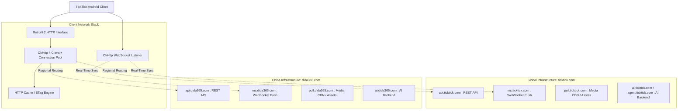

# Network and Backend Architecture

## 1. Network Stack Overview

TickTick implements a high-performance, resilient networking layer built on top of **Square OkHttp** and **Retrofit 2**. Communication is conducted over TLS 1.3 with HTTP/2 multiplexing, supplemented by persistent full-duplex **WebSockets** for real-time collaborative synchronization.



---

## 2. Infrastructure & Regional Partitioning

TickTick maintains two completely isolated backend ecosystems determined by the user's registration region and application distribution variant:
1. **Global Ecosystem (`ticktick.com`)**:
   * Master REST API: `https://api.ticktick.com`
   * WebSocket Real-time Push: `wss://ms.ticktick.com/websocket`
   * Static Assets & CDN: `https://pull.ticktick.com`
   * AI & Agent Services: `https://ai.ticktick.com`, `https://agent.ticktick.com`
   * Web App Endpoint: `https://ticktick.com/webapp/`
2. **China Ecosystem (`dida365.com` / 滴答清单)**:
   * Master REST API: `https://api.dida365.com`
   * WebSocket Real-time Push: `wss://ms.dida365.com/websocket`
   * Static Assets & CDN: `https://pull.dida365.com`
   * AI Services: `https://ai.dida365.com`, `https://agent.dida365.com`
   * Web App Endpoint: `https://dida365.com/webapp/`

---

## 3. Authentication & Security Headers

All outgoing requests pass through an `OkHttp Interceptor` that attaches standardized authentication and device telemetry headers:

```http
GET /api/v2/batch/check/1715000000 HTTP/2
Host: api.ticktick.com
Authorization: Bearer <JWT_USER_TOKEN>
X-Device-Id: d41d8cd98f00b204e9800998ecf8427e
User-Agent: TickTick/8.3.0.1 (Android; Google Pixel 8; Android 14; SDK 34)
HL: en_US
Timezone: America/New_York
Accept: application/json
Content-Type: application/json; charset=UTF-8
If-None-Match: "7a8b9c0d1e2f3a4b"
```

### Authentication Mechanisms:
* **Token Storage**: User token is stored in Android `EncryptedSharedPreferences` or private app preferences (`account_token`).
* **Session Refresh**: If an API returns `401 Unauthorized`, the interceptor automatically queues requests, initiates a token refresh via `/api/v2/user/token/refresh`, and replays queued calls upon token renewal.
* **OAuth Integrations**: Direct native OAuth integrations for Google Sign-In, Apple ID (`SignInWithApple`), Microsoft OAuth (`login.microsoftonline.com`), Facebook SDK, and Weibo SDK.
* **Multi-Factor Authentication (MFA)**: Endpoints `/api/v2/user/mfa/code/verify` and `/api/v2/user/sms/phone/bind` enforce two-step SMS or TOTP authenticator app verification.

---

## 4. Master REST API Catalog

The following endpoints were directly extracted from the bytecode string pool in `com.ticktick.task`:

### 4.1 Batch & Delta Synchronization
| HTTP Method & Endpoint | Description | Request / Response Payload |
| :--- | :--- | :--- |
| `GET /api/v2/batch/check/{checkpoint}` | **Core Delta Sync**: Checks for remote changes newer than the client's local checkpoint counter. | Query returns list of modified task SIDs, project SIDs, habit SIDs, and deleted entity IDs. |
| `POST /api/v2/batch/taskProject` | **Atomic Batch Mutate**: Submits multiple task/project creates, updates, and deletes in a single network round-trip. | Body contains `{add: [...], update: [...], delete: [...]}` arrays. |
| `GET /api/v2/sl` | **Smart List Batch**: Fetches definitions and rules for user custom Smart Lists. | Returns JSON array of `MobileSmartProject` configurations. |

### 4.2 Habit Tracking APIs
| HTTP Method & Endpoint | Description | Request / Response Payload |
| :--- | :--- | :--- |
| `GET /api/v2/habitRecords` | Fetches aggregated habit performance history and monthly completion heatmaps. | Returns `{habitRecords: [...]}` with streak metrics and completion counts. |
| `POST /api/v2/habitSections/batch` | Synchronizes user-defined habit categories (Morning/Afternoon/Evening) and display order. | Array of section definitions with `sortOrder` integers. |

### 4.3 Focus & Pomodoro APIs
| HTTP Method & Endpoint | Description | Request / Response Payload |
| :--- | :--- | :--- |
| `GET /api/v2/pomodoro/all` | Retrieves user's complete focus history for statistical aggregation. | Returns array of `Pomodoro` records. |
| `POST /api/v2/pomodoro/task/bind` | Associates a completed focus session with a specific `Tasks2.SID`. | `{pomodoroId: "...", taskId: "..."}` |
| `POST /api/v2/pomodoro/habit/bind` | Associates a focus session with a habit check-in. | `{pomodoroId: "...", habitId: "..."}` |
| `GET /api/v2/timer/statistics/{timerId}/{startDay}/{endDay}/{interval}` | Retrieves aggregated time metrics across days, weeks, or months for chart rendering. | Daily focus duration arrays, interruption counts, and project distributions. |
| `GET /api/v2/pomodoros/timeline` | Retrieves chronological timeline blocks of past focus periods. | Timeline JSON payload. |

### 4.4 Eisenhower Matrix APIs
| HTTP Method & Endpoint | Description | Request / Response Payload |
| :--- | :--- | :--- |
| `GET /api/v2/matrixProfiles` | Retrieves all configured Eisenhower Matrix profiles (Default, Work, Personal). | Array of `MatrixProfile` entities. |
| `POST /api/v2/matrixProfiles/batch` | Creates or updates custom quadrant rule mapping configurations (Pro tier). | Array of updated profile rule sets. |

### 4.5 Calendar & External Integrations
| HTTP Method & Endpoint | Description | Request / Response Payload |
| :--- | :--- | :--- |
| `POST /api/v2/calendar/subscription/{calendarId}/show` | Subscribes to an external `.ics` WebCal feed URL. | `{url: "...", color: "#FF0000", name: "..."}` |
| `POST /api/v2/calendar/{connectId}/bind/project` | Binds an external calendar feed to a specific local project/list. | Binds remote calendar events to task entities. |
| `POST /api/v2/connect/notion` | OAuth handshake and sync mapping for Notion database integration. | Notion auth token exchange. |
| `POST /api/v2/third/telegram/bind/code` | Binds a Telegram bot channel for two-way task creation via chat. | Verification code payload. |

### 4.6 AI & Assistant APIs
| HTTP Method & Endpoint | Description | Request / Response Payload |
| :--- | :--- | :--- |
| `POST /api/v1/conversations` | Dispatches task breakdown prompts or natural language queries to TickTick AI backend. | `{prompt: "Break down Project Launch into steps", taskId: "..."}` |
| `GET /api/v1/token-usage/current` | Queries user's remaining monthly AI quota tokens. | `{usedTokens: 1250, totalLimit: 50000}` |

### 4.7 Billing & Subscription Verification
| HTTP Method & Endpoint | Description | Request / Response Payload |
| :--- | :--- | :--- |
| `POST /api/v2/subscribe/verify/google` | Verifies Google Play In-App Purchase receipt tokens against backend billing servers. | `{purchaseToken: "...", productId: "ticktick_pro_yearly"}` |
| `GET /api/v3/subscribe/free_trial_2w` | Checks user eligibility for 14-day Pro promotional trials. | `{eligible: true, trialDurationDays: 14}` |

---

## 5. WebSocket Real-Time Push Channel

To maintain sub-second multi-device synchronization without polling, TickTick maintains a persistent WebSocket connection via OkHttp:

* **Endpoint**: `wss://ms.ticktick.com/websocket`
* **Heartbeat**: Ping/Pong frame exchanged every 30 seconds.
* **Frame Payload Structure**:
  ```json
  {
    "type": "PUSH_SYNC",
    "checkpoint": 1715001234,
    "entities": ["task", "project"],
    "sourceDevice": "web_chrome_mac"
  }
  ```
* **Client Response**: Upon receiving a `PUSH_SYNC` frame, the client triggers `SyncManager.triggerQuickSync()` to immediately query `/api/v2/batch/check/{checkpoint}`, fetching only the delta changes made by the other device.
