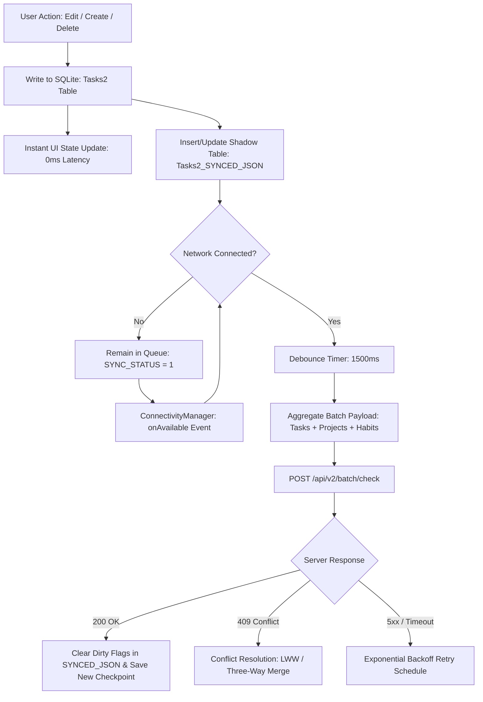

# Offline and Synchronization Architecture

## 1. Local-First Design Philosophy

TickTick is engineered from the ground up as a **Local-First, Offline-Capable Application**. In `com.ticktick.task`:
* **Zero UI Blocking**: Every user action (creating a task, checking off a habit, editing a description, moving a column) writes immediately and synchronously to local SQLite storage via GreenDAO.
* **Optimistic UI Updates**: The user interface immediately reflects the modified state before any network transaction is dispatched.
* **Asynchronous Sync Engine**: A dedicated background pipeline (`SyncManager`) continuously monitors connectivity and synchronizes dirty state with remote cloud endpoints.



---

## 2. Shadow Change-Tracking Tables

To track local mutations without scanning entire database tables, TickTick maintains dedicated shadow change tables for each core entity:

### 2.1 Schema: `Tasks2_SYNCED_JSON`
| Column Name | SQL Type | Purpose & Constraints |
| :--- | :--- | :--- |
| `_id` | `INTEGER PRIMARY KEY AUTOINCREMENT` | Local auto-incrementing ID. |
| `SID` | `TEXT NOT NULL` | Global server UUID of the mutated task entity. |
| `JSON_CONTENT` | `TEXT` | Serialized JSON snapshot of the modified entity. |
| `CHANGE_TYPE` | `INTEGER NOT NULL` | Mutation type: `1` = Create, `2` = Update, `3` = Delete. |
| `SYNC_STATUS` | `INTEGER NOT NULL` | Sync state: `0` = Clean/Synced, `1` = Pending Sync, `2` = Failed / Retrying. |
| `TIMESTAMP` | `INTEGER NOT NULL` | Epoch milliseconds when the local mutation occurred. |
| `RETRY_COUNT` | `INTEGER DEFAULT 0` | Consecutive failure count used for backoff calculations. |

Similar shadow tables exist for `PROJECT_SYNCED_JSON`, `HABIT_SYNCED_JSON`, `HABIT_RECORD_SYNCED_JSON`, and `COLUMN_SYNCED_JSON`.

---

## 3. Network Monitoring & Synchronization Triggers

### 3.1 Network State Observer
TickTick registers an Android `ConnectivityManager.NetworkCallback`:
```java
// Logic represented from SyncNetworkReceiver / ConnectivityManager
NetworkRequest request = new NetworkRequest.Builder()
    .addCapability(NetworkCapabilities.NET_CAPABILITY_INTERNET)
    .build();
connectivityManager.registerNetworkCallback(request, new NetworkCallback() {
    @Override
    public void onAvailable(@NonNull Network network) {
        SyncManager.getInstance().onNetworkRestored();
    }
});
```

### 3.2 Sync Execution Triggers
Synchronization is triggered under six discrete conditions:
1. **Application Lifecycle (`onResume`)**: Every time the app transitions from background to foreground, a lightweight checkpoint check is dispatched.
2. **Connectivity Restoration (`onAvailable`)**: When transitioning from airplane mode / offline to Wi-Fi or cellular data, pending dirty rows are flushed.
3. **User Pull-to-Refresh**: Manual swipe-down on task lists triggers an immediate forced delta sync.
4. **WebSocket Push Signal (`PUSH_SYNC`)**: When another device (e.g. desktop web app) makes an edit, the WebSocket connection delivers a checkpoint frame, triggering an instant delta download.
5. **Debounced Local Mutation**: After a user creates or modifies a task, a 1500ms debounce timer starts. When the timer expires without further keystrokes, changes are batched and uploaded.
6. **WorkManager Periodic Job**: A background worker (`SyncWorker`) runs periodically every 15 to 30 minutes when idle to maintain fresh state.

---

## 4. Conflict Resolution Algorithms

When multiple devices concurrently edit the same entity while offline, TickTick resolves conflicts using deterministic strategies:

### 4.1 Last-Write-Wins (LWW) for Scalar Fields
For scalar properties (`title`, `priority`, `due_date`, `pin`, `status`):
* Each entity maintains a remote `MODIFIED_TIME` timestamp and an `ETAG`.
* If a remote version has `serverModifiedTime > localModifiedTime`, the server version overwrites the local scalar fields.
* If local changes are newer, the local version is pushed and the server updates its master record.

### 4.2 Non-Destructive Set Union for Checklists / Subtasks
For checklist items within a task:
* Each checklist item has its own persistent `item_id` / `SID`.
* When synchronizing conflicting checklist versions:
  * Items deleted on one device are marked deleted (`isDeleted = true`).
  * Newly added items on either device are merged into the checklist array.
  * Check status is reconciled such that `completed = true` takes precedence over `completed = false` if completed after the last known sync.

### 4.3 Conflict Copy Creation for Rich Markdown Notes
When extensive descriptions or markdown notes on the same task are modified concurrently on two devices and cannot be cleanly auto-merged:
* The local modification is saved as the primary task.
* A duplicate conflict task is automatically generated titled:
  `"[Conflict] " + originalTitle + " (" + deviceName + " " + dateString + ")"`
* This guarantees **zero data loss** for long-form notes and task descriptions.

---

## 5. Offline Media & Attachment Caching

* **Image Previews**: Thumbnails and images are cached in the app's internal cache directory using **Glide** with an LRU disk cache limit (default: 250 MB).
* **Deferred Attachment Upload**: If an image or voice memo is attached while offline:
  * The file is stored in local app-specific storage (`files/attachments/{uuid}.jpg`).
  * The attachment record is created with `uploadStatus = PENDING`.
  * When network is restored, `AttachmentUploadWorker` executes a multipart POST to `/api/v1/attachment/upload/...`, updates the remote URL, and marks the attachment clean.
* **Selective Download Preference**: A user setting (`prefkey_upload_download_attachment`) allows users to restrict attachment auto-downloading to Wi-Fi connections only, preventing excessive cellular data usage.
