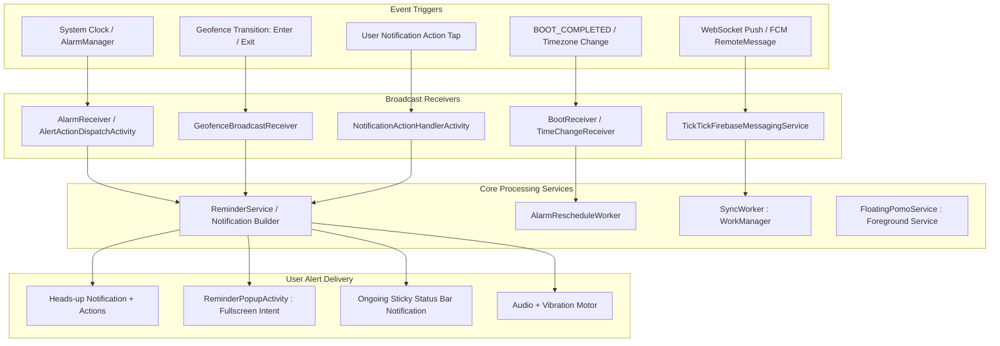

# Notifications and Background Systems

## 1. Background Architecture Overview

To provide reliable task alarms, background synchronization, persistent focus timers, and geofenced alerts across strict Android battery optimization policies (Doze mode, App Standby buckets), TickTick employs a multi-tiered background processing infrastructure:



---

## 2. Alarm Scheduling & Doze Mode Survival

### 2.1 Exact Alarm Scheduling
Because standard background tasks are deferred during Android Doze mode, TickTick utilizes high-precision alarm APIs:
* **Standard Reminders**:
  ```java
  alarmManager.setExactAndAllowWhileIdle(
      AlarmManager.RTC_WAKEUP,
      triggerTimestamp,
      pendingIntent
  );
  ```
* **Annoying Alert / Critical Alarms**:
  Uses `AlarmManager.setAlarmClock()`, which registers a visible alarm clock icon in the Android status bar and provides absolute immunity against Doze mode postponement.

### 2.2 Re-registration on Reboot & Time Alterations
When a device restarts or the user crosses time zones, all active `AlarmManager` registrations are cleared by the Android OS. TickTick intercepts these events via manifest declarations:
* **Intercepted System Broadcasts**:
  * `android.intent.action.BOOT_COMPLETED`
  * `android.intent.action.LOCKED_BOOT_COMPLETED`
  * `android.intent.action.MY_PACKAGE_REPLACED`
  * `android.intent.action.TIME_SET`
  * `android.intent.action.TIMEZONE_CHANGED`
* **Execution Flow (`BootReceiver`)**:
  1. Boot event wakes up `com.ticktick.task.receiver.BootReceiver`.
  2. Queries local SQLite table `TASK_REMINDER` where `TRIGGER_TIME > currentEpochMs`.
  3. Re-schedules each individual alarm with `AlarmManager`.
  4. Reschedules daily morning (08:30) and evening (20:00) summary alerts.

---

## 3. Notification Channels (Android 8.0+ / API 26+)

TickTick registers distinct notification channels to allow granular user control over sound, vibration, and visual prominence:

| Channel ID | Channel Name | Importance Level | Sound & Vibration Profile | Purpose & User Visibility |
| :--- | :--- | :--- | :--- | :--- |
| `channel_task_reminder` | Task Reminders | `IMPORTANCE_HIGH` | Custom Ringtone + Vibrate | Standard scheduled task alerts. Displays heads-up banner on screen. |
| `channel_annoying_alert` | Annoying Alert | `IMPORTANCE_MAX` | Persistent Looping Siren | **Pro Feature**: High-urgency alarms. Plays looping audio until user acts. |
| `channel_ongoing_today` | Today's Tasks | `IMPORTANCE_LOW` | Silent / No Vibration | Persistent, non-dismissible notification in the status bar listing active tasks. |
| `channel_pomodoro_focus`| Focus Timer | `IMPORTANCE_LOW` | Silent | Ongoing notification displaying live Pomodoro countdown and Pause/Stop controls. |
| `channel_habits` | Habit Reminders | `IMPORTANCE_DEFAULT` | Short Chime | Reminders to complete scheduled daily habits. |
| `channel_collaboration` | Collaboration | `IMPORTANCE_DEFAULT` | Standard Notification | Alerts for task assignments, comment mentions, and shared list updates. |
| `channel_sync_status` | Data Sync | `IMPORTANCE_MIN` | Silent | Brief background notification shown only during lengthy data imports/exports. |

---

## 4. Notification Shade Actions

Every standard task notification rendered by TickTick features embedded interactive action buttons (`NotificationCompat.Action`) allowing zero-click task resolution directly from the Android lockscreen or notification shade:

```
+-------------------------------------------------------+
| [TickTick] Meeting with Marketing Team                |
| Today, 3:00 PM - Conference Room B                    |
|                                                       |
| [ COMPLETE ]       [ SNOOZE ]       [ WON'T DO ]      |
+-------------------------------------------------------+
```

1. **`COMPLETE` Action**:
   * PendingIntent targets `AlertActionDispatchActivity`.
   * Immediately updates `Tasks2.STATUS = 2` (Completed) in SQLite.
   * Cancels active notification and dismisses any pending snooze alarms.
   * Dispatches delta update to sync queue.
2. **`SNOOZE` Action**:
   * Opens quick snooze bottom sheet (`SnoozePopupActivity`) or directly applies the default snooze interval (default: 15 minutes).
   * Calculates new trigger time: `now + snoozeDuration`.
   * Schedules a new one-shot `AlarmManager` wake-up call.
3. **`WON'T DO` Action**:
   * Sets `Tasks2.STATUS = 3` (Won't Do).
   * Moves task into won't-do category without penalizing streak statistics.

---

## 5. Fullscreen Alarm Mode (`ReminderPopupActivity`)

For critical reminders and Annoying Alerts, TickTick activates the Android Fullscreen Intent mechanism (`android.permission.USE_FULL_SCREEN_INTENT`):
* **Screen Wakeup**: Calls `setTurnScreenOn(true)` and `setShowWhenLocked(true)` on `ReminderPopupActivity`.
* **Visual Experience**: When the device is locked, the screen turns on and renders an immersive fullscreen alarm interface with high-contrast text, large "Swipe to Complete" and "Swipe to Snooze" controls.
* **Do Not Disturb (DND) Bypass**: If the user has granted `ACCESS_NOTIFICATION_POLICY`, high-priority alarms override system silent mode, utilizing the device's alarm audio stream (`AudioManager.STREAM_ALARM`).

---

## 6. Location-Based Geofence System

TickTick integrates the Google Play Services **Geofencing API** for location-triggered reminders:
* **Registration**: When a user attaches a location reminder to a task (`FavLocation` or custom map pin):
  * Constructs a circular geofence with coordinate `(latitude, longitude)` and radius `r` (slider from 50 to 1000 meters; default: 100m).
  * Defines transition types: `GEOFENCE_TRANSITION_ENTER` (When Arriving) or `GEOFENCE_TRANSITION_EXIT` (When Leaving).
  * Registers geofence via `GeofencingClient.addGeofences()`.
* **Trigger Event**:
  * When the Android location provider detects geofence boundary crossing, fires `GeofenceBroadcastReceiver`.
  * Extracts task `SID` from geofence request ID.
  * Verifies task is still uncompleted (`STATUS == 0`).
  * Emits notification: *"Reminder: You have arrived at [Location Name] - [Task Title]"*.
