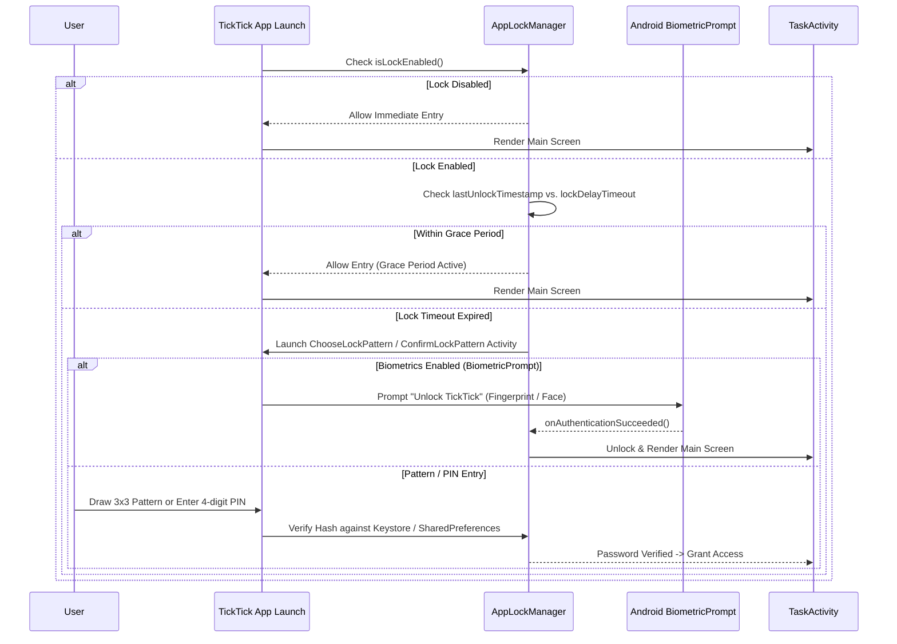

# Security, Privacy, and Permissions

## 1. Permission Architecture Overview

TickTick requests **61 permissions** in its `AndroidManifest.xml` to support its extensive feature set spanning location geofences, calendar synchronization, voice capture, biometric locking, and multi-device wearable syncing.

This document categorizes every permission, identifies its runtime vs. install-time status, provides its functional justification in the code, and documents the application security architecture.

---

## 2. Complete Manifest Permission Audit

### 2.1 Core Network, Alarms & Lifecycle Permissions
| Android Permission Name | Type | Justification & Bound Feature in Code |
| :--- | :--- | :--- |
| `android.permission.INTERNET` | Normal | Core cloud synchronization, REST API calls, WebSockets, and media downloads. |
| `android.permission.ACCESS_NETWORK_STATE` | Normal | Monitored by `ConnectivityManager` to detect online/offline state and trigger sync. |
| `android.permission.WAKE_LOCK` | Normal | Keeps CPU awake during background alarm processing and database commits. |
| `android.permission.RECEIVE_BOOT_COMPLETED` | Normal | `BootReceiver`: Reschedules active alarms with `AlarmManager` after device reboot. |
| `android.permission.SCHEDULE_EXACT_ALARM` | Normal (API 31+) | Required on Android 12+ to schedule exact reminders with `AlarmManager`. |
| `android.permission.USE_EXACT_ALARM` | Normal (API 33+) | Used by productivity/alarm category apps on Android 13+ for guaranteed alarm firing. |
| `android.permission.VIBRATE` | Normal | Vibrates device motor during task reminders, habit check-ins, and Pomodoro alarms. |
| `android.permission.POST_NOTIFICATIONS` | Dangerous (API 33+) | Android 13+ runtime permission required to display any notification or heads-up banner. |
| `android.permission.FOREGROUND_SERVICE` | Normal | Keeps persistent background services active (ongoing timer, audio playback). |
| `android.permission.FOREGROUND_SERVICE_MEDIA_PLAYBACK` | Normal (API 34+) | Permits playing ambient white noise sounds in background while screen is off. |

### 2.2 Location & Geofencing Permissions
| Android Permission Name | Type | Justification & Bound Feature in Code |
| :--- | :--- | :--- |
| `android.permission.ACCESS_FINE_LOCATION` | Dangerous | High-precision GPS coordinates for setting geofenced task reminders. |
| `android.permission.ACCESS_COARSE_LOCATION` | Dangerous | Cell/Wi-Fi triangulation for general location picker rendering. |
| `android.permission.ACCESS_BACKGROUND_LOCATION` | Dangerous (API 29+) | Required on Android 10+ for geofences to fire when TickTick is not in foreground. |

### 2.3 Storage, Camera & Media Permissions
| Android Permission Name | Type | Justification & Bound Feature in Code |
| :--- | :--- | :--- |
| `android.permission.CAMERA` | Dangerous | Taking photos to attach to tasks, checklist items, habit check-in journals, or scanning barcodes. |
| `android.permission.RECORD_AUDIO` | Dangerous | Voice input memo recording attached to tasks; speech-to-text quick task creation. |
| `android.permission.READ_MEDIA_IMAGES` | Dangerous (API 33+) | Android 13+ photo picker for task image attachments. |
| `android.permission.READ_MEDIA_AUDIO` | Dangerous (API 33+) | Selecting custom user audio files for reminder ringtones. |
| `android.permission.READ_EXTERNAL_STORAGE` | Dangerous (Legacy) | File picker for attaching documents (PDF, DOCX) on Android 12 and below. |
| `android.permission.WRITE_EXTERNAL_STORAGE`| Dangerous (Legacy) | Saving local `.bak` database backup files and exporting `.csv` spreadsheets. |

### 2.4 Calendar & System Control Permissions
| Android Permission Name | Type | Justification & Bound Feature in Code |
| :--- | :--- | :--- |
| `android.permission.READ_CALENDAR` | Dangerous | Reading external Google, Outlook, and system calendar events into TickTick's Calendar view. |
| `android.permission.WRITE_CALENDAR` | Dangerous | Two-way sync: writing TickTick scheduled tasks into the user's Android calendar provider. |
| `android.permission.SYSTEM_ALERT_WINDOW` | Special | Displays the floating circular Pomodoro timer widget over other apps. |
| `android.permission.USE_FULL_SCREEN_INTENT` | Normal | Turns on screen and displays fullscreen alarm popup over the lockscreen. |
| `android.permission.ACCESS_NOTIFICATION_POLICY` | Special | Overrides system Do Not Disturb (DND) for critical Annoying Alert task alarms. |
| `android.permission.REQUEST_IGNORE_BATTERY_OPTIMIZATIONS` | Special | Prompts user to whitelist TickTick to prevent aggressive manufacturer app killing. |
| `android.permission.USE_BIOMETRIC` | Normal | Unlocking the application using fingerprint or face authentication via `BiometricPrompt`. |
| `android.permission.USE_FINGERPRINT` | Legacy | Legacy fingerprint authentication fallback on API 23–27 devices. |

---

## 3. Application Security & App Lock Architecture

TickTick includes an embedded security subsystem designed to prevent unauthorized local access to personal tasks and habit diaries:

### Security Implementation Details:
* **Storage of Credentials**: User pattern hashes are computed using SHA-256 with a device-specific salt and stored in private SharedPreferences (`prefkey_lock_pattern_hash`).
* **Stealth Mode (`prefkey_stealth_mode`)**: Disables the visible line trace when drawing the unlock pattern on the screen, shielding against shoulder surfing.
* **Auto-Lock Grace Periods**: Configurable auto-lock delay thresholds:
  * `0` (Immediately upon app exit)
  * `60000` (1 minute)
  * `300000` (5 minutes)
  * `900000` (15 minutes)

---

## 4. Privacy, Telemetry & Third-Party SDK Audit

An analysis of DEX classes and asset manifests reveals the following integrated third-party SDKs:

| SDK Provider | Integrated Classes / Packages | Purpose & Data Transmitted |
| :--- | :--- | :--- |
| **Google Play Billing** | `com.android.billingclient.api.*` | In-app subscription purchases, receipt token verification. |
| **Google Play Services** | `com.google.android.gms.location.*` | Geofencing client and high-accuracy fused location provider. |
| **Google Sign-In / Credential** | `com.google.android.gms.auth.api.*` | Federated OAuth authentication. |
| **Google ML Kit Document Scanner** | `com.google.mlkit.vision.documentscanner.*` | Camera-based physical document edge detection and scanning. |
| **Facebook SDK** | `com.facebook.*` | Facebook OAuth login and optional attribution events. |
| **Huawei WearEngine** | `com.huawei.wearengine.*` | Real-time task notifications and habit synchronization with Huawei smartwatches. |
| **Sentry / Crashlytics** | `io.sentry.*` / `com.google.firebase.crashlytics` | Application crash reporting, unhandled exception stack traces. |

### Account Deletion & GDPR Compliance:
TickTick implements native compliance endpoints allowing users to permanently erase remote data:
* `POST /api/v2/user/deleteThirdSiteAccount`: Unlinks third-party OAuth providers.
* `POST /api/v1/user-settings/privacy`: Manages user telemetry consent, marketing cookies, and data retention toggles.
