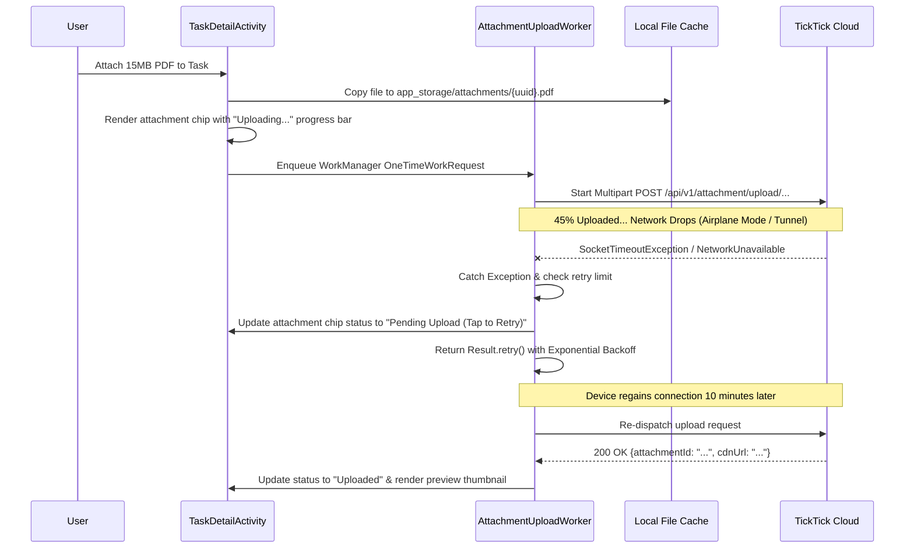

# Edge Cases and Error Handling

## 1. Overview of System Resilience

In a productivity application with millions of users across diverse Android devices, edge case resilience is paramount. This document investigates how TickTick handles temporal anomalies (time zones, leap years, daylight savings), network volatility, hardware restarts, database corruption, and high-concurrency conflicts.

---

## 2. Temporal Anomalies & Time-Zone Handling

### 2.1 Floating Tasks vs. Fixed-Time Events
A critical design challenge in calendar and to-do systems is distinguishing between:
* **Absolute Timestamp (Fixed Point in Time)**: e.g., a cross-timezone Zoom meeting at 15:00 UTC.
* **Floating Timestamp (Local Wall-Clock Time)**: e.g., "Take medication at 08:00 AM" or "Submit report by 17:00". If the user flies to Tokyo, they still want the reminder at 08:00 local Tokyo time, not 08:00 New York time.

#### TickTick's Implementation:
* By default, tasks without an explicit timezone binding are treated as **Floating Time Tasks**.
* When the Android OS fires `android.intent.action.TIMEZONE_CHANGED`:
  1. `TimeChangeReceiver` is invoked.
  2. The recurrence and alarm engine iterates over active alarms in `TASK_REMINDER`.
  3. For floating tasks, the alarm is rescheduled to match the local wall-clock hour in the newly adopted time zone.
  4. For calendar events synchronized from external sources (Google Calendar / Exchange), the event preserves its original UTC epoch timestamp, shifting its display position on the day grid accordingly.

### 2.2 Month-End and Leap Year Recurrence Behavior
When a user sets a recurrence rule on the 29th, 30th, or 31st of the month:
* **The 31st Problem**: If a task repeats monthly on the 31st:
  * In April (30 days), the recurrence engine clamps the date to the last day of the month: **April 30th**.
  * In February (28 or 29 days), the date clamps to **February 28th** (or **29th** in leap years).
* **Leap Day (Feb 29th) Yearly Recurrence**:
  * For tasks set to repeat yearly on February 29th:
  * In common years (non-leap years), the engine evaluates the rule to **February 28th**.

---

## 3. Network Disruption & Upload Recovery



---

## 4. Hardware Restarts & Battery Optimization Defenses

### 4.1 System Reboot Recovery
Android clears all pending `AlarmManager` alarms on reboot. TickTick's defense:
1. `BootReceiver` intercepts `android.intent.action.BOOT_COMPLETED` and `LOCKED_BOOT_COMPLETED`.
2. Reads cached reminders from SQLite `TASK_REMINDER`.
3. Calls `AlarmManager.setExactAndAllowWhileIdle()` or `setAlarmClock()` for all upcoming reminder events.

### 4.2 Aggressive OEM Task Killer Defense
Certain Android manufacturers (Xiaomi MIUI, Huawei EMUI, Samsung OneUI) aggressively kill background processes to save battery:
* **Battery Whitelist Prompt**: TickTick detects the device OEM and displays a custom setup banner (`ReminderIgnoreBatteryOptimizationPreference`).
* **Direct OEM Intent Routing**: The app contains manufacturer-specific intent launchers directing the user to the exact OEM settings screen:
  * Xiaomi: `com.miui.securitycenter/com.miui.permcenter.autostart.AutoStartManagementActivity`
  * Huawei: `com.huawei.systemmanager/.startupmgr.ui.StartupNormalAppListActivity`
  * Samsung: `com.samsung.android.lool/com.samsung.android.sm.ui.battery.BatteryActivity`

---

## 5. Database Resilience & Corruption Safeguards

### 5.1 SQLite Integrity Verification
* On application startup inside `DatabaseOpenHelper`, TickTick executes:
  `PRAGMA quick_check;`
* If corruption is detected, the database helper avoids a crash and attempts:
  1. Opening the backup database file located in internal storage (`ticktick_backup.db`).
  2. Restoring clean data into a newly instantiated database file.

### 5.2 Schema Migration Safety (`UpgradeHelper`)
* Database upgrades across versions are executed within an atomic SQLite transaction:
  ```sql
  BEGIN TRANSACTION;
  -- Apply migration DDL
  ALTER TABLE TASKS2 ADD COLUMN IS_FLOATING INTEGER DEFAULT 0;
  COMMIT;
  ```
* If an `SQLException` occurs during migration, the transaction rolls back, preserving user data integrity and logging the migration error to Sentry/Crashlytics.

---

## 6. High-Volume Performance & Archival Strategy

To maintain smooth 60fps scrolling when users accumulate tens of thousands of tasks:
* **Completed Task Archiving**:
  * Completed tasks are not queried during standard list rendering unless explicitly expanded.
  * In database queries, active lists use the indexed clause:
    `WHERE STATUS = 0 AND DELETED = 0`
* **Automated Archival Utility**:
  * Users can trigger "Archive Completed Tasks" (`ArchiveCompletedTaskActivity`).
  * Moves historical completed tasks into an archive table, reducing the index size of `Tasks2` and keeping SQLite queries under 5ms.
