# Feature Dependency Map

## 1. Global System Dependency Graph

The following Mermaid architectural graph illustrates the inter-feature relationships, data bindings, and hardware dependencies across TickTick's functional subsystems:

```mermaid
graph TD
    subgraph CoreEngine [Core Data & Model Layer]
        TaskData[Tasks2 SQLite Entity]
        ProjectData[PROJECT & FOLDERS]
        HabitData[HABIT & HABIT_CHECK_IN]
        PomoData[Pomodoro Records]
    end

    subgraph FeatureModules [User Feature Subsystems]
        TaskManager[Task Management]
        QuickAddNLP[Quick Add & NLP Parser]
        CalendarView[Calendar Multi-View]
        HabitTracker[Habit Tracking System]
        FocusPomo[Focus & Pomodoro Timer]
        MatrixView[Eisenhower Matrix]
        CollabModule[Shared Lists & Collaboration]
    end

    subgraph HardwareAndOS [Android OS & Hardware Services]
        AlarmMgr[AlarmManager : Exact Alarms]
        NotifChan[NotificationManager & Channels]
        SensorAccel[Accelerometer : Flip-to-Focus]
        AudioSvc[MediaPlayer : Ambient White Noise]
        OverlayWin[WindowManager : Floating PiP Ball]
        GeoClient[Google Play Geofencing API]
        BioPrompt[BiometricPrompt / KeyStore]
    end

    subgraph CloudLayer [Network & Synchronization]
        RESTSync[Delta Batch REST Sync]
        WSPush[WebSocket Real-Time Channel]
        CloudAI[AI Breakdown & NLP API]
        BillingGoogle[Google Play Billing]
    end

    %% Bindings
    TaskManager --> TaskData
    TaskManager --> ProjectData
    QuickAddNLP --> TaskManager
    QuickAddNLP -. Optional AI breakdown .-> CloudAI

    CalendarView --> TaskData
    CalendarView --> ProjectData
    
    MatrixView --> TaskData
    
    FocusPomo --> TaskData
    FocusPomo --> PomoData
    FocusPomo --> SensorAccel
    FocusPomo --> AudioSvc
    FocusPomo --> OverlayWin

    HabitTracker --> HabitData
    HabitTracker -. Can link focus session .-> FocusPomo

    TaskManager --> AlarmMgr
    TaskManager --> NotifChan
    TaskManager --> GeoClient

    CollabModule --> ProjectData
    CollabModule --> WSPush
    CollabModule --> RESTSync

    RESTSync --> TaskData
    RESTSync --> ProjectData
    RESTSync --> HabitData
    RESTSync --> PomoData

    BillingGoogle -. Gates Pro features .-> CalendarView
    BillingGoogle -. Gates Pro features .-> MatrixView
    BillingGoogle -. Gates Pro features .-> HabitTracker
```

---

## 2. Feature-to-Entity Dependency Matrix

| Feature Subsystem | Primary Database Tables | Secondary / Cross-Linked Tables | Synchronization Shadow Tables |
| :--- | :--- | :--- | :--- |
| **Task Management** | `Tasks2`, `CHECKLIST_ITEM` | `PROJECT`, `TAG`, `ATTACHMENT`, `COMMENT` | `Tasks2_SYNCED_JSON` |
| **Organization (Lists & Folders)** | `PROJECT`, `PROJECT_GROUP` | `COLUMN`, `FILTER` | `PROJECT_SYNCED_JSON` |
| **Reminders & Alarms** | `TASK_REMINDER`, `FavLocation` | `Tasks2`, `LOCATION` | (Synced as part of Task entity) |
| **Calendar System** | `Tasks2`, `CALENDAR_BIND_EVENT` | `PROJECT`, `TIMETABLE` | (Synced via Task & External CalDAV) |
| **Habit Tracking** | `HABIT`, `HABIT_CHECK_IN`, `HABIT_RECORD` | `HABIT_SECTION`, `HABIT_REMINDER` | `HABIT_SYNCED_JSON`, `HABIT_RECORD_SYNCED_JSON` |
| **Focus / Pomodoro** | `Pomodoro`, `PomodoroConfig` | `PomodoroSummary`, `Tasks2`, `HABIT` | (Synchronized via `/api/v2/pomodoro`) |
| **Eisenhower Matrix** | `MATRIX_PROFILE`, `MATRIX_QUADRANT` | `Tasks2`, `PROJECT` | (Synchronized via `/api/v2/matrixProfiles`) |
| **Collaboration** | `PROJECT_MEMBER`, `COMMENT` | `PROJECT`, `Tasks2`, `NOTIFICATION` | (Synchronized via Batch API & WebSockets) |

---

## 3. Feature-to-Permission Dependency Matrix

| Feature | Required Permissions | Degradation Behavior if Denied |
| :--- | :--- | :--- |
| **Task Reminders** | `POST_NOTIFICATIONS`, `SCHEDULE_EXACT_ALARM`, `WAKE_LOCK` | Task alarms will not sound or display banners; reminders fail silently. |
| **Location Reminders** | `ACCESS_FINE_LOCATION`, `ACCESS_BACKGROUND_LOCATION` | Geofence location triggers are completely disabled; prompt suggests time reminder. |
| **Voice Task Input** | `RECORD_AUDIO` | Voice-to-text mic button is hidden or displays permission rationale dialog. |
| **Photo Attachments** | `CAMERA`, `READ_MEDIA_IMAGES` | User cannot take new photos or browse gallery; file picker restricted. |
| **External Calendar View** | `READ_CALENDAR`, `WRITE_CALENDAR` | External Google/Outlook calendars cannot be rendered in TickTick calendar grids. |
| **Floating Pomodoro Timer**| `SYSTEM_ALERT_WINDOW` | Picture-in-picture floating timer ball cannot float over other apps; timer runs in notification shade. |
| **App Lock** | `USE_BIOMETRIC`, `USE_FINGERPRINT` | Biometric fingerprint unlock unavailable; user must enter Pattern or PIN. |

---

## 4. Cross-Feature Integration Points

1. **Habit to Pomodoro Linking**:
   * A user tracking a habit such as "Read 30 minutes" can tap "Start Focus" directly from the habit card.
   * Completing the Pomodoro session automatically registers a corresponding entry in `HABIT_CHECK_IN` with duration = 30 min.
2. **Calendar to Task Dragging**:
   * The Calendar Day grid directly updates `Tasks2.START_TIME` and `Tasks2.DUE_DATE`.
   * Unscheduled tasks are queried directly from the `Tasks2` table with `WHERE ALL_DAY = 1 OR DUE_DATE IS NULL`.
3. **Eisenhower Matrix to Priority Syncing**:
   * Dragging an item into Quadrant 1 (Urgent & Important) automatically updates `Tasks2.PRIORITY = 3` (High Priority) and verifies `DUE_DATE` is within the next 24 hours.
   * Dragging into Quadrant 4 (Not Urgent & Not Important) sets `Tasks2.PRIORITY = 0` (None).
4. **Smart Lists to Filter Engine**:
   * Custom Smart Lists are dynamic SQL queries executed against `Tasks2` joined with `PROJECT` and `TAG`. They do not duplicate task entities.
