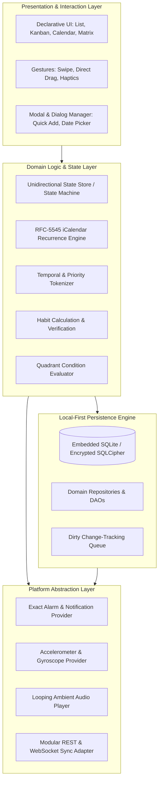

# Implementation Specifications & Clean-Room Architecture

## 1. Architectural Philosophy for an Independent Alternative

To build an independent, open-source productivity application inspired by TickTick without infringing on proprietary implementation, the development agent must adopt a **Clean-Room, Local-First Architecture**.



---

## 2. Core Clean-Room Subsystem Blueprints

### 2.1 The Recurrence Engine (RFC 5545 Compliance)
To replicate TickTick's recurrence capabilities cleanly:
* **Storage Format**: Store all recurrence expressions in standard iCalendar format (`RRULE` strings):
  * Example: `RRULE:FREQ=DAILY;INTERVAL=1`
  * Example: `RRULE:FREQ=WEEKLY;BYDAY=MO,WE,FR;INTERVAL=1`
  * Example: `RRULE:FREQ=MONTHLY;BYMONTHDAY=15;INTERVAL=1`
* **Repeat From Calculation**:
  * If `repeatFrom == 0` (Due Date): Next occurrence = `currentDueDate + interval`.
  * If `repeatFrom == 1` (Completion Date): Next occurrence = `currentCompletionTimestamp + interval`.
* **Exception Dates**: Store skipped dates as an ISO-8601 comma-delimited string in `EX_DATE`.

### 2.2 Natural Language Processing (NLP) Parser
To replicate real-time chip tokenization without remote API latency:
* **Rule-Based Tokenizer**: Implement a lightweight local regex lexer that scans input text for temporal and priority expressions:
  * Temporal tokens: `today`, `tomorrow`, `tonight`, `next (mon|tue|wed|thu|fri|sat|sun)`, `in \d+ (hours|days|weeks)`, `at \d{1,2}(:\d{2})?\s*(am|pm)?`.
  * Priority tokens: `!1` / `!high`, `!2` / `!med`, `!3` / `!low`.
  * Organization tokens: `~ProjectName`, `#TagName`.
* **Span Replacement**: In the text widget, wrap matched substrings in interactive Chip Spans. Pressing backspace immediately restores the underlying plain text characters.

### 2.3 The 4-Quadrant Eisenhower Matrix Engine
* Provide a reactive filter evaluator:
  ```json
  {
    "quadrant_1": {
      "name": "Urgent & Important",
      "conditions": [
        {"field": "priority", "operator": "IN", "values": [5]},
        {"field": "dueDate", "operator": "LESS_THAN_OR_EQUAL", "value": "TODAY_END"}
      ]
    },
    "quadrant_2": {
      "name": "Not Urgent & Important",
      "conditions": [
        {"field": "priority", "operator": "IN", "values": [3, 5]},
        {"field": "dueDate", "operator": "GREATER_THAN", "value": "TODAY_END"}
      ]
    }
  }
  ```
* Dragging an item across quadrant boundaries evaluates the difference between the source and target rule sets and updates `Tasks2.PRIORITY` and `Tasks2.DUE_DATE` accordingly.

---

## 3. Master Feature Specification Index

Every discovered feature in `03_MASTER_FEATURE_INVENTORY.md` (`F001` to `F206`) maps directly to our modular domain specification system:

| Domain | Feature Range | Core Specifications & Focus Areas |
| :--- | :--- | :--- |
| **01. Task Management** | `F001` – `F035` | Quick Add, Full Detail, Checklists, Nested Subtasks, Priority Flags, Tags, Markdown Body, Attachments, Comments, Batch Operations, Task Duplication, Archival. |
| **02. Reminders & Alarms** | `F036` – `F055` | Exact Alarms, Multi-Reminders (up to 5), Relative Offsets, Snooze Intervals, Annoying Alert Looping Alarms, Doze Survival, Fullscreen Wakeup Dialogs, Geofencing. |
| **03. Calendar System** | `F056` – `F075` | Month, Week, Day, 3-Day, Agenda Views, Drag-to-Schedule, Duration Resize, CalDAV / External Google & Outlook Calendar Two-Way Sync, Course Timetable. |
| **04. Habit Tracking** | `F076` – `F090` | Custom Habits, Target Metrics (Quantitative Units), 60+ Icon Catalog, Streak Flame Calculation, Missed Day Retroactive Repair, Monthly Check-in Heatmaps. |
| **05. Focus & Pomodoro** | `F091` – `F103` | Rotary Countdown Dial, Stopwatch, Flip-to-Focus Accelerometer Sensor, Looping Ambient White Noise, OLED Pixel Jitter, Floating PiP Timer Ball, Strict Mode App Lock. |
| **06. Lists & Organization**| `F104` – `F117` | Lists, Folders, Custom Sort, Kanban Columns, Timeline Gantt, Tag Hierarchy, Color Coding, List Archiving. |
| **07. Smart Features** | `F118` – `F127` | Real-time NLP Tokenizer, Live Chip Rendering, Voice-to-Text Input, Global Search Index, Smart Lists. |
| **08. Collaboration** | `F128` – `F137` | Shared Lists, Member Roles (Owner/Admin/Member), Task Assignment, Comment Streams, @Mentions, WebSocket Push Sync. |
| **09. Productivity Tools** | `F138` – `F150` | 2x2 Eisenhower Matrix, Custom Quadrant Filter Rules, Productivity Score, Achievement Badges, Statistics Charts. |
| **10. Personalization** | `F151` – `F164` | Theme Store, Pure Black OLED Theme, City Themes, Swipe Action Customizer, TabBar Layout Customizer, Font Sizing. |
| **11. Data Management** | `F165` – `F177` | Offline SQLite Storage, Shadow Change Tracking (`SYNCED_JSON`), CSV Export, Encrypted Local Backups, Auto-Archival. |
| **12. Integrations** | `F178` – `F206` | Notion Sync, Telegram Bot, Siri/Google Assistant Shortcuts, Webhooks, Home Screen Widgets (12 widget varieties). |

---

## 4. Craft Anything & AI Development Platform Handoff

When providing these specifications to an AI development platform (such as **Craft Anything** or an autonomous coding agent):
1. **Pass Schemas First**: Supply `evidence/code_references/schema.sql` and `research/08_DATA_ARCHITECTURE.md` to establish the exact SQLite entities.
2. **Pass Core Workflows**: Supply `research/06_COMPLETE_USER_WORKFLOWS.md` so the builder understands end-to-end user journeys before coding UI widgets.
3. **Pass UI & Micro-Interactions**: Supply `research/04_SCREEN_AND_NAVIGATION_INVENTORY.md` and `research/05_INTERACTION_AND_MICRO_BEHAVIOR.md` to dictate screen hierarchy, swipe thresholds, and direct manipulation.
4. **Enforce Platform Independence**: The agent can render these blueprints in Flutter, React Native, Rust (Slint/Iced), Kotlin Multiplatform, or Web (Wasm/TypeScript) without architectural friction.
